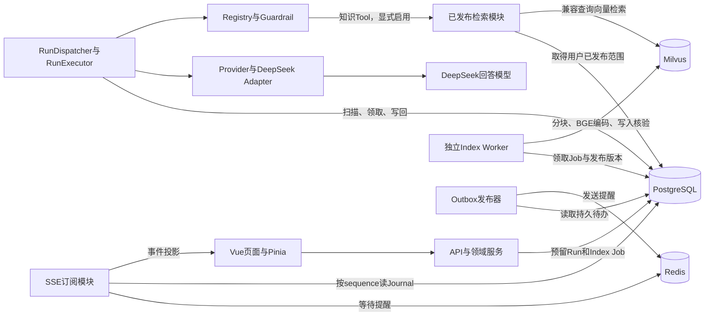

# MiniMew 整体架构导读

核对日期：2026-11-12。覆盖当前第四章与5.1–5.3的真实实现，并标出后续连接点。它是跨章节的架构导航，不另维护学习进度；实际进度和授权仍见[交接记录](AGENT_HANDOFF.md#当前检查点)。

用户最新要求是看懂整体架构、模块关系与选择原因，不再通过简单场景或异常边界判断题推进。本文先展示整体位置，再沿请求说明调用关系、状态归属和代码，已有测试不因纯文档讲解重复执行。

## 1. 整体定位：执行平台承载 Agent/RAG

MiniMew复现的不只是“调用模型得到文本”，还包括一次工作从创建、执行、持久化到界面展示的生命周期。可以把它分成三个相互协作的系统：

- **对话执行系统**：接受用户意图，创建Thread/Run/Message，调度并执行模型或工具，保存过程与最终结果。
- **文档构建与检索系统**：先将文档解析、分块、编码并发布为可检索版本；提问时对已发布范围检索，返回材料。
- **事件展示系统**：从持久事件恢复界面，处理增量正文、重连和状态展示。

Agent循环位于对话执行系统内部；RAG是它能够调用的一类能力。LangChain、Embedding和Milvus分别承担不同环节，不能用其中一个库代替整个运行平台。

## 2. 先区分模块与运行进程

当前后端是**带独立索引Worker的模块化应用**，不是为每个类建立一个微服务。

| 运行位置 | 里面有什么 | 为什么放在这里 |
| --- | --- | --- |
| 浏览器 | Vue页面、Pinia状态、Event投影 | 负责交互和呈现，读取服务端事实 |
| API进程 | FastAPI入口、领域服务、RunDispatcher、RunExecutor、SSE、Outbox发布任务 | HTTP接收与后台Run执行共用正式业务模块；目前无需增加独立聊天执行服务 |
| 独立Index Worker进程 | Job领取、源文件读取、解析/分块、本地Embedding、向量写入核验与发布 | 文档构建较重且有独立任务生命周期，避免绑在上传HTTP请求里；可独立启停 |
| PostgreSQL | 用户、Thread、Message、Run、Event Journal/Outbox、文档版本/索引任务/产物及模型配置 | 保存需要事务约束、查询和恢复的业务事实 |
| Redis | 事件提醒通道 | 缩短SSE发现新事件的等待时间；事件仍从PG读取 |
| Milvus | 有范围身份的向量索引及检索记录 | 承担Dense相似度检索；文档是否当前有效由PG目录决定 |
| 本地源文件/模型目录 | 上传源文件、本地模型缓存 | 原文件由storage模块按服务端身份寻址，PG登记元数据；模型在需要时由对应运行进程加载 |
| DeepSeek远端服务 | 回答模型推理 | Provider通过HTTP调用，独立于本地Embedding |

入口证据：[app.py](src/minimew/app.py)在API lifespan中启动execution_lifespan和notification_lifespan；[dispatcher.py](src/minimew/execution/dispatcher.py)创建后台调度任务；[worker.py](src/minimew/documents/worker.py)有独立Worker入口。5.3在线查询资源已接入execution_lifespan，显式开启知识能力后API也加载一份本地BGE；当前没有独立Embedding HTTP服务。

## 3. 模块关系总图

这张图展示模块关系，箭头标注调用/读取/写入职责，节点不代表一个个微服务。知识Tool接线已完成，需显式设置MINIMEW_KNOWLEDGE_ENABLED=true后重启API启用。

图中上传源文件存储、认证和契约没有展开，下面分别说明。Embedding位于文档构建/查询路径中，具体实现在embeddings模块；它不是Provider中的回答模型。

## 4. 一次提问：从用户意图到执行结果

**第一步：接收和登记。** Vue经HTTP调用[api/runs.py](src/minimew/api/runs.py)，路由调用[conversations.reserve_run](src/minimew/conversations.py)。服务端校验用户和Thread，处理幂等，创建Run及归属的一对Message，冻结回答模型配置，在PG事务中保存。此时HTTP接收成功表示工作已登记，不代表已经得到模型答案。

**第二步：取得执行资格。** [RunDispatcher](src/minimew/execution/dispatcher.py)后台扫描PG中的候选Run，调用[RunExecutor](src/minimew/execution/service.py)；由[ExecutionRepository](src/minimew/execution/repository.py)的领取事务裁定谁能执行。Dispatcher负责“何时启动、同时执行几个”，Executor负责“启动后怎样走完整个工作”。查询候选和领取资格是两个职责。

**第三步：推进模型与工具回合。** Executor组织有界上下文，调用Provider。模型返回文本时准备最终答案；返回工具请求时交Registry解析及参数校验、Guardrail授权，再调用handler，将关联结果回传模型。每个Run的上下文、预算和结果独立，最多4次模型请求/6次工具调用，重试仅限当前模型请求。

当前默认知识开关关闭，Registry为空，仍是普通聊天。5.3开启后服务端装配真实knowledge_search、只读能力和每Run私有KnowledgeSession；5.2历史包只验收通用循环，5.3已另行验证真实知识链。

**第四步：保存。** 普通聊天的公开分片通过Repository/Journal逐批提交；最终文本及消息/Run状态通过原终结事务保存。模型Adapter没有数据库Session，Executor不在等待模型时持有整轮数据库事务。

为什么这样拆：HTTP生命周期很短，模型执行可能很长；分开后，刷新页面不会重建工作，幂等提交、排队、查询和取消都有持久对象承接。Dispatcher不用理解模型协议，Provider不用理解Run事务，Executor可以在一个正式路径上协调两者。

## 5. Provider、工具和RAG各自处在哪一层

| 层次 | 核心问题 | 当前代码与边界 |
| --- | --- | --- |
| Run执行层 | 本次工作何时执行、下一步是什么、还能花多少预算、如何终结 | [service.py](src/minimew/execution/service.py)、[repository.py](src/minimew/execution/repository.py)；拥有业务生命周期 |
| 模型边界 | 如何把统一消息发给具体模型，如何得到规范化回合 | [provider.py](src/minimew/execution/provider.py)、[deepseek.py](src/minimew/execution/deepseek.py)、[messages.py](src/minimew/execution/messages.py)；LangChain/SDK的差异在此转换 |
| 工具能力层 | 什么工具可见、参数是什么、由谁处理、本次能否执行 | [tools.py](src/minimew/execution/tools.py)；Registry保存描述/实现映射，Guardrail作具名授权决定 |
| RAG检索层 | 当前用户允许查哪些版本、如何编码问题并召回相关片段 | [knowledge.py](src/minimew/knowledge.py)注册Tool并投影结果，复用[documents/retrieval.py](src/minimew/documents/retrieval.py)、[embeddings](src/minimew/embeddings)、[vector_store](src/minimew/vector_store) |

把Registry与RAG分开，是因为以后还会接Web Research、只读SQL等能力；执行器可以统一管理它们的调用生命周期，而每种工具仍保留自己的业务实现。RAG内部则可从Dense逐步扩展检索策略，不需要把数据库/分块细节塞进RunExecutor。

Provider边界让业务代码处理“文本回合/工具回合”这样的统一结果。模型SDK的消息类、流参数碎片和HTTP资源归Adapter管理；变更模型接入主要影响Adapter与配置，业务Run的终态和幂等规则保持自己的职责。

## 6. 文档上传与知识查询是两条不同路径

**构建路径（已实现）**：上传HTTP → [catalog.py](src/minimew/documents/catalog.py)与[storage.py](src/minimew/documents/storage.py)登记源文件/不可变Version/持久Index Job → 独立Worker领取 → parsing/chunking → 本地BGE文档编码 → Milvus写入/manifest核验 → PG原子发布current version。

**查询路径（5.3已接通，需启用知识开关）**：用户问题 → knowledge_search → 服务端当前用户 → PG取得published scope → 与目标索引兼容的查询Embedding → Milvus范围内Dense召回 → 候选材料及来源定位 → 模型继续回答。正式Evidence与引用校验在5.4。

构建相当于提前整理和建立检索索引，查询相当于利用索引找材料。上传时不需要调用DeepSeek回答模型；提问时也不重新解析整套文档或重建向量。两条路径共享解析产物、版本身份、Embedding配置和向量索引契约。

独立Worker的收益是将重型构建和HTTP响应分开，代价是要管理Job、租约、发布和清理。Document Version与current指针将“正在构建”与“可供查询”分开，给后续来源引用和质量比较保留明确身份。

## 7. 结果为什么还要经过Journal、Outbox、Redis和SSE

这是一条独立于智能决策的展示链：

1. Repository在业务事务内通过[journal.py](src/minimew/execution/journal.py)写入Event和Outbox待办。
2. [outbox.py](src/minimew/execution/outbox.py)读取已提交待办，向Redis发提醒。
3. [streaming.py](src/minimew/execution/streaming.py)按sequence读取PG事件，用SSE发送到浏览器；提醒与定时补查均用于发现新事件。
4. 浏览器的[runEventStream](frontend/src/events/runEventStream.ts)负责连接，[runEventReducer](frontend/src/events/runEventReducer.ts)更新投影，[chat store](frontend/src/stores/chat.ts)组织界面状态，Vue组件呈现。

Journal解决“结果怎样留存和重放”；Outbox解决业务提交与后续通知的衔接；Redis解决发现事件的及时性；SSE解决向浏览器持续传输；reducer解决事件如何变成可显示状态。它们沿用同一份PG事实，各自承担不同环节。

## 8. 数据与状态归谁保存

| 对象 | 归属/存放 | 在整体架构中的用途 |
| --- | --- | --- |
| Thread、业务Message、Run | PostgreSQL | 用户对话历史、一次执行身份及持久状态；当前每Run一条用户消息和一条assistant消息 |
| AI/Tool内部消息 | 当前Run执行的内存上下文 | 多次模型/工具交互的输入，不自动等于数据库新增业务Message；当前尚无图Checkpoint恢复 |
| Event Journal、Outbox | PostgreSQL | 公开执行事实和后续通知待办 |
| 界面消息/Run投影 | 浏览器Pinia/reducer | 根据查询和事件组织展示，不能决定服务端终态 |
| 文档目录、Version、Job、产物/manifest | PostgreSQL，原源文件另存storage目录 | 决定谁拥有文档、什么版本已发布、索引预期是什么 |
| 向量及检索记录 | Milvus | 相似度召回，使用PG产生的scope限制范围 |
| 回答Model Snapshot、文档构建配置 | 与对应Run/工作或文档版本关联的持久记录 | 让已创建的工作使用明确配置，支持追踪和后续比较 |

认证是跨模块约束：[api/auth.py](src/minimew/api/auth.py)、[security.py](src/minimew/security.py)、[refresh.py](src/minimew/refresh.py)负责身份与令牌；业务服务仍校验资源归属。`contracts/run_event_v1.json`是跨端事件真源，生成Python/TS；它将服务端事实与前端投影连接起来。

## 9. 选择原因与代价

| 选择 | 在本项目解决什么 | 代价/约束 |
| --- | --- | --- |
| FastAPI + Pydantic | 与Python模型/检索生态在同一后端中组织HTTP、依赖和明确契约 | 需要正确管理异步生命周期及阻塞模型操作 |
| SQLAlchemy + PG事务 | 把Run、消息、事件、版本发布的业务一致性落到存储 | 需要设计事务边界、锁和迁移 |
| Vue + Pinia + reducer | 将交互、页面状态和事件投影拆开 | 存在服务端持久状态与浏览器投影的同步工作 |
| Redis提醒 + PG Journal | 同时满足及时发现和持久重放 | 多一个基础设施，提醒不能成为另一份业务事实 |
| Milvus + 显式Adapter | 沿用SuperMew向量栈，隔离向量存储细节，给后续检索扩展留正式接口 | 增加部署和资源成本，必须维护与PG发布范围的关联 |
| LangChain模型Adapter | 复用消息/模型SDK接口，统一传输协议接入 | 仍需项目自身管理Run、权限、预算、资源与持久化 |
| 先显式工具循环、再引入LangGraph | 先把模型回合与工具调用关系看清；第六章再用图组织复杂检索路由 | 当前循环简单可读，但还没有复杂图编排和Checkpoint恢复 |

这些选择服务于“学习复现SuperMew + 持久运行 + 可评测RAG”的目标，不宣称它们是所有聊天应用的唯一方案。

## 10. 后续能力接到哪里

- **5.3已交付/5.4待做**：知识工具已连接执行系统与文档检索；下一步Evidence连接召回材料与答案引用。
- **第六章**：在智能检索/决策层加入Hybrid、重排、评判、改写和LangGraph路由；原Run仍承接业务生命周期。
- **第七章**：为中间执行状态增加Checkpoint/HITL及同Run恢复，不用新提问模拟恢复。
- **第八章**：独立Evaluation Worker复用正式RAG路径，Dataset/Observation/Gate形成比较闭环；当前MiniMew未实现该进程。
- **第九章**：Skill与模型/能力控制面管理可用能力，Web/SQL/Sandbox作为工具进入同一受控执行体系。

当前已完成的架构连接点是：5.2通用工具执行机制，通过5.3知识Tool接到第四章已发布检索底座。真实CPU/Milvus链已用受控回答Provider验证，模型实际工具选择/答案质量和引用仍待后续验收。

## 11. 放大5.3：知识工具的模块装配设计

本节源于2026-11-12架构讨论，用户明确“开始5.3”后已按以下职责完成接线。实际命令、结果和限制见[5.3实施记录](chapters/05-基础知识问答.md#53-实施记录2026-11-12)；默认关闭知识能力，开启后才装配在线资源与Tool。

### 调用层次与新增连接点

| 层次 | 上游输入与下游输出 | 为什么保留这层 |
| --- | --- | --- |
| 原RunExecutor | 调用Registry/Guardrail和工具handler，接回结构化结果 | 统一拥有执行生命周期，不依赖某个知识库的SQL或Milvus细节 |
| [知识Tool入口](src/minimew/knowledge.py) | 接收严格query与服务端ToolContext；将检索候选整理为受限工具结果 | 适配模型能调用的契约，保持工具参数与内部检索数据结构解耦 |
| 同模块KnowledgeSession | 从可信用户取得scope，保存本Run的固定范围，由Registry为每Run创建并绑定 | 让同一次回答中的多次检索使用一致的版本依据，避免共享“当前用户/当前范围” |
| 已有retrieval.py | published_scope读取PG发布目录，search_published按范围检索、合并排序 | 复用第四章的版本/范围规则，不另建知识Tool专用检索路径 |
| 已有Embedding与Vector Adapter | query→兼容向量；限定scope的向量→命中payload | 模型推理、向量存储及业务版本规则分别维护 |

现有search_published的输入已经是scope、用户、查询向量和profile，本身不调用回答模型，也不从HTTP/模型参数推导身份。它按已发布manifest逐一限定搜索，再合并排序取top-k；5.3先复用该正式路径，文档规模扩大后的批量检索优化不在本轮自动展开。

### 两种配置和两种模型

- 回答模型：Run创建时冻结的Model Snapshot决定DeepSeek等回答Provider配置，负责理解问题、提出工具请求和组织答案。
- Embedding模型：已发布索引的编码空间和文档构建配置约束查询编码，负责把问题映射为向量。当前只接已验证的轻量bge-small空间；不能用当前随意选中的M3查询旧空间。

两者的职责与配置来源不同。knowledge_search向回答模型回传候选文字/定位字段，不把512维查询向量、向量记录hash整包当作答案材料发送。当前chunk同时保留source_text和embedding_text：后者可包含为编码补充的标题上下文，前者保留原文；结果组织应明确区分原文与检索辅助内容，正式Evidence/引用映射在5.4继续完善。

### 状态和资源分别归谁所有

本Run第一次实际知识检索时取得published_scope，保存到KnowledgeSession，后续餐费/住宿等调用复用；下一Run重新读取当时最新已发布版本。ToolContext.tool_sessions是服务端绑定的不可修改目录，其中会话对象由本Run独占。scope仅保留必要身份/manifest和到期信息，不跨模型/工具调用持有数据库Session或事务；沿用既有scope到期与旧索引保留窗口。

重资源由[knowledge_runtime.py](src/minimew/knowledge_runtime.py)管理：开启能力后API启动加载本地轻量模型、创建只读Milvus连接；单线程准入控制同步操作。每次检索传入显式用户/scope，共享Runtime不存“当前Run”。退出时先停止/排空Dispatcher，再关闭资源。普通模型/工具上下文、候选列表和结果预算仍是Run私有状态。

这与Spring中应用级基础设施Bean与每请求业务上下文的职责区分相近。API与Index Worker各自拥有模型实例，磁盘缓存可复用，内存对象不能直接跨进程复用。API内受控调用轻量模型的接线较少，代价是API与Worker同时运行各占模型内存；本步没有新增独立Embedding服务。启用步骤见[README](README.md#已发布知识工具53)，缺资源时明确启动失败，运行中故障通过稳定知识错误表达。

### 程序内部数据到模型输入的转换

Milvus命中payload包含chunk原文、编码文本、来源身份和节信息等内部数据。知识Tool应投影出问题所需的原文、Document/Version/chunk标识、相关定位与相似度，限制结果数量和总大小；不原样暴露内部payload或数据库对象，也不创建第二条直接拼prompt的聊天入口。

当前代表性调用链是：RunExecutor→Registry/Guardrail→知识Tool入口→本Run检索会话→published_scope/encode_query/search_published→候选投影→原工具结果消息→同一回答模型。通用执行器、检索算法、模型运行时和存储Adapter各自有明确位置，后续Hybrid/Rerank可以继续在正式检索层扩展。
