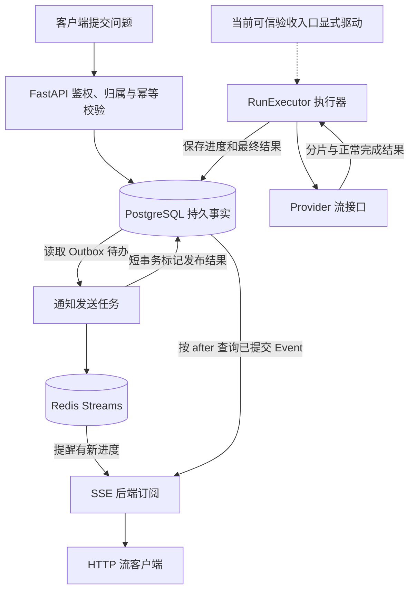
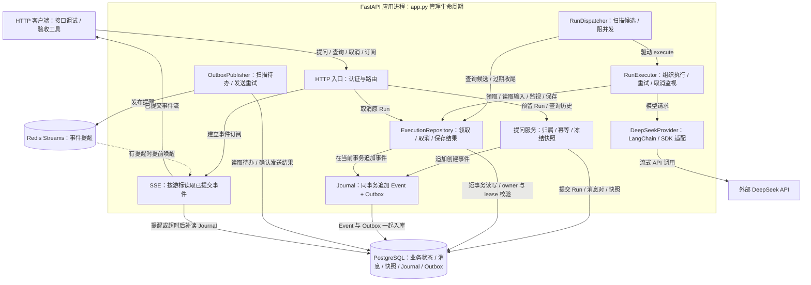

# 第 2 章：持久化普通对话

当前学习进度、实际验证结果、理解反馈和编码授权统一见 [交接记录](../AGENT_HANDOFF.md#当前检查点)。本文件保存章节计划、各小步记录和下方基于真实源码的章节总结与代码框架；历史小步中的“当前”只指记录当时。

## 开章计划

计划日期：2026-10-30。本章已在进行中，本次按新增约定补齐子项安排；不将这份补录描述为开工前已完成的计划。补录时源码已有 2.1 的提问预留和 2.2 的模型配置/快照，执行状态仍仅支持 pending。后续子项是待讲解、待授权的计划。

### 本章目标与范围

把第 1 章的用户认证与 Thread 入口扩展为可持久追踪的普通对话执行链：接收提问、冻结模型配置、领取 Run、组织模型输入、调用 Provider、保存结果、记录执行事件，再通过 SSE 补放给客户端。

本章的最小闭环由后端接口和验收工具证明；完整聊天页面由第 3 章实现。Tool、知识库检索和 RAG 属于后续章节；完整 HITL、续租接管和复杂恢复在第 7 章展开。本章仍须保证基本执行隔离、过期 owner 不可写入以及权威终态只产生一次。

### 子项安排

| 子项 | 要实现或理解的内容 | 依赖与顺序 | 沿用/新增技术及职责 | 验收场景 |
| --- | --- | --- | --- | --- |
| 2.1 原子接收提问 | Run、用户/assistant 消息对、幂等键、首标题和归属查询 | 接第 1 章 Thread 与认证 | 沿用 FastAPI、Pydantic、SQLAlchemy、PostgreSQL、Alembic；事务保存领域事实 | 同键重发得到原 Run；失败回滚无部分记录；不能读取他人对话 |
| 2.2 模型配置与快照 | 最小 Profile、当前选择、本地管理命令、创建时冻结配置 | 在 2.1 同一预留事务内扩展 | 沿用现有栈；JSONB 保存无 Secret 配置，确定性摘要核对快照，数据库约束保护不可改写 | 修改当前配置不影响旧 Run；配置缺失拒绝新建；原键重发复用原快照 |
| 2.3 最小持久执行 | 执行器与可注入 fake Provider、领取/所有权/租约、历史输入、成功/失败/过期处理及最小终态事件 | 使用 2.1/2.2 的 Run、消息和快照；先跑通可控执行 | Python 异步接口与 asyncio 管理调用；数据库原子领取和短事务落库；最小版本化事件契约与 Journal 从此步建立 | 同一 Run 不被同时领取；不同 Run 不串数据；过期执行者写入被拒绝；答案、Message 状态、Run 终态和对应事件一起提交 |
| 2.4 完整 Event Journal | 在同一事件真源上完善生命周期/正文事件、每 Run 序号、查询及跨端类型 | 扩展 2.3 的正式事件模型，保留同一写入入口 | 版本化 JSON Schema/生成类型与 PostgreSQL 事件表；不新增平行事件状态 | sequence 有序、同一 Run 隔离；失败不留半条完成事实；生成类型与真源一致 |
| 2.5 SSE 与断线补放 | 按事件游标读取 Journal、实时推送、断线续读与身份隔离 | 事件先入库，再提供 SSE 投影 | FastAPI 流响应与 SSE 协议；HTTP/SSE 为消费者，不拥有任务终态 | 重连可读回漏失事件；断流不等于 Run 取消；越权订阅拒绝 |
| 2.6 Outbox 与 Redis 通知 | 持久待发送通知、跨进程唤醒、通知丢失后的 Journal 查询 | 接 2.4/2.5，先确定事实与通知的边界 | 首次接 Redis；PostgreSQL Outbox 记录待通知事实，Redis 负责低延迟信号 | 通知丢失或进程退出不丢执行事实；不从 Redis 宣布权威完成 |
| 2.7 真实 DeepSeek Adapter | 将真实模型接入同一 Provider 接口，沿用快照与正式执行链 | 可控执行和事件链验证后接外部服务 | 编码前确认 LangChain/OpenAI-compatible Adapter 组合与版本；唯一重试所有者、绝对 deadline、流式输出和错误映射 | 每次请求显式关闭思考；密钥不入库/出端；网络/Provider 错误明确可追踪；fake 不构成在线通过证明 |
| 2.8 基础取消与终态竞态 | 按 Run 请求取消、跨实例检查、取消与完成竞争、过期写入拒绝 | 沿用执行所有权、Journal 和通知 | 数据库状态转换、事务条件更新和任务级取消信号；不新增第二套取消事实 | 只取消指定 Run；关闭连接不等于取消；完成/失败/取消只有一个权威终态 |
| 2.9 章节验收与总结 | 复盘端到端流程，保存文字总结与实际代码框架 | 根据实际实现和对应验证结章 | 聚焦测试、真实基础设施检查、文档与源码走读；不以补写总结替代验收 | 一轮普通对话、幂等、并发、故障、补放有证据；每个模块的职责、状态归属和调用关系清楚 |

### 数据流与关键边界

目标执行链：

```text
请求及身份校验
→ Thread 所有权与提交幂等检查
→ 短事务保存 Run、消息对与冻结快照
→ 执行器按规则领取 Run 并提交
→ 组织历史与本次消息，在数据库事务之外调用 Provider
→ 短事务保存回答、Message/Run 终态及对应持久事件
→ SSE 按游标读取 Event Journal
```

- Run 1/2/3 指业务任务，执行器 E1/E2 指处理任务的程序，Provider Adapter 指与模型服务通信的代码；后续示例保持这些对象名称一致。
- 同 Thread 拟按提问顺序执行，不同 Thread 可并行。输入截止于本 Run 的用户提问，排除未来消息和本 Run 的空回答占位。失败轮次是否进入后续模型输入、上下文预算和历史截取规则在 2.3 编码前确定。
- 领取成功只保存运行状态，模型返回也不等于持久完成；必须在结果事务中保存同一 assistant Message 与权威终态事件后，才能宣布完成。
- 基本所有权从 2.3 开始建立，保存结果时检查 Run 状态、owner token 和租约有效性。最小方案先把过期任务明确终结失败，不隐式重跑模型；详细恢复策略仍须讨论，租约不等于外部副作用可回滚。
- 2.3 从第一条终态开始就写最小持久 Journal 和版本化契约；2.4 在同一真源上扩展事件种类、序号与查询，不建立临时完成状态或先完成再补事件的路径。
- SSE 和 Redis 不代替 PostgreSQL；连接断开、通知丢失或模型已返回，都不能单独决定 Run 终态。
- 真实 Provider 从该 Run 的快照获取调用配置，服务端独立读取 Secret；关闭思考的要求从配置传到实际请求。具体 SDK、重试与流式调用细节在 2.7 前核对官方资料，不提前安装依赖。
- API 如何唤醒执行、轮询与进程生命周期、Thread 并发提交的预期版本策略、失败历史和消息预算、旧无快照 Run 的显式拒绝方式，都要在相关小步实施前讲清。既有成功/失败或权限边界不能通过静默 fallback 改写。

### 2.3 具体实现范围

本节记录本小步约定的实施边界；开始反馈、实际进度与验证结果以交接记录为准。

1. **状态与持久化**：扩展 Run 的 pending/running/succeeded/failed 和 assistant Message 的未完成/完成/失败状态，保留一对消息归属与快照不可变规则，增加迁移并同步接口契约。
2. **领取与最小所有权**：数据库条件领取，记录本次 owner token 与期限；同一 Thread 按消息顺序执行，不同 Thread 可并行。提交仍沿用已有 Thread 行锁允许排队，本步不新增客户端预期版本字段。保存结果必须仍为有效 owner；过期任务明确失败，不自动接管重跑模型。旧无快照 Run 禁止调用模型，不补猜当前配置。
3. **输入整理**：从该 Run 快照读取模型配置，历史只选择本次提问之前成功完成的完整问答，再加入当前用户消息。失败轮次留在业务历史供查询，本步不传入后续模型上下文；排除未来消息和当前空回答占位。限制历史大小，按完整问答裁剪最旧内容，保留本次输入；字符/条数预算不冒充模型的精确 token 计数。
4. **Provider 与驱动方式**：定义异步 Provider 接口，执行器在数据库事务之外调用；fake Provider 仅在可信的隔离验收中注入，用于可控成功、异常和超时。验收入口驱动正式执行器处理原 Run，不新增聊天/执行旁路 HTTP route。默认开发 API 此步仍只预留，真实 Provider 和后台运行调度在后续接入同一执行器，不向开发用户静默返回假答案。
5. **结果与最小事件**：建立统一的版本化最小 Journal，按 Run 有序保存必要生命周期和终态事件。原 assistant Message 的正文/状态、Run 终态及对应消息完成/Run 终态事件在同一结果事务中提交；失败、重复结束、迟到写入与回滚均保持唯一终态。2.4 扩展同一事件真源，2.5 才提供 SSE。
6. **验证与讲解**：用离线测试和临时 PostgreSQL 验证领取竞争、历史截点、Thread 顺序、跨 Run 隔离、过期 owner、超时/错误、结果与事件一起回滚、终态仅一次。同步迁移、契约生成物、README、交接和相关文件职责说明；仅在实际业务职责需要时整理结构，不提前引入 Redis、真实 SDK、Tool 或 RAG。

首次引入的是 Provider 接口、执行所有权/租约和 Journal 等架构概念，以及 asyncio 的调用管理；数据库、事务、校验与迁移继续使用已有技术。完整接管恢复、真实模型重试、SSE 与 Redis 分别在后续独立小步讨论。

### 2.4 讨论顺序

在 2.3 的同一 Journal、契约和执行链上继续扩展，实际理解反馈与编码授权仍以交接记录为准。

1. **身份与序号**：区分 Thread Message sequence 与单 Run Event sequence，说明 event_id、run_id 和游标的职责。
2. **事件查询与游标**：讨论如何校验用户/Thread/Run 归属，按 after sequence 分页读取已提交事件，终态与空页分别表示什么；保持单一正式查询入口。
3. **正文增量与最终结果**：解释 message.delta 与 message.completed 的区别、分片与最终正文的关系；确定 Provider 渐进输出如何接入同一执行器，不保留平行 generate/stream 执行链或隐藏 fallback。具体流式接口、持久写入资格及失败后的部分输出行为在编码前讨论。
4. **契约与故障验证**：从现有 JSON Schema 真源扩展并生成两端消费者，验证序号、分页、归属、跨 Run 隔离及终态原子性。SSE 传输保留在 2.5，真实 DeepSeek 流保留在 2.7。

### 2.4 具体实现范围

2026-11-02 根据讨论整理，作为待授权范围；实际理解反馈与开始授权只记在交接记录中。本节不是已实现能力清单。

1. **统一渐进输出入口**：把当前一次返回字符串的 Provider 接口演进为可逐批输出的异步流接口，执行器消费同一入口；隔离 fake 模拟正常分片、空输出、超时、中断和迟到输出。同步调整现有调用与测试，不保留两条 generate/stream 执行链或隐藏 fallback。真实 SDK 选择仍在 2.7；默认 API 的后台执行调度也在后续接入。
2. **正文事件与追加资格**：在现有事件契约、Journal 和 repository 上增加 message.delta。每批分片使用短事务检查 running、owner token 和未过期租约，按单 Run sequence 追加；已提交事件才可供消费者读取。分片可有界聚合，不要求一个 token 一次数据库提交。流式调用仍在数据库事务之外。
3. **保留失败正文**：失败终结时从该 Run 已提交的正文分片恢复可靠前缀，保留到同一 assistant Message，并以 failed 状态的 message.completed 与 run.failed 同事务终结。有效 owner 的错误处理和可信的过期终结都保持原有资格边界；旧 owner 不得借失败处理继续追加。未提交分片不作为可重放正文，失败问答继续排除出后续成功历史。“回答未完成”由失败状态驱动展示，完整聊天 UI 在第 3 章实现，不把提示文字混进模型正文。
4. **按游标查询**：建立单一正式事件查询入口，先核验当前用户的 Thread/Run 归属，按 after sequence 升序分页读取已提交事件。游标按 Run 独立，空页只表示该次查询暂无后续事件；终态依赖已提交的 Run 结束事实。SSE 投影在 2.5 衔接此查询规则。
5. **契约、迁移和验证**：从 MiniMew JSON Schema 真源同步生成 Python/TypeScript 类型，数据库约束变化走新 Alembic 迁移并保留旧数据；同步正式 HTTP 契约和文档。优先定向离线测试，再用临时 PostgreSQL 覆盖事件序号/回滚、分页/越权、两 Run 隔离、流式失败前缀、过期 owner 和唯一终态；按实际影响扩大回归，不执行上级全仓库或真实模型检查来替代本步验收。

沿用 PostgreSQL、SQLAlchemy、FastAPI、Pydantic、Alembic、现有契约生成器与测试工具，不为本步提前安装 LangChain/LangGraph 或 Provider SDK。主要新增内容是同一执行链的异步渐进输出、持久分片与游标查询。通过隔离验收驱动正式执行器证明本步行为，SSE、Redis、真实 DeepSeek 和完整聊天页面按后续子项衔接。

### 2.4 概念关系与提交边界

2026-11-02 根据复盘中的实际疑问补充。先区分数据记录与执行代码，再阅读后面的文件职责。

| 名称 | 属于什么 | 用 Java/Spring 的熟悉职责理解 |
| --- | --- | --- |
| Thread | 数据记录 | 一段对话的 Entity；其中关联多次 Run 和消息 |
| Run | 数据记录 | 一次任务的 Entity，保存状态、归属和配置快照等 |
| Message | 数据记录 | 用户问题与 assistant 回答；每个 Run 关联一对 |
| Event | 数据记录 | 归属于一个 Run 的进度/结果流水，按 sequence 排序保存 |
| 执行器（RunExecutor） | 后端执行代码 | 类似业务 Service，处理 Run、调用模型客户端、通过存储代码保存事件和结果 |
| Provider | 模型客户端代码 | 类似 DeepSeekClient，连接外部服务并返回分片或正常完成结果 |
| E1 / E2 | 讲解时的编号 | “执行器 1 / 执行器 2”的代号，只在并发例子中使用 |

简化调用关系：执行器读取一个 Run → 根据其配置调用 Provider → Provider 访问模型服务并返回内容 → 执行器调用数据库存取代码保存 Event、Message 和 Run 状态。Run、Message 和 Event 是被操作的数据，Provider 与执行器是运行的代码。

| 动作 | 表示什么 | 是否证明数据库已经提交 |
| --- | --- | --- |
| 收到 ProviderDelta("今天") | 模型客户端返回了一批文字，此时在内存中 | 否 |
| 把对应 message.delta 写入事件表并成功 commit | 这批文字已持久化，可以按 Run/sequence 重读 | 是，仅针对这次事务的记录 |
| 收到 ProviderCompleted(完整正文) | 模型客户端确认正常生成结束 | 否，最终结果仍需保存 |
| 提交最终 Message、Run 终态及对应结束事件 | 任务已持久终结；成功或失败由保存的状态区分 | 是 |

因此“已提交正文”专指数据库事务已成功 commit 的正文记录，与是否收到 ProviderCompleted 分开判断。同一个 Run 可以在尚未正常生成结束时就已经提交数批正文；中途失败后保留这些已提交分片。即便收到完整生成结果，最终事务若回滚，也不能宣布 Run 成功。不要把当前 Run 的已提交分片误解成此前其他已完成对话。

例子：收到“今天” → 该分片提交 → 收到“天气” → 该分片提交 → 流中断，没有正常完成结果 → 执行器从事件表恢复“今天天气”，把原回答和 Run 持久终结为 failed。两个分片的事务保留，失败的是本次任务的完整作答。

### 2.4 实现后的职责导航

2026-11-02 基于本步源码整理；这是章内走读，第 2 章完整总结仍在 2.9 进行。验收命令和实际理解反馈统一记录在交接文件。

| 模块 | 做什么 | 与前后模块如何协作 |
| --- | --- | --- |
| [execution/provider.py](../src/minimew/execution/provider.py) | 声明唯一流式接口、不可变分片与明确完成结果 | Adapter 输出 ProviderDelta / ProviderCompleted；这些内部对象不直接成为前端终态 |
| [execution/service.py](../src/minimew/execution/service.py) | 消费流、执行绝对 deadline、检查输出协议并关闭来源 | 逐批调用 repository；未明确完成的流按失败收尾，存储错误保持独立 |
| [execution/repository.py](../src/minimew/execution/repository.py) | 管理分片短事务、最终结果与过期终结 | 检查 running/owner/lease，追加已提交正文；失败时从事件表恢复可靠前缀 |
| [execution/journal.py](../src/minimew/execution/journal.py) | 沿用同一追加入口 | 校验事件契约并分配单 Run sequence，不建立第二份运行内事件真源 |
| [execution/queries.py](../src/minimew/execution/queries.py) 与 [api/runs.py](../src/minimew/api/runs.py) | 归属校验与事件分页 | 登录身份 → Thread/Run 归属 → sequence > after → items/next_cursor/has_more；空页不决定终态 |
| [事件契约](../contracts/run_event_v1.json) 与生成物 | 增加 message.delta 并同步 HTTP 消费者 | JSON Schema 生成 Python/TypeScript，路由导出 OpenAPI 后生成 HTTP 类型 |
| [0008 迁移](../migrations/versions/0008_streaming_events.py) | 扩展分片类型及数据库保护 | 拒绝不合法分片、超量正文和丢弃已提交前缀的失败终结，保留 0007 的连续序号/原子终态约束 |
| [事件集成测试](../tests/test_events_pg.py) 与 [验收入口](../scripts/check_models.py) | 证明流式失败、查询与迁移行为 | 临时 PostgreSQL 驱动正式执行器，验证多个 Run、越权、事务回滚、租约到期和旧事件保留 |

代表流程：执行器收到“今天”这一批正文 → repository 检查有效执行资格 → journal 保存 message.delta 并随事务提交 → 查询接口可读取该分片 → 下一批写入回滚，或模型流异常结束 → 失败终结事务从已提交事件恢复“今天”，保存原 assistant Message 的正文和 failed 状态，同时写入 message.completed(status=failed) 与 run.failed → 历史 API 返回失败正文。第 3 章页面再根据 failed 显示“回答未完成”。

成功时以 ProviderCompleted 的完整正文校正最终 Message，提交后 message.completed 提供权威正文、run.completed 提供成功终态。正文事件与查询已建立，SSE 和真实模型分别在后续子项接入；本步没有新建应用启动循环或把 fake 放入默认 API。

### 2.5 讨论顺序

在已有事件表和分页查询上增加传输能力；本节是讨论安排，不表示已获编码授权。

1. **职责与连接生命周期**：SSE 持续把已提交事件发送给浏览器；执行器拥有任务执行，连接中断只影响订阅。先用一条执行主线说明，不混入多个执行器或新状态层。
2. **游标与结束条件**：讨论事件如何进入 SSE 文本帧、如何从已处理位置补读、何时因持久终态结束连接；区分心跳、暂无新事件和真正结束，不从关闭连接制造终态。
3. **身份与跨 Run 隔离**：沿用 Bearer 身份与 Thread/Run 归属，说明客户端连接方式、重连时的身份恢复与游标归属；前端只讲模块职责与数据流，不展开流解析语法。
4. **资源与验收范围**：讨论短数据库读取、等待期间释放 Session、断连清理、读取故障和慢客户端行为；明确初版如何发现新事件及如何在 2.6 衔接通知，再确定临时 PostgreSQL/真实 HTTP 流验收场景。

正式实现范围在上述细节讲清后另行整理，仍需用户明确开始反馈。完整聊天页面属于第 3 章，真实模型与后台执行调度按 2.7 接入；SSE 读取已有 Run 的事件，不启动第二条执行链。

### 2.5 具体实现范围

2026-11-02 根据讨论汇总，作为待授权范围，实际反馈与开始授权见交接记录。本步是事件传输，沿用 FastAPI、PostgreSQL、asyncio 和现有契约；使用框架流响应能力，不安装新服务或 SDK。

1. **正式 SSE 读取入口**：新增 `GET /v1/threads/{thread_id}/runs/{run_id}/events/stream?after=0`，响应 `text/event-stream`，将已提交的完整 Run Event JSON 按 SSE 文本帧发送。以显式 after 作为唯一恢复入口，仍表示本 Run 最后已处理的 sequence；客户端通过 fetch 和现有认证模块连接，浏览器消费/重连逻辑在第 3 章接入。本步不添加另一套 Last-Event-ID 恢复分支，也不创造新的业务事件身份，帧可不含可选 id 字段。
2. **复用统一查询与完成判断**：在现有 events_after 正式实现上返回内部“分页 + Run 状态/事件尾序号”，HTTP JSON 接口仍只投影原 RunEventPage。一次 Run 读取同时取得状态与尾序号，事件读取限定到该次尾序号；SSE 从 after 逐页补齐，确认终态且已发送到其最终序号才正常结束。若客户端游标已到持久终态末尾，握手返回 204，无需再伪造或追加完成事件。空页、has_more=false 和 EOF 均不单独表示任务成功。
3. **有界等待与连接资源**：每轮独立 Session/短事务读取，结束并释放数据库资源后再发送或等待；初版周期性读库发现新事件，轮询与心跳采用有界默认间隔。心跳为 SSE 注释，不落库、不占业务序号。按发送背压工作，设置连接/发送等待边界，慢客户端、断连或取消只结束该订阅，清理生成器/等待资源，不建立无界队列或终结 Run。Redis 通知在 2.6 接入。
4. **身份与到期**：握手复用正式验签、用户存在性及 Thread/Run 归属校验，保持 Bearer 头与内存 Access 的规则；不把 Token 放 URL 或事件。为持续连接，在单一正式验签结果中保留已验证的用户 ID/到期时间并作为请求上下文使用，同步现有调用方，不另建不验签解析或兼容 fallback。到期后停止当前订阅，客户端再刷新身份并从原游标重连；登录/刷新公开协议保持原职责，Run 不因订阅到期而失败。该持续到期处理是 MiniMew 新增规则，不能称为参考项目已有行为。
5. **故障与公开响应**：连接开始前明确拒绝未登录、越权、非法游标及读取故障，沿用 401/404/422，存储不可用使用受控 503。开始推送后遇到读取/发送故障则结束该订阅，保持原游标可补读，不在已经发送的 HTTP 响应中改状态码，不伪造空页或业务失败/成功事件；只暴露受控信息，不输出原始异常或凭据。执行器自身故障仍由原执行链处理。
6. **验证、契约与交付**：补充 SSE 帧/心跳、验证后身份上下文、游标/终态边界及清理的定向离线测试；通过临时 PostgreSQL 和独立临时端口上的真实 HTTP 流验证及时发送、断线续读、终态前补齐、到期断开、读取故障、多个订阅/Run 隔离、无数据库长事务和不影响 Run。认证内部接口变化后覆盖原有鉴权/刷新回归，保留有意义的既有断言。更新正式 OpenAPI/生成 HTTP 类型、README、章节职责走读与交接；保持 0008 持久结构与现有 Run Event 真源，本步无新增业务状态、表或迁移计划。

本步由可信隔离验收驱动已有执行器和订阅，默认开发 API 继续只预留 Run；真实 DeepSeek/后台驱动在 2.7、完整聊天页面在第 3 章实现。不会把测试 fake 注入默认 API；连接断开、超时或 Token 到期均不调用 Run 终结接口。

### 2.5 实现后的职责导航

2026-11-02 基于本步源码整理；不是第 2 章结章总结。具体测试运行记录与学习反馈统一见交接记录。

| 模块 | 职责 | 状态归属 |
| --- | --- | --- |
| [security.py](../src/minimew/security.py) | 单一正式 Access 验签，保留已验证的用户 ID 与 UTC 到期时间 | 不可变、仅本次请求使用的身份信息；不保存原始 Token |
| [api/auth.py](../src/minimew/api/auth.py) | 核验用户存在，向普通接口和 SSE 投影同一身份依赖 | 既有登录/刷新与 UserResponse 协议不变 |
| [execution/queries.py](../src/minimew/execution/queries.py) | 同一归属校验与事件 SQL，固定本次尾序号并返回内部元信息 | PostgreSQL 是事实来源；元信息只是该次读取结果 |
| [execution/streaming.py](../src/minimew/execution/streaming.py) 的 EventSubscription | 每轮短读后生成 SSE 数据帧/心跳，按尾序号判断补发完成 | 每条连接独立持有发送游标，不写 Run、Message 或 Event |
| 同文件的 EventStreamResponse | 监控断连/到期，限制慢发送并关闭生成器和等待任务 | 只拥有这条 HTTP 连接的资源，不能宣布任务终态 |
| [api/runs.py](../src/minimew/api/runs.py) | 握手鉴权/参数与错误投影、预读第一页、终态已消费时返回 204 | 输出原事件投影，不启动模型 |
| [SSE 离线测试](../tests/test_sse.py)、[真实 HTTP 测试](../tests/test_sse_pg.py) 和 [读取边界测试](../tests/test_stream_reads_pg.py) | 验证帧编码、生命周期、重连与同次尾序号边界 | 真实流只用自己的临时服务器/端口和临时 PostgreSQL |

代表流程：浏览器用原 Run 的 after=4 和 Bearer Token 建立连接 → 同一身份路径校验并保留到期时间 → 同一事件查询取得“第 5/6 条 + 本次尾序号” → 关闭数据库 Session 后逐条发送 → 继续读后续页 → 发送最终正文和持久终态后结束。若期间断网/到期，只清理该连接，执行器仍由原执行链管理。重连以客户端最后已处理的位置继续补读。

本步沿用 FastAPI/Starlette 流响应和 asyncio，不新增服务或生产依赖；事件 JSON、0008 结构和 Provider 执行链保持各自职责。发送前有显式有效期检查，也有连接/发送超时；响应头发送结果不明确时选择中断，避免再次发送状态头。默认 API 的模型驱动和完整前端仍在后续阶段接入。

### 2.6 讨论顺序

在已提交事件与 SSE 的同一正式链路中增加及时通知；本节只是讨论计划，当前学习反馈和编码授权以交接记录为准。

1. **通知与事实**：说明固定频率查询的成本，以及 Redis 如何唤醒 SSE；正文、顺序和终态仍从 PostgreSQL 读取。先沿一条 Run 主线讲，通知缺失时用同一查询补读，不增加第二套正文或业务状态。
2. **待发送通知记录（Outbox）**：用“事件已提交，但通知没发出去”的场景说明同事务保存待办；再讨论发布成功后的确认、重试和重复通知，区分发布与浏览器处理确认。
3. **接入与资源**：结合参考实现讨论 Redis Streams、通知载荷、Python 异步客户端和 MiniMew 独立 Docker/连接/命名空间；参数、兼容版本、运行驱动方式及客户端关闭时机在编码前确认，不提前安装或启动。
4. **故障与验收**：讨论 Redis 不可用、进程在提交/发送/标记之间退出、多订阅与隔离、有界等待和补查；明确日志/重试边界和真实 PostgreSQL/Redis/HTTP 检查，随后整理可授权的具体范围。

首次增加的是 Redis 服务与其客户端、持久通知待办及发布流程；PostgreSQL、事务、事件序号、SSE 和身份规则继续沿用。完整执行器恢复/HITL 属于后续章节，通知不会替代 Run 的所有权或完成事务。参考 SuperMew 当前采用 Streams 并可携带完整事件 JSON，其订阅仍以 PostgreSQL 查询为业务事实来源；MiniMew 的具体通知载荷在后续讨论后决定。

### 2.6 接入草案（讨论稿）

2026-11-03 根据已讨论的数据流整理以下方案，供后续范围确认；这是计划，不代表已实现或已获编码授权。

1. **独立 Redis 与异步客户端**：在 MiniMew Compose 中增加独立 Redis 服务，仅绑定本机地址，使用 MiniMew 专属连接配置与 key 前缀。Python 新增 redis-py，使用 redis.asyncio 访问 Streams；服务版本、客户端兼容版本和锁定结果在实施前核对。不另加任务队列框架。
2. **沿用 Journal 的事务入口**：新增 Outbox 表及迁移，在现有 append_event 调用方的同一个 PostgreSQL 事务中保存事件与发送待办。后续发布代码读取已有事件，不重新追加业务事件；不为每次通知重建 Run、Message 或业务 sequence。
3. **随应用管理发送任务**：建议开发形态在 FastAPI lifespan 中启动一条有界扫描待办的异步任务。每批先用短事务读取，释放数据库资源后发送 Redis，成功后另用短事务记录发布结果；失败保留待办、记录受控错误并有界退避重试。退出时停止并等待该任务，再关闭 Redis 客户端和数据库资源；重启读取数据库中的未发送待办，不依赖进程内队列恢复。此处只驱动通知，默认 API 的 Run 执行调度仍在 2.7。
4. **修改同一 SSE 等待位置**：沿用现有 EventSubscription/事件查询，在无新事件时有界等待 Redis；被唤醒或超时后都回 PostgreSQL 补查。Redis 故障时以有间隔的补查继续服务，不紧循环；订阅仍受已验签有效期、连接/发送预算、断连清理与原终态尾序号约束。补查间隔拟由当前 0.5 秒调整为更长的有界间隔，具体值随范围确认。
5. **通知内容与资源界限**：建议沿用参考项目的完整 Event JSON 形式，并复用已有事件契约；SSE 不把 Redis 副本直接转发为业务事实。同一 Run 的通知按独立 Stream 分隔，多订阅各自等待及维护游标，读取不取走条目。设置 Stream 保留数量/到期及有界连接资源；应用启动创建客户端、退出显式关闭，不在导入时启动任务或创建跨事件循环资源。具体容量与保留参数待确定。
6. **按一致性风险验证**：新增定向离线检查以及隔离 PostgreSQL/Redis/真实 HTTP 检查，覆盖事务回滚、发送后未标记的重复重试、Redis 不可用/恢复、通知落后而 Journal 已有多条事件、双订阅独立游标、断连清理与无长事务。复核迁移和现有 Run/终态不变量，同步 README 与模块职责走读；不调用真实 DeepSeek，也不提前接入聊天页面或第 7 章执行恢复能力。

本草案保持的核心不变量：业务事件与发送待办本地原子保存；外部发送可重复，业务事件不因重发而重新创建；正文、排序和终态仍由 PostgreSQL 决定；订阅/通知故障不代替执行器终结 Run。参数、故障行为与上述任务生命周期仍需讨论确认，再整理可明确授权的实施范围。

### 2.6 具体实现范围

2026-11-03 根据场景讨论与只读环境核对整理，供用户明确授权；当前反馈与授权状态统一记录在交接文件。

1. **版本与独立基础设施**：目标 Redis `7.4.12-alpine`，使用官方镜像并在接入时锁定 digest；新增 MiniMew 专属容器和数据卷，本机映射 `127.0.0.1:56379`，key 前缀使用 `minimew:run_events:v1`。本地已有的 `7.4.9` 镜像不视为目标补丁已安装。Python 目标依赖为 `redis==8.1.0`，通过 uv 更新独立 manifest/lock；使用 `redis.asyncio`，不加 Celery 或其他调度框架。本地连接凭据由独立配置管理，示例文件仅放占位值，原始凭据不进事件/公开日志；具体注入采用不暴露 Secret 的方式。
2. **Outbox 迁移与唯一写入口**：新增持久待办及所需发布状态/重试元信息、索引和关联保护，沿现有 append_event 在同一个事务写入 Event/Outbox。发布读取已有 Event，不再造事件身份或业务 sequence，不在持有业务数据库事务时访问 Redis。迁移保留既有 Journal、Message 和 Run 事实；不因为旧事件没有实时提醒而改写它们，历史恢复仍走原 Journal 查询。
3. **发布与生命周期**：在已有 FastAPI lifespan 内创建 Redis 资源并运行通知扫描任务，空闲扫描间隔初始 0.5 秒；读取待办后释放读事务，发送成功再用短事务标记。发送失败保留待办并记录受控错误，初始重试等待 1 秒、逐步延长到最多 30 秒；发布代码是重试所有者，显式关闭客户端隐式重试。单次外部操作、扫描批次及关闭等待都设边界。退出先停止并等待任务，再关闭 Redis/数据库资源；重启重新扫描未完成记录。此任务不领取 Run、不调用模型，也不在导入时启动。
4. **Streams 与订阅等待**：同一 Run 使用独立 Stream，沿用现有完整公开 Event JSON；保留数量初始约 1000 条、空闲过期初始 24 小时，Redis 副本丢失不删除 PostgreSQL 事实。SSE 各自 XREAD 等待，游标互相独立；只把提醒用于唤醒，回同一 events_after 查询取得正文/顺序/终态。将空闲补查的目标间隔设为最多 5 秒，并受心跳/身份/连接预算进一步限制；已有待发送页立即继续补齐，不逐页等待 5 秒。Redis 等待/发送使用有界资源，避免阻塞等待耗尽发布连接。
5. **故障行为与不变量**：Redis 启动时或运行中不可达，API 的 PostgreSQL 业务路径继续工作；SSE 以有间隔的超时补查继续，通知发布有界退避，不能紧循环或静默假称发布成功。现有 /health/ready 仍明确只探测数据库，不扩大其返回形状或声称整个依赖链健康；Redis 故障通过稳定类别日志体现。通知重试可能重复，不能因此创建第二条业务 Event；发布确认不等于浏览器确认。身份/归属检查、终态原子性、owner/lease、失败前缀和订阅清理继续沿原正式入口执行。
6. **验证与同步**：先跑新增传输/待办/生命周期及 SSE 等待的定向离线测试；由于新增迁移并修改共享 Journal，扩大到受影响的迁移、Run/Message/Event/执行与 SSE PostgreSQL 集成，再用隔离 Redis 和真实 HTTP 验证双订阅、通知落后、Redis 故障/恢复、发布后未标记重试和无长事务。只操作测试自己拥有的临时数据库、Redis key/临时容器和 HTTP 端口，不清空共享 Redis 或停止用户现有进程。核对既有事件契约/生成物与 HTTP 公开协议无需改变，同步 README、章节职责导航与交接记录，按影响报告实际运行结果。

上述参数是初始运行边界，不要求记忆数值；实施中如兼容性或资源验证要求调整，记录原因并同步最终配置。版本依据为 Redis 官方镜像标签与 redis-py/PyPI 兼容说明（2026-11-03 核对）；服务端与 Python 客户端版本编号彼此独立。本步不接真实 DeepSeek、不启动模型执行调度、不实现用户取消或聊天页面，也不自动 commit/push。

### 2.6 实现后的职责导航

2026-11-03 基于本步真实源码整理；第 2 章完整结章总结仍留在 2.9，实际命令和学习反馈见交接记录。

| 文件/模块 | 现在负责什么 | 协作与状态归属 |
| --- | --- | --- |
| [models.py](../src/minimew/models.py) 的 EventOutbox 与 [0009 迁移](../migrations/versions/0009_event_outbox.py) | 保存待发事件 ID、发布时间、失败类别和下次重试时间 | 外键关联原 Event，没有第二份正文；新事件缺少待办、删除未发布待办或回退已发布状态会被数据库拒绝 |
| [execution/journal.py](../src/minimew/execution/journal.py) | 在原事务内追加 Event 和 Outbox，并提供公开形状的序列化 | 仍不自行 commit；[queries.py](../src/minimew/execution/queries.py) 与通知复用该序列化，事件查询仍由原归属/游标 SQL 拥有 |
| [execution/outbox.py](../src/minimew/execution/outbox.py) | 短读待办、发送提醒、短事务确认，有界重试 | 不持有跨 Redis 调用的数据库事务；并发确认只更新未发布行，迟到失败不能把已发布记录改回待办；进程重启从数据库继续 |
| [execution/notifications.py](../src/minimew/execution/notifications.py) | Redis Streams 客户端、原子追加/过期及有界等待 | 完整公开 Event JSON 是通知副本；重复或更旧序号被同 Run 更新的提醒覆盖；两个有界连接池分别供发布和等待 |
| [execution/streaming.py](../src/minimew/execution/streaming.py) 与 [api/runs.py](../src/minimew/api/runs.py) | 将原空闲等待改为 Redis 唤醒/超时补查 | 每条订阅各有业务游标和内部提醒位置，Redis 不推进业务 after；仍按原尾序号补齐终态、连接结束不终结 Run |
| [app.py](../src/minimew/app.py) 与 [settings.py](../src/minimew/settings.py) | 应用事件循环内创建资源、启动通知任务、停任务并关闭资源 | Redis 不可达时保留数据库业务路径，错误明确记录；默认 API 仍不自动领取 Run 或调用模型 |
| [compose.yaml](../compose.yaml)、[Redis 入口脚本](../docker/redis-entrypoint.sh) 与 [.env.example](../.env.example) | 独立服务、版本/端口/卷、凭据注入 | Redis 7.4.12 与 redis-py 8.1.0 已接入；密码为独立 Secret，ACL 使用哈希，发布内容不带凭据 |
| [通知离线测试](../tests/test_notifications.py)、[Outbox PG 测试](../tests/test_outbox_pg.py)、[Redis/HTTP 测试](../tests/test_redis_integration.py) | 验证事务、资源、重试、双订阅、故障恢复与事实来源 | 真实 Redis 验收只管理自己的临时容器/固定临时端口，保留原有行为断言；运行记录见交接文件 |

代表流程：执行器收到一批正文 → 原 Journal 在一个 PostgreSQL 事务内写入正文 Event 和通知待办 → 提交后发送任务读到待办并释放数据库资源 → Redis 接受进度提醒 → 独立事务标记待办已发布 → 等待同一 Run 的 SSE 连接被唤醒 → 按自己的原 after 回 PostgreSQL 读全部后续 Event → 发送浏览器。待办标记与 SSE 唤醒可先后发生，二者均不决定业务终态。

两个典型失败：Redis 收到提醒后、发布标记前进程退出，重启会重发同一事件的提醒，原 Event 和 Run 不重建；Redis 停机时，待办保留并退避重试，SSE 超时补查，数据库和模型正常时 Run 仍可成功。没有浏览器在线也可以发布；浏览器再来仍从 Journal 补读。Redis 保存完整 JSON 也不成为正文真源，验收用错误副本证明 SSE 读取的是 PostgreSQL。

本步修复了回归暴露的 Windows 到期边界：本机单调时钟分辨率为 15.625ms，一次性把 UTC exp 换算为单调截止可能提前结束连接。独立的连接期限任务在唤醒后复核 UTC 有效期，发送前继续检查已验签到期时间，退出时一并清理期限/发送/断连任务。原有到期测试断言保留。该期限任务只是本订阅资源，不是 Run 执行器或新业务状态。

没有增加新 Run Event 类型、HTTP route 或前端消息状态；事件真源、OpenAPI 与生成物保持原样。开发库升级为 0009，既有用户/Thread/模型配置保留；这一步没有真实 DeepSeek 调用、自动执行调度或聊天输入页面。

### 截至 2.6 的完整链路走读

2026-11-03 根据当前源码整理。后端的持久执行/事件传输已通过验收，默认 API 目前只预留 Run；可信验收程序显式调用执行器，真实 Provider 与自动 Run 调度在 2.7。Vue 当前已有身份恢复和 Thread 管理，消息输入/历史正文展示/SSE 消费仍待第 3 章，不能把下面的 HTTP 客户端能力称为现有聊天页面。



图中是职责，不是十个独立进程；FastAPI 业务接口、SSE 与通知发送任务位于当前后端应用中。执行器是已有代码，当前由验收入口调用。Redis 不连向执行器，也不直接连向浏览器。

1. **启动资源**：Uvicorn 调用 app.py 的 create_app，读取独立 MINIMEW 配置并装配路由。lifespan 创建共享 Engine/Session 工厂和 Redis 发布/等待资源，启动 OutboxPublisher。请求和执行操作各自使用短 Session/事务；启动的是发提醒的任务，没有自动领取 pending Run 的模型任务。
2. **身份链路**：Vue 登录请求到 /auth/login，后端查用户并用密码库验证保存的哈希，成功后返回 Access JWT，并通过 HttpOnly、Path=/auth Cookie 设置 Refresh Token；数据库只保存 Refresh 的摘要与生命周期。Access 只驻留 Pinia 内存。页面刷新时认证 store 通过 /auth/refresh 恢复 Access，再读 /auth/me；业务资源仍须通过 JWT 与归属检查。当前 Thread 请求遇到 401 会进入身份恢复重试界面，不自动重放写请求。
3. **创建对话**：POST /v1/threads 使用认证用户 ID 创建默认“新对话”，提交后返回 Thread ID，前端再显示正式对话。此时没有 Run、消息或模型调用。列表和详情只能查该用户的 Thread。当前个人模式没有增加多租户层。
4. **预留一次提问**：POST /v1/threads/{thread_id}/runs 携带 content、idempotency_key 和 Bearer 身份。conversations.reserve_run 在一个事务中锁定归属正确的 Thread，先检查同一 key：相同问题返回旧 Run，不同问题返回冲突；新请求冻结当前模型快照，创建 pending Run、一条 completed 用户 Message 与一条空的 pending assistant Message，分配 Thread 消息序号，首次提问更新标题，再追加 run.created 与对应 Outbox，一起提交。事务任何部分失败都回滚，首次提问后的标题不依赖模型是否成功。
5. **领取执行**：现有 RunExecutor.execute 接收该用户/Thread/Run ID，repository.claim 按 Thread→Run 锁序验证 pending，检查同 Thread 前面有无尚未终结的提问，写 running、owner token、lease 与 run.started/Outbox，独立提交后才允许调用 Provider。Run 是数据库记录，执行器是操作它的代码；owner token 是执行资格，不是用户 JWT。
6. **整理输入与消费流**：repository.request 读取该 Run 冻结快照，取本次问题以前最近的成功完整问答，context.py 按轮数/字符预算保留整对历史，再加入当前问题。Provider.stream 收到该请求，只输出 ProviderDelta 或 ProviderCompleted，不写业务库。当前是统一接口与测试 Provider，尚未接真实 DeepSeek SDK/网络调用，也尚未使用 LangGraph 图来驱动这一轮。
7. **逐批持久化正文**：收到 ProviderDelta("你好") 后，执行器调用 repository.append_delta；检查 running、相同 owner、未过期 lease，追加 message.delta 与 Outbox，在短事务中提交。分片最初在 Provider 返回值的内存里，成功提交后才成为可靠正文。此时 assistant Message 仍可为 pending/空正文；逐批持久正文保存在 Journal，不为每个分片创建一条新 Message。每一批都走同一入口、复核资格，数据库事务不跨整个模型请求。
8. **发布提醒与 SSE 补读**：OutboxPublisher 随应用运行，读到已提交待办后关闭读事务，再发送 Redis，成功后另用事务确认，失败保留并退避。SSE 接口独立校验身份/Thread/Run/after，先读已有 Journal，再发送原事件 JSON；空闲时等 Redis，被唤醒或超时均以 sequence > after 读 PostgreSQL。Redis 正文不直接转发，Outbox 发布状态不参与历史过滤。服务器发送游标与浏览器最后已处理游标分开，浏览器重连应带后者；两个页面各有独立订阅，彼此不消费掉提醒。
9. **原子终结与历史查询**：ProviderCompleted 只表示正常生成完成，仍需确认流结束并提交结果。最终事务检查执行资格，将完整答案写回原 assistant Message、标记 completed，追加 message.completed、run.completed 及两份待办，并把 Run 改为 succeeded，一起 commit。失败时从已提交 delta 恢复可靠前缀，原 assistant Message 标为 failed，和 run.failed 同事务保存。GET messages 读取最终消息历史，GET Run 读取任务状态，GET events/SSE 读取执行流水；三者是不同用途，来源均为 PostgreSQL。

例如同一 Run 输出两批文字时：

| Run 内 sequence | Event | 表示的事实 |
| --- | --- | --- |
| 1 | run.created | Run 与问题、空回答已创建 |
| 2 | run.started | 执行资格已领取 |
| 3 | message.delta | 第一批正文已提交 |
| 4 | message.delta | 第二批正文已提交 |
| 5 | message.completed | 原回答已保存最终正文与 completed 状态 |
| 6 | run.completed | Run 已成功终结，与第 5 条同事务 |

这仍只有两条 Message。Thread 的 Message sequence 跨多轮继续增长，Event sequence 则每个 Run 从 1 开始；event_id 是身份，sequence 才是该 Run 内的排序/恢复位置。每个新 Event 同事务有一份待办，但不承诺 Redis 永久存有每个事件。

失败边界：浏览器断线/JWT 到期只结束订阅；Redis 故障只影响通知及时性，数据库健康时可补查；发送后未标记会重试同一提醒，不重调模型；Provider 中途失败保留已提交前缀；最终事务失败不能因 ProviderCompleted 或 HTTP 200 宣称成功。若整个执行进程硬退出，running 记录可能保留到租约过期，已有可信过期终结方法但当前没有自动扫描/重新执行驱动；不能把 Outbox 重启恢复解释为模型执行自动恢复。

### 2.7 讨论与小步安排

2026-11-03 在 2.6 职责复盘后补充讨论顺序；这不是应用编码授权。按用户反馈可只授权已讲清的一小步，进度和待答题仍统一维护在交接文件。

1. **真实 Provider 适配**：先说明现有 RunExecutor、准备实现的 DeepSeekProvider、LangChain 模型客户端与外部 DeepSeek 服务的分工。候选使用 `langchain-deepseek` 的 ChatDeepSeek，其支持异步流式；对现有 ProviderRequest/ProviderDelta/ProviderCompleted 做参数与结果转换。具体包版本、输入/结束信号及错误行为在实施前核对；不改变现有唯一 Provider 接口或新建聊天路由。
2. **配置与失败边界**：沿用每个 Run 冻结的模型配置，服务端独立取得 Secret，不把密钥写入快照/事件。保持用户已选的 `deepseek-v4-flash`、`https://api.deepseek.com` 和显式关闭思考要求；DeepSeek 当前仍接受该旧模型名，但实际请求由其当前 Flash 服务映射处理，不承诺历史模型权重固定。讨论正常完成、截断、网络失败、部分正文之后的重试边界和绝对 deadline；唯一重试所有者及 SDK 隐式重试关闭方式先确认。
3. **自动运行驱动**：在真实 Provider 职责明确后讨论从持久 pending Run 发起执行、同 Thread 顺序、跨 Thread 有界并发、应用启停及过期 running 的处理。继续调用现有 claim/RunExecutor，不把 Outbox 发布器变为模型调度器，不依赖内存队列作为任务事实，不提前实现第 7 章的接管/HITL。
4. **分组与真实验收**：先验证 Adapter 的可控响应/错误与正式执行器、数据库、事件链，再讨论使用本机配置密钥进行小规模真实模型检查和自动驱动/SSE 验证。API Key 只在本机配置，不在聊天中提交。最终整理具体可授权范围；Vue 聊天输入/消息消费仍在第 3 章。

本步首次增加模型客户端及消息/流结果适配。LangChain 模型客户端负责调用外部服务，业务持久化与运行资格继续由现有 RunExecutor/Repository/Journal 负责。Run Snapshot 中的 `provider=openai_compatible` 是现有配置标识，候选使用 DeepSeek 专用 SDK 不自动改变该标识或增加第二套模型配置。官方参考：[LangChain ChatDeepSeek](https://docs.langchain.com/oss/python/integrations/chat/deepseek)、[DeepSeek 调用参数与旧名称映射](https://api-docs.deepseek.com/quick_start)、[关闭思考参数](https://api-docs.deepseek.com/guides/thinking_mode/)。

2.7 模型重试初始草案：最多 2 次尝试（首次 + 1 次重试），只在尚未提交正文、错误确属暂时性且剩余总预算/租约允许时重试；SDK 隐式重试关闭，由 RunExecutor 统一控制。重试继续使用原 Run、消息对、输入与冻结快照，所有尝试/退避共用最初 deadline。已有已提交正文时，明确模型失败就保存失败前缀，不把重新生成的答案直接拼接；凭据/参数错误不盲目重试，数据库写入失败独立处理，不能据此重调模型。该草案仍需场景确认，不表示现有执行器已实现重试，不承诺外部模型服务恰好只执行一次。

2.7 自动驱动初始草案：开发形态新增随应用生命周期启停的 Run 调度器，扫描持久 pending 候选、限制活跃执行数量并调用既有 RunExecutor；候选查询不自行授予执行资格，由执行器内部原 claim 事务裁决。与 Outbox 发布任务分别处理 Run 和通知待办；Redis 不作为待执行任务的事实来源。同 Thread 顺序沿用现有规则，不同 Thread 有界并发。具体扫描策略、资源上限、退出和过期 running 处理仍须讲清后确认，不把发现持久 pending 的能力扩大为所有中断任务均可自动续跑。

2.7 生命周期初始草案：正常退出先停止扫描/新领取，有界等待现有执行，再取消尚未结束的任务、尽力按已有规则收尾，最后关闭模型/Redis/数据库资源。硬退出可能留下 running，不将它们统一改回 pending。重启仅扫描 pending 正常领取；running 的租约未过期时保留现有资格，过期后由已有 recover_expired/expire 失败终结并保留可靠前缀，准备接入有界后台过期扫描，不自动从头重调模型。该处理不等于恢复中断的生成，完整恢复/接管仍在第 7 章。

### 2.7 具体实现范围

2026-11-03 汇总职责、失败/重试、预算、领取及重启讨论后的提案；用户于 2026-11-04 明确授权实施。以下保留授权时范围，实际实现与验证见下节；学习状态仍以交接记录为准。

必须保持：沿用原 Run/Message/快照、Provider.stream、Journal 与 SSE 查询；模型调用不跨数据库事务；只有有效领取结果可调用模型，保存仍检查 owner/lease；密钥和私有推理不进入快照/事件/前端；网络/协议/存储失败保持区别，终态仍由原事务产生。

1. **依赖与真实适配器**：候选固定入口包 `langchain-deepseek==1.1.1`，授权后用 uv 解析并锁定兼容组合，按直接使用补充 LangChain Core、底层 SDK/追踪控制等依赖，不手改 lock、不默认升级现有包。当前公开元数据可用组合为 langchain-core 1.7.4、langchain-openai 1.7.3、openai 3.42.1、langsmith 0.14.17；底层新 SDK 还会带入 httpx2，现有 httpx 0.28.1 的 HTTP/测试调用继续保留。具体解析结果与资源 API 通过受控协议测试确认。已只读检查两个集成 wheel 的校验和/客户端字段，没有安装它们。
2. **单一 Provider 接口与配置**：新增 DeepSeekProvider，实现既有 stream；输入使用 Run 冻结快照及既有整理后的消息，不在调用时读最新 Profile。沿用用户选择的 deepseek-v4-flash 和 https://api.deepseek.com，每次请求显式传 thinking.type=disabled，映射温度、输出上限与超时。凭据取独立 `MINIMEW_DEEPSEEK_API_KEY`，不依赖其他项目或 SDK 默认环境变量；此专用适配器在联网前拒绝不属于指定 DeepSeek HTTPS 服务的地址，避免把该服务的密钥发送至其他 origin。模型客户端属于本次调用，流关闭/取消/初始化失败均有有界清理，禁用 SDK 自动外部追踪。
3. **流与错误转换**：只将公开答案文字转换为 ProviderDelta，空元信息/usage 不当正文，私有 reasoning 不入库。只有有效非空答案与正常完成判定均满足才输出 ProviderCompleted；缺失完成、截断、非预期工具调用和流协议错误不能假称成功。SDK/网络错误转换为现有受控 ProviderFailure，不公开原始异常或请求头；不因 Provider 故障产生伪造答案。一般仍使用现有公开错误码，若接口/契约确需变化，从真源同步生成。
4. **执行器拥有有界重试**：最多 2 次模型尝试，SDK max_retries=0；仅对确认的暂时性错误、尚无已提交正文、原执行资格仍有效且总预算允许的情况重试。初始重试等待 0.5 秒，服务端明确要求更久等待时也不能越过剩余预算。两次尝试共用原 Run、快照、输入、owner 和最初 deadline，重试不重新领取；已有已提交正文时失败收尾，不从头生成后接尾。密钥/参数错误与存储写入错误不触发盲目模型重试，资源清理另设上限，不延长生成预算。
5. **自动 Run 驱动**：在应用 lifespan 中新增调度器，默认空闲 0.5 秒扫描、每实例最多 2 个活跃执行；只选择当前可开始的候选，避免同 Thread 后继任务阻塞其他 Thread。候选查询后仍调用同一 RunExecutor，由现有 claim 事务最终裁决，同 Thread 顺序与跨 Run 隔离不变。任务集合只用来管理本进程资源，PostgreSQL 是待执行工作的事实来源，Redis 仍只提供进度提醒。
6. **凭据未配置与生命周期**：缺少/空 API Key 时仍可启动身份和 Thread 功能，不领取 pending 进行模型调用；新提问明确返回现有配置不可用 503。同键同内容的已有 Run 仍优先返回，不因后来配置缺失而重建或遮蔽旧任务。配置存在但上游拒绝凭据时，原 Run 失败且不盲目重试。准备每 5 秒有界驱动一次过期终结（单批最多 100），只处理租约已过期的 running，保留前缀并失败，不自动重跑；未过期 running 不抢占。正常关闭先停止领取，等待最多 5 秒后取消剩余执行，再有界等待清理并关闭资源；无法提交收尾的记录留待过期终结。/health/ready 仍只探测数据库，不宣称模型服务健康。
7. **分组验证、真实检查与文档**：先用可控 SDK/HTTP 流验证参数/密钥边界、正常/缺失/截断结束、故障与重试上限、共享 deadline、取消/资源释放和两 Run 隔离；默认测试不访问真实模型。通过临时 PostgreSQL/Redis 与真实 HTTP 验证 POST 后自动执行、同 Thread 顺序、两个调度器领取竞争、跨 Thread 并发上限、过期 running、重启及 SSE 补放。密钥就绪且用户授权后，再用显式在线脚本在临时库做小规模 DeepSeek 调用，使用短提示/小输出预算验证同一正式链路，不在开发库写测试对话，不把 fake 验证冒充在线通过。同步 README、环境示例、生成 HTTP 契约（若公开描述变化）、代码职责走读和交接。无新增业务表/迁移的初始计划，不实现取消 API、Tool/RAG 或 Vue 聊天页面，不 commit/push。

依赖依据：[langchain-deepseek 1.1.1](https://pypi.org/project/langchain-deepseek/1.1.1/)、[DeepSeek Chat Completions](https://api-docs.deepseek.com/api/create-chat-completion/)、[LangSmith 追踪开关](https://docs.langchain.com/langsmith/trace-without-env-vars)。具体配置数值是初始运行边界，兼容性/验证若要求调整，记录理由并同步最终实现。

### 2.7 实现后的职责走读（2026-11-04）

本次把真实模型与自动驱动接入已有执行链；沿用原 Thread、Run、消息对、快照、Journal、Outbox 和 SSE，没有建立另一条聊天接口。尚未接入 LangGraph、Tool 或 RAG。以下是子项记录，第 2 章仍需在 2.9 结章总结。

新引入的是 `langchain-deepseek` / LangChain Core 的模型与消息接口、底层 OpenAI-compatible SDK、SDK 所需的 httpx2，以及关闭外部追踪的 LangSmith 控制。uv 实际锁定 OpenAI SDK 3.44.0，其余主要版本与讨论方案一致；新增 28 个锁定包（含其他平台条件依赖），旧包版本未变。LangChain 的 `astream` 在 Adapter 内消费模型流；业务 Run 的领取、重试、持久化和终态仍由 MiniMew 自己管理。

| 模块 | 本次职责 | 状态与调用归属 |
| --- | --- | --- |
| [settings.py](../src/minimew/settings.py)、[环境示例](../.env.example) | 读取本机模型密钥、扫描间隔和并发上限 | 配置只在应用创建时冻结；Key 为 SecretStr，不进入业务快照 |
| [app.py](../src/minimew/app.py) | 组装通知与执行两个生命周期 | 停机先结束执行，再关闭通知和数据库；无模块级后台任务 |
| [api/runs.py](../src/minimew/api/runs.py)、[conversations.py](../src/minimew/conversations.py) | 同一入口预留 Run，幂等结果优先于凭据检查 | 新提问缺 Key 返回已有 503；旧同键同内容返回原 Run |
| [dispatcher.py](../src/minimew/execution/dispatcher.py) | 扫描候选、限制每实例并发、周期过期终结、停机等待 | 本地 task 集合只负责资源管理；待执行事实在 PostgreSQL |
| [repository.py](../src/minimew/execution/repository.py) | 查可执行候选，沿用 claim/保存/过期事务 | 排除同 Thread 被阻塞后继；claim 才授予 owner/lease |
| [service.py](../src/minimew/execution/service.py) | 执行与最多两次模型尝试 | 本 Run 的提交进度、原始 deadline 和请求只在此次执行中使用 |
| [deepseek.py](../src/minimew/execution/deepseek.py) | 用冻结配置调用 ChatDeepSeek，转换公开流与错误 | 每次尝试自有客户端；关闭思考/SDK 重试/重定向/外部追踪，有界释放 |
| [provider.py](../src/minimew/execution/provider.py) | 原流协议，补充内部可重试标志与等待信息 | 不新增公开事件或错误码，不写数据库 |
| [check_runtime.py](../scripts/check_runtime.py)、[check_deepseek.py](../scripts/check_deepseek.py) | 定向集成与显式在线验收 | 临时库、独占 Redis、独占端口；在线才使用本机真实 Key |

一条新问题的实际链路：

```text
POST Run → 归属/幂等/配置检查 → 同事务保存 pending Run、消息对、快照、created Event/Outbox
    → HTTP 返回 201（表示已创建）
后台调度器扫描候选 → RunExecutor → claim 事务提交 running/owner/lease
    → 读取该 Run 快照和历史 → DeepSeekProvider → ChatDeepSeek.astream → DeepSeek API
    → 公开正文转 ProviderDelta → repository 短事务保存 Journal 与 Outbox
    → OutboxPublisher 发 Redis 提醒 → SSE 被唤醒后从 PostgreSQL 读取 → 浏览器
正常结束 → ProviderCompleted → 原 assistant Message、message.completed、run.completed 同事务提交
```

模型或网络失败前尚无已提交正文时，执行器可以在资格与剩余预算允许下重试一次；等待同样扣原预算。若已提交“今天”再失败，则原 Run 失败并保留“今天”，不会再次生成后拼接。ProviderCompleted 仅表示模型流按协议完成，数据库提交后才有权威成功。数据库异常不触发模型重试。

同一 Thread 的后续问题等待前序 pending/running 结束；不同 Thread 可并行，本实例最多两个活跃执行。重启后 pending 可以再次被发现；有效 running 保留原资格，过期 running 仅失败终结并保留前缀。默认无 Key 时不调用模型，但过期清理仍运行。正常停机先停扫描，给现有任务 5 秒，再取消并有界等待清理；硬退出留存记录由 lease 过期处理。

2026-11-04 已实际完成受控 SDK、重试、生命周期和 PostgreSQL/Redis/HTTP 验收；显式在线检查由真实 DeepSeek 返回 `OK`，产生 5 条连续事件，游标补读成功，临时资源清理完毕。详细首次/复验结果见交接记录。Run Event 真源和生成消费者未变；HTTP OpenAPI/TypeScript 只更新配置不可用的说明，没有新增表或迁移。用户已有后端进程未重启，需按 README 重启才能加载新代码和 Key；完整聊天 UI 与用户取消仍属后续范围。

### 2.8 讨论起点：取消请求与权威终态

2026-11-04：下一小步目标是让用户停止指定 Run，其他 Run 继续按原规则执行。沿用 FastAPI、PostgreSQL、asyncio、Provider 和 Journal/SSE；拟增加持久取消请求、cancelled 终态以及取消与完成的竞争规则，没有新增服务器的计划。以下为教学设计，尚未获编码授权，具体 API、字段、Contract 和迁移范围待后续确认。

先区分两个时点：取消接口校验归属并把请求保存到数据库，表示已接收取消意图；执行器处理该请求并成功提交取消终态，才表示业务上已经取消。设计链路是“请求取消 → PostgreSQL 保存意图 → 执行器发现并尝试关闭 Provider 流 → 事务保存原回答的已提交前缀及取消终态事件 → SSE 读取”。浏览器点击、HTTP 接收反馈和关闭 SSE 都不能自行产生权威取消结果，也不能据此保证上游请求没有发生费用。

取消与完成竞争的拟定规则：沿用 Thread → Run 锁顺序，用短事务确定顺序并核对当前状态。成功终态和对应事件先提交，后来的取消不得改写它；取消请求先持久保存，后续结果提交必须在同一受锁事务里重新检查该标记，按取消收尾，即使 Provider 已产生完整答案也不能直接提交成功。终态只产生一次，模型返回本身不决定竞争结果。SSE 或 GET Run 都投影已提交的事实，不决定终态何时生效。

未领取 pending 的拟定取消方案：取消服务在校验归属、锁定并确认仍为 pending 后，直接在同一事务保存原 Run 的取消终态、原 assistant Message 及完成/取消事件和 Outbox，不等执行名额、不先调用模型或伪造执行 owner。未来迁移需明确表达“尚未开始即可取消”，同步修改目前终态必需执行字段的约束。取消与 claim 使用同一 Thread → Run 锁顺序：取消先提交，则 claim 看见终态并拒绝领取；claim 先提交，则按 running 保存取消请求、由执行器发现并收尾。扫描得到的旧候选不构成执行资格。

running 取消发现的拟定方案：每次执行由其 owner 管理一个轻量异步监视任务，默认每 0.5 秒独立短查询共享 PostgreSQL 中的取消与资格状态，不等待 SDK 再输出一批正文。发现取消后尝试停止本 Run 的模型读取，再按原资格收尾；其他 Run 继续，退出时有界关闭读取与监视资源。每批正文和最终结果保存仍需在受锁事务中检查取消标记，防止检查间隙出现的取消被迟到输出越过。取消请求落到其他后端进程时，owner 也可经共享数据库发现；Redis 继续负责 SSE 提醒，不作为取消是否存在的判断依据。

重复取消的拟定行为：已有取消请求则返回当前进度；已 cancelled 则返回原取消结果，不新增第二套终态事件；已 succeeded/failed 则返回现有终态，不改写。取消 API 的重试继续针对原 run_id，不另建 Run。取消入口数据库操作失败返回受控 503，不把该 HTTP 错误当作 Run 已取消或已失败；若提交响应丢失，结果可能不确定，恢复后查询或重试同一取消请求，由持久状态去重。

例如数据库已提交取消请求，但提交确认回到 API 前连接断开，API 仍可能返回 503，而执行器随后能读到取消请求。此时 503 仅说明调用方未取得成功确认，不能证明请求未入库，也不能决定 Run 终态；使用原 run_id 查询/重试来消除不确定性。

监视读库失败的拟定处理：停止本 Run 模型读取并有界清理，不把异常当作无取消请求，也不伪装为 Provider 故障触发模型重试；可在有界收尾事务重新检查资格/取消标记后保存中断或取消结果。存储持续不可用时不能宣称终态已保存，可能仍留下 running，由数据库恢复后的过期路径收尾。本地停止和持久终态提交分开表达。

取消不绕过 owner/lease：已过期的旧执行器即便读到取消请求也不能保存 cancelled，只能停止本地调用。受信任的过期终结入口用当前数据库状态和过期条件裁决，已记录取消请求则 cancelled，否则失败 EXECUTION_EXPIRED；均保留已提交前缀、不重跑模型、终态一次。模型流关闭异常不抹掉持久请求，有界清理和正文/结果写入屏障共同阻止迟到输出。

正式实现范围在上述场景确认后另行整理；当前实际进度和用户答案统一记录于交接文档，不提前增加应用状态或修改契约。

### 2.8 具体实现范围

2026-11-04 根据前述场景讨论整理，用户随后明确反馈“开始2.8”。以下保留授权范围，实际实现见下节；用户反馈与学习进度统一见交接记录。

**保持的不变量**：沿用原 Run、用户/assistant 消息对、冻结快照、统一 Journal/Outbox 和 SSE；取消不新建 Run、不回滚既有消息/标题、不改写终态。取消请求和每次正文/终态写入沿用 Thread → Run 锁顺序；状态、消息、终态事件和 Outbox 原子提交，终态一次。旧 owner 或过期 lease 不因“执行取消”而恢复写入资格。只保留已提交的正文，取消后新到达的正文/完成结果不可越过写入检查；模型/任务停止与数据库终态提交分开表达。

1. **技术与迁移**：沿用 FastAPI、Pydantic、SQLAlchemy、PostgreSQL、Alembic、asyncio 与现有 Redis/SSE，无新增生产依赖。新增 `0010` 前向迁移和对应 ORM 变化：Run 增加可空的 `cancel_requested_at`，Run/assistant Message 增加 `cancelled` 状态。请求时间由数据库生成、首次保存后不重复更新或清除。允许尚未领取的 pending 直接取消：执行 owner/started_at/lease 仍为空，不伪造领取或 run.started。同步状态转换、终态不可变、消息/事件一致性、正文前缀与终态唯一索引等约束。保留旧数据及快照，旧取消时间均为 NULL，不重写 0007–0009，不通过不安全降级丢弃取消事实。
2. **事件与跨端契约**：从本目录 Event 真源扩展 RunStatus/MessageStatus、新事件 `run.cancel_requested` 和 `run.cancelled`，`message.completed` 允许取消消息状态。取消请求事件记录持久请求时间，取消终态事件为受控 cancelled 结果；首次接受时写一次请求事件，每次终结仍只有一条 message.completed 与一条权威 Run 终态事件。加入受控 `EXECUTION_STORAGE_UNAVAILABLE`，用于监视读库故障后确已保存的执行中断；不公开原始异常。统一生成 Python/TypeScript，HTTP Run 响应新增可空 `cancel_requested_at`，通过正式路由生成 OpenAPI/HTTP 类型，不手改生成文件、不破坏旧事件字段。
3. **取消 HTTP 入口**：新增 `POST /v1/threads/{thread_id}/runs/{run_id}/cancel`，无新消息正文或新幂等键，以原 run_id 重试。沿用身份、用户/Thread/Run 归属和 no-store；未认证 401，越权/不存在统一 404，存储异常受控 `503 RUN_CANCELLATION_UNAVAILABLE`。pending 同事务记录取消请求并直接终结，返回 200；running 记录请求后返回 202，响应仍以持久状态和请求时间表达取消中。已有请求不重复写事件；已 cancelled/succeeded/failed 返回原状态 200，不改写终态。取消不依赖当前模型配置或 API Key。503 不证明请求未提交，查询/重试原 Run 消除不确定性。
4. **共享事务与竞争处理**：在原 execution Repository 内增加取消请求/资格读取，沿用统一追加与终结入口，不另建执行链。pending 取消与 claim 由同一锁裁决；旧候选必须再次 claim。running 的分片追加、重试前资格检查、成功/失败/超时/中断终结均重查取消标记；取消先提交就按取消收尾，已提交终态则保持。取消正文从 Journal 的已提交分片恢复，不把仅在 Provider 内存里的完整答案补入取消结果；实际持久为 cancelled 时执行器不得误报 succeeded。被取消轮次留在历史，不进入后续成功问答上下文，同 Thread 后继可按原规则继续。
5. **本 Run 拥有的异步监视与资源**：执行器并行管理模型消费与取消/资格监视两个任务，默认 `MINIMEW_CANCELLATION_POLL_SECONDS=0.5`，查询使用现有有界数据库配置。不等待下一批模型正文，不跨查询等待持有 Session，不新增全局 task map 或 Redis 取消队列；跨实例由共享 PostgreSQL 发现。发现取消/资格失效时只停止本 Run 的模型消费，取消不会使其他 Run 被误终结。尝试前、退避和结果提交覆盖取消；所有模型尝试仍共用原 deadline，取消不触发模型重试。读取/监视任务由同次执行关闭并有界等待，适配器资源沿用现有清理预算，区分用户取消与应用停机中断。
6. **存储故障与过期收尾**：监视读库异常使本次模型读取停止，按存储故障处理，有界清理并最多进行一次有界收尾尝试；重新核对数据库后，已接受取消优先，否则可将已中断执行保存为 EXECUTION_STORAGE_UNAVAILABLE。不能确认保存则保留原持久状态，不制造本地终态或重调模型。旧 owner 失效只停止本地调用；既有过期清理入口按数据库当前状态独立终结，取消标记存在则 cancelled，否则 failed/EXECUTION_EXPIRED，保留前缀且不重跑。模型流关闭出错不撤销取消请求，迟到分片/结果继续受写入屏障约束。
7. **SSE、查询与幂等**：`cancelled` 纳入 EventRead 的终态判断，发送完已提交尾部后正常关闭；原游标分页、重连补放、已消费终态返回 204、JWT/归属与断连隔离保持。取消请求和取消结果都用原 Outbox 发布，Redis 故障时继续从 Journal 超时补查。同键同内容重新提交已取消提问仍返回原 Run，主动重新提问使用新 key，不暗中“恢复”或重生成。
8. **分组验证与文档**：先跑取消的离线/受控 Provider 与 SDK 清理相关测试，再做临时 PostgreSQL/Redis/真实 HTTP 验收：pending 不调用模型、无正文时取消、两个应用进程间发现、同 Thread 后继放行、跨 Run 隔离、重复取消、claim/完成/失败竞争、监视存储故障、过期 owner/迟到写入、终态及 Event/Outbox 一次与事务回滚、断线补放/Redis 故障。新增 0010 的空库/0009 升级保留、不可变/前缀/唯一约束、metadata 与 head 检查；因为共享终态事务/触发器变化，扩大到原 Run/执行/Journal/Outbox/SSE 集成回归，未变结果不机械重复。不得删除或弱化已有回归断言，区分首次、复验、通过、跳过和未运行。同步 README、环境示例、验收脚本 revision、章节实际职责走读与交接；前端仅同步生成类型，不建设聊天/停止 UI。默认不请求真实模型，除非实现发现真实 SDK 资源行为需要再显式在线验收；不把受控测试说成已停止远端生成/计费。

本步不包含新的执行进程形态、续租/owner 接管、HITL/Checkpoint、失败或取消后重生成、Tool/RAG、聊天页面、部署、commit 或 push。第 2 章仍需在 2.9 完成整章验收、总结和代码框架复盘。

### 2.8 实现后的职责走读（2026-11-04）

本步接入按原 Run 取消，正式入口和事实来源保持：取消 API 保存意图，执行器负责发现并停止本次模型读取，Repository 提交权威结果，Journal/Outbox/SSE 负责传递。沿用现有依赖，没有引入新服务器或 Python 包。第 2 章尚未结束，2.9 再做整章总结与框架复盘。

| 文件/模块 | 当前职责 | 与已有模块的衔接 |
| --- | --- | --- |
| [api/runs.py](../src/minimew/api/runs.py) | 新增 POST cancel，校验身份/归属，返回 200/202/受控 503 | 调同一认证函数和 ExecutionRepository；取消不要求模型 Key |
| [models.py](../src/minimew/models.py)、[0010](../migrations/versions/0010_run_cancellation.py) | 保存请求时间与取消终态，保护旧事实/前缀/终态唯一性 | pending 取消没有虚假 owner/租约/run.started；running 仍受资格保护 |
| [repository.py](../src/minimew/execution/repository.py) | request_cancel、check_control、分片屏障和统一终结 | `_locked_run` 统一 Thread → Run 加锁，`_write_terminal` 同事务保存消息/完成事件/终态/Outbox；finish 返回实际保存的终态 |
| [service.py](../src/minimew/execution/service.py) | 每 Run 管理模型消费和独立取消监视，控制 deadline 和清理 | 调用前初始检查完成后开始模型预算，监视按间隔查询；取消、存储故障、资格丢失与停机各自处理 |
| [dispatcher.py](../src/minimew/execution/dispatcher.py)、[settings.py](../src/minimew/settings.py) | 沿用活跃 Run 上限，传入默认 0.5 秒的监视间隔 | 本地任务集合管理资源；取消意图仍保存在共享 PostgreSQL |
| [Event 真源](../contracts/run_event_v1.json)、[journal.py](../src/minimew/execution/journal.py) | 新增请求/取消事件及 cancelled 消息状态 | 从真源生成 Python/TS；每个请求/终态事件均有同事务 Outbox，不另建通知协议 |
| [queries.py](../src/minimew/execution/queries.py)、[streaming.py](../src/minimew/execution/streaming.py) | 将 cancelled 识别为终态，按原游标读完尾部 | Redis 提醒和超时补查保持，SSE 不拥有取消权限，已读完终态仍返回 204 |
| [取消 PG 测试](../tests/test_cancellation_pg.py)、[HTTP 测试](../tests/test_cancellation_http.py) | 验证竞争、回滚、故障、隔离、SDK 清理与双进程发现 | 隔离临时库/Redis/端口；[子进程入口](../tests/cancellation_process.py) 仅在显式临时库测试中注入 Provider |

正在执行时的一条完整取消链：

```text
用户 POST 原 Run 的 /cancel
→ 认证、归属和 Thread/Run 锁检查
→ 保存 cancel_requested_at、run.cancel_requested、Outbox，提交后返回 202
→ 原执行器的独立监视查询读到取消，尝试停止本 Run 模型读取
→ 统一结果事务重新检查 owner、lease 与取消标记
→ 从 Journal 恢复已提交正文，保存原 assistant Message(status=cancelled)
→ 同事务追加 message.completed、run.cancelled 和 Outbox，提交 cancelled
→ Outbox 发 Redis 提醒，SSE 从 PostgreSQL 补读；Redis 停机也可超时补读
```

pending 取消没有模型读取任务，取消 API 在同一事务中完成请求与终态，返回 200。已完成的成功/失败/取消 Run 仅返回原结果；重复请求不会追加第二套事件。同一 Thread 后继 Run 可在前序取消结束后继续，取消轮次留在业务历史但不作为成功问答传入后续模型。相同幂等键和正文重新 POST 创建接口仍返回原 Run，新的提问意图才使用新键。

模型返回完整答案并不绕过最终检查：取消请求先提交则保存取消结果，只保留已提交分片；成功终态先提交则保持成功。普通 owner 写入要求有效 token/lease；`expire/recover_expired` 是独立事务的受信任过期终结入口，使用数据库过期条件，而不是恢复旧 owner 的正常执行资格。该入口可由执行器发现过期后或后台周期驱动调用，不重新运行模型。

监视读库失败先停止消费，有界尝试保存存储中断；若取消已持久接受则优先 cancelled，若无法提交则仍可能 running，之后按过期条件收尾。模型预算、重试和退避共用原截止时间，外层等待也有截止保护。清理有界等待，超时后再次请求停止并收集异常；上游未合作时仍由存储屏障拒绝迟到写入，不承诺撤回远端已产生的费用。

实现与验收中保留了原断言：修复了 pending 响应的异步隐式读取、首次监视查询撞上连接/极短预算的时机问题，以及吞取消后的清理路径。实际分组、首次失败与复验见交接记录。现已验证 38 个新增场景，扩大 PostgreSQL 100、离线 127、HTTP 4、自动驱动 9 与迁移保留检查均有本轮通过记录；不是一次全仓库测试。开发库已升级 0010，历史数据保留；没有重启用户已有后端或执行真实 DeepSeek 在线取消。README、环境示例和生成契约已同步，聊天/停止按钮仍待第 3 章。

### 2.3 实现后的职责导航

2026-10-30 源码补充，供本小步复盘；整章结束时仍需重新核对并完成下方结章总结。

| 模块 | 做什么 | 如何协作与保存事实 |
| --- | --- | --- |
| [execution/service.py](../src/minimew/execution/service.py) | RunExecutor 组织一次执行 | 调 repository 领取、读取输入，调用 Provider，再调 repository 提交；不拥有另一套内存终态 |
| [execution/provider.py](../src/minimew/execution/provider.py) | Provider 接口、冻结的请求与输入消息 | 接收本 Run 配置和 messages，只返回文本或错误；不读写业务库 |
| [execution/context.py](../src/minimew/execution/context.py) | 历史输入整理 | 保留最近的完整成功问答和本次问题，按字符/轮数限制大小 |
| [execution/repository.py](../src/minimew/execution/repository.py) | 领取、结果和过期事务 | 独立 Session、Thread/Run 锁、条件写入资格；原子保存同一回答和 Run 终态 |
| [execution/journal.py](../src/minimew/execution/journal.py) | 统一追加 Journal | 在调用方事务中校验公开 payload、分配单 Run sequence、保存事件 |
| [事件契约](../contracts/run_event_v1.json) 与 [生成器](../scripts/generate_event_contract.py) | 跨端事件及状态/错误类型真源 | 生成 Python/TypeScript 消费者，变更从真源进行；当前尚无 SSE 消费实现 |
| [conversations.py](../src/minimew/conversations.py) 与 [models.py](../src/minimew/models.py) | 沿用预留/查询与统一 ORM 映射 | 预留同事务增加 created 事件；保存 Message、Run、Journal 与冻结快照的关系 |
| [0007 迁移](../migrations/versions/0007_persistent_execution.py) | 数据库执行/终态约束 | 保留旧数据，增加状态/所有权/日志；延迟约束拒绝半条完成事实 |
| [隔离执行验收](../scripts/check_execution.py) 与 [执行测试](../tests/test_execution_pg.py) | 在临时库注入 fake 驱动正式执行器 | 不写开发库测试对话，不调用真实模型，结束时清理临时库 |

代表流程：已有提问与 Run → 执行器领取并提交 running → 读取原快照与截止本次提问的历史 → 释放数据库事务后调用 Provider → 回答填回原 assistant Message → 完成事件与 Run 终态一起提交。普通调用错误写失败；过期 owner 迟到不能覆盖结果。默认 API 暂无执行循环，fake 仅由隔离验收注入。

本步按执行职责建立 execution 包，原有认证、Thread 路由和数据映射保留其职责，没有为了目录分层另建聊天入口。上方为子项职责走读，不替代本章最后的总结。

### 2.3 实现前的源码导航（计划补录快照）

以下仅为 2026-10-30 的源码导航，结章时必须重新核对；待实现的 Executor、Provider、Journal 与 SSE 不列作已有能力。

| 文件 | 当前职责 |
| --- | --- |
| [app.py](../src/minimew/app.py) | 组装应用路由、配置与资源生命周期，当前没有执行器启动逻辑 |
| [api/runs.py](../src/minimew/api/runs.py) | 提交提问/查询 Run 的 HTTP 入口与错误映射 |
| [api/threads.py](../src/minimew/api/threads.py) | Thread 生命周期与消息历史入口 |
| [conversations.py](../src/minimew/conversations.py) | 归属校验、原子预留、幂等、标题/消息序号和历史查询 |
| [conversation_schemas.py](../src/minimew/conversation_schemas.py) | 对话接口的输入输出结构和约束，当前 Run 状态只有 pending |
| [model_control.py](../src/minimew/model_control.py) | Profile 版本与当前选择、冻结/验证 Run 的无 Secret 快照 |
| [model_cli.py](../src/minimew/model_cli.py) | 本地设置和查看模型配置/Run 快照 |
| [models.py](../src/minimew/models.py)、[database.py](../src/minimew/database.py) | 业务表映射、共享 Engine 与请求独立 Session |
| [migrations/](../migrations/) | 显式管理表结构，当前链到 0006 |
| [tests/](../tests/)、[check_models.py](../scripts/check_models.py) | 离线行为检查与显式临时 PostgreSQL 验证 |

### 计划调整

2026-10-30：依据用户新增章节约定补录编号 2.1–2.9，将已有实现、执行、事件、传输、通知、真实 Provider、取消和结章验收的安排写清。原路线未固定后续编号，本次编号只作后续讨论顺序；不表示这些范围已获编码授权。最小终态 Journal 与契约前置到 2.3，以保持终态原子持久化的不变量。

### 2.9 讨论与安排

2026-11-04：依据开章计划，2.8 取消后幂等复核完成后开始章节复盘。此处安排只读分析与文档工作，不新增应用代码或直接开始第 3 章。

| 顺序 | 工作 | 要形成的结果 |
| --- | --- | --- |
| 2.9.1 核对证据 | 对照 2.1–2.8 的实现与已记录检查，区分受控 Provider、真实 SDK/HTTP、真实基础设施和真实模型 | 能力与证据对应；尚未验证的边界明确，不机械重复未变化的用例 |
| 2.9.2 完整链路走读 | 串起请求保存、后台执行、事件传递和取消控制 | 说清 API、调度器、执行器、Provider、Repository、通知任务和 SSE 分别做什么 |
| 2.9.3 代码与状态归属 | 核对实际目录、事实表、运行资源和统一契约 | 保存源码导航及一条代表性流程；按实际阅读问题决定是否需要整理，不为分层另建实现 |
| 2.9.4 文字总结与衔接 | 归纳成果、失败行为、验证和剩余范围，准备下一章 | 填写下方结章总结与完整框架；第 3 章先讨论子项计划，编码仍须另行明确授权 |

首轮复盘沿三条协作链理解：API 保存提问；调度器/执行器/Provider 执行并持久保存事实；Outbox 发布任务/Redis/SSE 把已提交事件送到浏览器。PostgreSQL 保存权威事实，通知/连接的可用性不反向决定已提交 Run 的结果。实际用户反馈统一写交接记录，尚未发生的结章理解与新验收不能预填通过。

## 结章文字总结

整理日期：2026-11-04。覆盖 2.1–2.8 的实际后端实现与已有验证，作为 2.9 复盘材料保存；学习复核与下一步授权仍只记录在 [当前检查点](../AGENT_HANDOFF.md#当前检查点)。本次源码走读不等于重新运行服务或在线验收。

### 本章实现了什么

MiniMew 已把“调用模型得到一段文本”扩展为可查询、可取消、可补放的持久化普通对话：用户在自己的 Thread 提问，后端原子创建 Run 和消息对，冻结模型配置；后台自动领取任务并流式调用 DeepSeek，保存过程事件和最终结果；客户端可以查询历史、订阅事件或从游标补读。调用模型时显式关闭深度思考。

同一提问的网络重发复用原 Run；主动重新提问使用新幂等键。同一 Thread 按提问顺序执行，不同 Thread 可共享实例的空余执行名额。关闭浏览器只结束连接，取消接口才表达停止指定 Run 的意图；取消结果以数据库终态为准。

当前 Vue 页面仍只提供账户和 Thread 管理，聊天输入、正文渲染、自动重连和停止按钮由第 3 章接入。LangChain 目前用于模型 Adapter，尚无 LangGraph、Tool、RAG 或 Checkpoint 执行流程；不能把普通对话闭环当成完整 Agent 平台。

### 关键技术与职责

| 技术或模式 | 本章解决什么问题 | 职责边界 |
| --- | --- | --- |
| FastAPI、Pydantic（沿用） | 提问、Run 查询、事件读取和取消入口；输入输出校验 | HTTP 请求返回不等于模型已完成 |
| SQLAlchemy、PostgreSQL、Alembic（沿用） | 短事务、所有权校验、持久状态和数据库约束；迁移扩展到 0010 | 等待模型或 Redis 时不保持业务数据库事务 |
| Model Snapshot、幂等键 | 固定本次配置；识别同一提交意图 | 快照不含 Key，也不能冻结第三方模型权重；幂等不保证远端只计费一次 |
| asyncio、owner token、lease、deadline | 管理本 Run 的任务、执行资格和总时间预算 | 本地 task 集合只管理资源；实际资格由数据库裁决 |
| LangChain / ChatDeepSeek、OpenAI-compatible SDK | 将冻结配置与历史消息转成模型请求，再归一化流式结果 | Adapter 不写业务数据库，不决定业务 Run 终态 |
| Event Journal、JSON Schema 与生成类型 | 保存每 Run 的有序执行事实，统一跨端事件格式 | Provider 的内部输出需经执行器持久化，才成为公开 Event |
| 事务 Outbox、Redis Streams | 记录待发通知，低延迟唤醒不同连接和进程中的订阅 | 发送提醒失败保留待办重试，不回滚已提交答案 |
| SSE | 按游标传递已经提交的事件 | 连接状态不决定 Run 成败；有效连接无提醒时也超时补查 |

重试只有 RunExecutor 一个所有者，SDK 隐式重试关闭。当前最多两次模型尝试，共用原绝对 deadline；只有暂时性 Provider 错误、尚无已提交正文且执行资格有效时才允许再尝试。数据库保存失败不能当成模型故障重新调用 Provider。

### 数据与状态由谁保存

以下对象都保存在 PostgreSQL；调度器、执行器和 SSE 是操作这些对象的运行代码。

| 持久对象 | 保存什么 | 恢复或查询时的用途 |
| --- | --- | --- |
| Thread | 用户归属、标题、消息尾序号 | 确定谁能访问，以及消息在本段对话中的顺序 |
| Run | 一次执行的幂等键、状态、owner/lease、取消时间、错误和事件尾序号 | 查询任务、领取资格、请求取消及拒绝迟到写入 |
| Message | 每 Run 一条 user 和一条 assistant 业务消息 | 用户问题立即保存；assistant 预留为空，结束时保存结果正文和状态 |
| Run 中的 Model Snapshot | 创建时的模型参数、Profile 版本及摘要 | 后续控制面修改不改变已有 Run 的执行输入 |
| ModelProfile / ModelAssignment | 可更新的配置和当前 answer 选择 | 为之后的新 Run 提供配置，不替换旧 Run 快照 |
| RunEventRecord（Journal） | 创建、开始、正文分片、消息完成和 Run 终态等有序事实 | 重放执行过程；失败或取消时恢复已提交正文前缀 |
| EventOutbox | 原事件的关联 ID、发送状态、尝试次数和下次重试时间 | 进程退出后仍可找到待发提醒，不另存一份权威答案 |

注意两个 sequence：`Message.sequence` 排列同一 Thread 的业务消息，`Event.sequence` 排列同一 Run 的执行事件。`event_id` 标识事件身份，不能代替 Run 内的顺序或跨 Run 排序。

生成中的正文先提交为 `message.delta` 事件，不是每一批都更新 assistant Message。读取已完成历史可用 Message；恢复仍在生成的正文需要读取该 Run 的 Journal。失败/取消终结只保留已提交分片，尚在模型或进程内存中的文字不能当成已保存。

### 一次提问的完整流程

1. **接收与预留**：`api/runs.py` 解析当前身份和输入，调用 `conversations.reserve_run`。锁定归属 Thread 后先查幂等结果；只有新工作才检查配置并冻结快照。Run、消息对、首次标题、序号、`run.created` 和 Outbox 一起提交，随后返回 Run ID。
2. **发现与领取**：Dispatcher 周期扫描持久 pending 候选，在实例有空位时调用 `RunExecutor.execute`。Repository 的 claim 事务重新检查同 Thread 前序任务，保存 running、owner、lease 和 `run.started`；扫描到候选本身不授予资格。
3. **组织模型输入**：Repository 读取原 Run 快照、本次问题和此前成功的完整问答；`context.py` 按轮数与字符预算组织输入。数据库 Session 关闭后，Executor 才等待 Provider。
4. **生成与保存分片**：`DeepSeekProvider` 使用 LangChain `astream`，把公开正文归一化为 `ProviderDelta`。Executor 校验协议、预算与执行控制，再由 Repository 逐批把 `message.delta` 和 Outbox 一起提交。Provider 的 `ProviderCompleted` 只表示模型侧确认正常完成。
5. **提交最终结果**：Executor 调用 Repository 统一终结。事务重查 running、owner、有效 lease 和取消标记，将原 assistant Message、`message.completed`、Run 的唯一终态、对应终态事件及 Outbox 一起提交。只有成功终态事务提交，才算业务成功。
6. **传到浏览器**：OutboxPublisher 读取待办并释放事务，向 Redis 发送提醒，再开短事务记录结果。SSE 收到提醒或等待超时后，通过 `queries.events_after` 从 PostgreSQL 读取事件并发送。订阅可以晚于执行建立；补读使用最后已经连续处理成功的 sequence。

普通运行时，API、Dispatcher 和 OutboxPublisher 当前都由同一个 FastAPI 应用生命周期启动；不是每次 POST 启动一个新进程，也没有另建 Celery Worker。多实例各有自己的运行资源，共享数据库来裁决资格。应用正常退出时先停扫描并清理执行任务，再关闭通知资源和数据库。

### 主要失败场景

| 场景 | 当前行为 |
| --- | --- |
| 创建成功但 HTTP 响应丢失 | 同键同正文返回原 Run；同键不同正文返回冲突；原 Run 已取消也不重跑 |
| 模型流报错且没有正常完成确认 | 不能制造 ProviderCompleted；按有界重试规则处理，失败终结保留已提交前缀 |
| Provider 已返回答案，但保存事务失败 | 不宣布业务成功，不因保存失败重新调用模型；可能保持 running，待存储恢复后的查询/过期收尾 |
| Redis 不可用 | 已提交 Run/Event 保留，Outbox 稍后重试；有效 SSE 按默认超时补查 PostgreSQL |
| 浏览器关闭或 Access Token 到期 | 结束该订阅，不取消 Run；恢复身份后重新订阅原 Run，并从可信游标补读 |
| pending 被取消 | 取消入口同事务保存请求与 cancelled 终态，不领取、不调用模型 |
| running 被请求取消 | 先保存请求，执行器独立监视并停止本 Run 的模型消费；统一结果事务再次检查取消标记 |
| 完成与取消竞争 | 以持久事务先后裁决；取消请求先提交则不能再保存成功，成功终态先提交则保持成功 |
| owner 资格失效或进程硬退出 | 旧资格不能正常追加/保存结果；可信过期事务按条件终结，已请求取消则 cancelled，否则失败，不自动重调模型 |
| 取消接口返回 503，或提交响应丢失 | 响应不能单独证明提交与否；查询原 Run 持久状态或重试同一操作来确认 |

浏览器已经断开时，旧连接不会自己继续超时读取。重新打开后应先恢复身份与历史，再为需要补读的原 Run 建立新订阅；已有可信游标则继续使用，否则按明确恢复规则重建，不能凭猜测跳过事件。这部分浏览器逻辑尚待第 3 章实现。

### 验证与限制

以下引用 [交接中的原始验收记录](../AGENT_HANDOFF.md#第-27-小步实现与验证2026-11-04) 和 [2.8 记录](../AGENT_HANDOFF.md#第-28-小步实现与验收2026-11-04)，均为 2026-11-04 已执行结果，不计作本轮 2.9 新通过，也不重新证明当前服务运行状态。

| 证据层次 | 已保存的实际记录 | 能说明的范围 |
| --- | --- | --- |
| 真实模型 | 2.7 的 `check_deepseek.py --online` 返回 OK，经正式 POST 自动执行、连续 Journal、SSE 与游标补读 | 当次真实 DeepSeek 普通对话闭环可用；当时 schema 为 0009，不代替 0010 的在线取消验证 |
| 离线执行与协议 | 2.8 扩大组 127 passed；之后受监视启动时机修改影响的 16 场景定向复验通过 | 受控取消、重试、执行、SSE、通知、配置和生命周期等行为；不是全仓库回归 |
| 真实 PostgreSQL | 2.8 扩大组最终 100 passed，原失败定位修复，原断言保留 | 领取竞争、状态与事件一致性、存储屏障、取消、回滚及读取边界 |
| 真实 HTTP / Redis / 双进程 | 2.8 完整 HTTP 组最终 4 passed，停机注入已修正并验证容器停止 | 跨进程取消、连接补读和隔离；模型输出由受控 Provider 提供 |
| 自动驱动与历史迁移 | 2.8 自动运行组 9 passed；0009→0010 数据保留 1 passed；空库/legacy 检查及 Alembic 结构检查通过 | FIFO、并发上限、持久发现和升级保留；开发库当时已到 0010 |
| 契约与静态检查 | 2.8 事件生成器、OpenAPI 导出、HTTP 类型生成、前端 typecheck、Ruff 和生成物格式检查最终通过 | 真源与消费者同步；不代表浏览器聊天 UI 已实现 |

2.8 新增 38 个不同测试场景；其扩大验证中共有 241 个不同用例获得通过记录，是多个分组的汇总，不是一次全仓库 `241 passed`。重复复验不叠加计数。首次失败、故障注入无效及修正经过均保留在交接中，没有通过删除或弱化原断言换取通过。

2.9 本轮只读源码并修改文档：新增/修改业务测试 0，重复运行业务测试 0；文档差异与链接检查结果见交接。没有新增 Contract、迁移、依赖、配置或评测资产，不触碰本机 Secret，不启动/重启用户服务。

尚未验证的边界：0010 上真实 DeepSeek 在线取消、完整浏览器聊天交互、生产部署、整个 MiniMew/上级 SuperMew 全量门禁。没有把受控 transport 的 SDK 清理当成远端生成或计费已经停止；本章也不交付 HITL、自动接管续跑或工具副作用恢复。

### 与下一章的衔接

第 3 章复用已有 Vue 3、TypeScript、Pinia、原生 fetch、认证恢复和 Thread 管理，重点增加 Run 提交、事件投影、SSE 消费与重连、流式正文和停止交互。事件 reducer、游标连续性和按 Run 隔离是本章后端事实在浏览器中的对应职责；后端不另建聊天路径。开章子项见 [第 3 章计划](03-最小聊天前端.md)。

新章开始前再给出子项安排并确认范围；不把此处的衔接说明当成第 3 章的编码授权。后续 Agent/RAG 进入执行链，仍沿用 Run/Message/Journal/SSE 的业务边界。

## 本章结束时的代码框架

### 第二章结束时的架构图（2026-11-04）

本图按第 2 章结束时的真实源码表达模块协作。当前部署边界是一个 FastAPI 应用进程、独立 PostgreSQL、独立 Redis 和外部 DeepSeek 服务。进程框内的方块是职责模块与异步任务，不是各自独立部署的服务；由 app.py 组装并管理生命周期。

图中的客户端代表可调用正式接口的调试/验收客户端。Vue 账户和 Thread 页面已有，但聊天输入、事件消费与停止 UI 还未接入；不把后端 SSE 已实现画成聊天页面已完成。实线表示代码调用或数据读写，虚线表示 Redis 提醒唤醒；未逐条画普通函数的返回值。



Provider 的返回方向在图中省略：DeepSeek 流返回给 DeepSeekProvider，经 `ProviderDelta` / `ProviderCompleted` 返回 Executor，再由 Executor 调 Repository 保存。Provider 没有直接通往 Journal、数据库或 SSE 的写入线。

看图时沿三条协作链理解即可：

1. **提问保存链**：客户端 → HTTP 入口 → conversations → 配置快照、Run、消息对、创建 Event/Outbox。这里成功是“提问已接收并持久保存”。创建事件的 Journal 追加与预留数据在同一事务内，图中分支不代表分别提交。
2. **后台执行链**：Dispatcher 主动查询候选 → Executor 通过 Repository claim → 组织原快照/历史输入 → Provider 调模型 → Repository 保存分片或最终结果。扫描候选不授予资格，claim 事务提交后才允许调用模型；同一终结事务保存 Message、Run 终态及完成/终态 Event/Outbox。
3. **结果传递链**：OutboxPublisher 查待办 → Redis 提醒 → SSE 查 PostgreSQL Journal → 客户端。Redis 不可用时有效 SSE 仍会超时查库；浏览器断开后需重新建立连接，才有后续读取。

**取消是对执行链的控制**：HTTP 取消入口 → Repository 保存原 Run 的取消请求；running 的 Executor 用独立短查询发现它，停止本 Run 的模型消费并按持久资格终结。pending 可直接同事务取消，不经过 Provider。两种路径的结果仍走同一个 Journal/SSE。

图没有把模型控制、输入整理和契约各画成一项服务：`model_control.py` 是提问/执行共用的快照逻辑，`context.py` 是模型输入整理，JSON Schema/生成类型是协议支撑；它们与下方实际文件导航一一对应。

### 图中数据与运行代码的对应

| 图中名称 | 属于哪一层 | 实际在哪里 |
| --- | --- | --- |
| Thread / Run / Message / ModelProfile / ModelAssignment | 持久业务数据 | PostgreSQL 表；[models.py](../src/minimew/models.py) 声明 ORM 映射，迁移设置结构与约束 |
| Model Snapshot | Run 创建时冻结的数据 | Run 的快照 JSON 与摘要字段；[model_control.py](../src/minimew/model_control.py) 冻结和验证 |
| Event Journal | 有序执行记录 | PostgreSQL 的 run_events；[journal.py](../src/minimew/execution/journal.py) 负责追加，不是一个独立数据库服务 |
| Outbox | 待通知的持久数据 | PostgreSQL 的 event_outbox；[outbox.py](../src/minimew/execution/outbox.py) 中的 Publisher 是处理它的运行代码 |
| Dispatcher / Executor / Provider | 任务调度、执行编排、外部模型适配代码 | 当前 FastAPI 应用中的 Python 对象与 Run-owned 异步任务 |
| SSE | 后端事件订阅与 HTTP 传输 | [streaming.py](../src/minimew/execution/streaming.py)；每个订阅独立持有游标，不保存另一套业务终态 |
| Redis Streams | 独立运行的提醒基础设施 | [notifications.py](../src/minimew/execution/notifications.py) 是客户端适配；SSE 不把 Redis 副本正文当成权威答案 |

### 业务目录与模块职责

以下按 2026-11-04 实际源码整理；只列与本章理解有关的文件。认证和 Thread 是上一章已有基础。

```text
MiniMew/
├── src/minimew/
│   ├── app.py                         # 组装路由及应用拥有的运行资源
│   ├── settings.py / database.py       # 配置、Engine 和短 Session
│   ├── models.py                      # PostgreSQL 表的 ORM 映射
│   ├── security.py / refresh.py        # 密码、Access / Refresh 基础
│   ├── api/
│   │   ├── auth.py / threads.py        # 身份、Thread 与消息历史入口
│   │   └── runs.py                    # 提问、Run、事件、SSE、取消入口
│   ├── conversations.py               # 归属、幂等预留与持久历史查询
│   ├── conversation_schemas.py        # HTTP 输入输出模型
│   ├── model_control.py / model_cli.py # 配置管理、快照与本地管理命令
│   ├── generated/run_event_v1.py       # 从事件真源生成的消费者
│   └── execution/
│       ├── dispatcher.py              # 找候选、限并发、驱动过期收尾
│       ├── service.py                 # RunExecutor：组织一次执行
│       ├── repository.py              # 领取、取消、分片和终态事务
│       ├── context.py                 # 整理本次模型输入
│       ├── provider.py / deepseek.py   # 流式接口与真实模型适配
│       ├── journal.py                 # 同事务追加 Event / Outbox
│       ├── queries.py / streaming.py  # 事件读取与 SSE 投影
│       └── outbox.py / notifications.py # 待办发布与 Redis 通知
├── contracts/run_event_v1.json         # 事件 wire 真源
├── migrations/versions/                # 0001–0010，结构和持久约束
├── frontend/src/                       # 已有账户 / Thread；聊天待下一章
│   └── generated/                     # HTTP 与 Event 消费者类型
├── scripts/                           # 生成、导出和隔离验收入口
└── tests/                             # 离线、PG、HTTP、迁移与运行场景
```

| 业务部分 | 做什么、与谁协作 | 源码入口 |
| --- | --- | --- |
| 应用组装 | 创建 Settings、共享 Engine/Session factory；管理通知与执行资源的启停 | [app.py](../src/minimew/app.py)、[settings.py](../src/minimew/settings.py)、[database.py](../src/minimew/database.py) |
| HTTP 入口 | 解析参数和身份，映射状态码；创建接口只预留，不等待模型生成 | [api/runs.py](../src/minimew/api/runs.py)、[api/threads.py](../src/minimew/api/threads.py) |
| 提问与历史 | 校验 owned Thread、复用幂等结果、创建 Run/消息对/首标题，查询历史 | [conversations.py](../src/minimew/conversations.py)、[conversation_schemas.py](../src/minimew/conversation_schemas.py) |
| 模型控制 | 为新 Run 冻结当前配置，为旧 Run 验证原快照；CLI 不创建模型客户端 | [model_control.py](../src/minimew/model_control.py)、[model_cli.py](../src/minimew/model_cli.py) |
| 持久数据与约束 | ORM 映射表；迁移设置唯一性、关联、快照和终态不可改写等数据库规则 | [models.py](../src/minimew/models.py)、[迁移目录](../migrations/versions/) |
| 自动调度 | 主动查 pending，受每实例名额限制调用 Executor；周期驱动过期终结 | [execution/dispatcher.py](../src/minimew/execution/dispatcher.py) |
| 执行编排 | 领取后构建请求、管理模型/监视任务、校验流、控制重试和 deadline，再调用存储层保存 | [execution/service.py](../src/minimew/execution/service.py) |
| 执行存储 | 每次操作独立 Session；统一 Thread→Run 锁顺序；owner/lease/取消标记保护分片和终态 | [execution/repository.py](../src/minimew/execution/repository.py) |
| 模型边界 | context 组织成功历史；Provider 声明内部输出；DeepSeek Adapter 消费 SDK 流并关闭资源 | [context.py](../src/minimew/execution/context.py)、[provider.py](../src/minimew/execution/provider.py)、[deepseek.py](../src/minimew/execution/deepseek.py) |
| 事件协议与写入 | Schema 生成跨端类型；Journal 在调用方事务内校验 payload、分配 Run 内序号并保存 Event/Outbox，不自行 commit | [事件真源](../contracts/run_event_v1.json)、[journal.py](../src/minimew/execution/journal.py)、[生成器](../scripts/generate_event_contract.py) |
| 事件查询与传输 | queries 做归属和游标分页；每条 SSE 独立持有游标，通知唤醒或超时后读取同一 Journal | [queries.py](../src/minimew/execution/queries.py)、[streaming.py](../src/minimew/execution/streaming.py) |
| 通知发布 | OutboxPublisher 扫描待办并重试；RedisStreams 的每条订阅独立 XREAD，不用分工消费替代多端接收 | [outbox.py](../src/minimew/execution/outbox.py)、[notifications.py](../src/minimew/execution/notifications.py) |
| 浏览器现有基础 | 内存身份与刷新、Thread 列表和选择；Event 类型已生成，聊天消费者尚待实现 | [auth store](../frontend/src/stores/auth.ts)、[threads store](../frontend/src/stores/threads.ts)、[ThreadsView.vue](../frontend/src/views/ThreadsView.vue) |
| 可执行证据 | 临时库/Redis 验收复用正式实现，受控 Provider 只在测试边界注入 | [运行验收](../scripts/check_runtime.py)、[模型在线验收](../scripts/check_deepseek.py)、[取消 HTTP 测试](../tests/test_cancellation_http.py) |

### 代表性流程走读

```text
POST 提问
  api/runs.py → conversations.reserve_run
              → model_control.freeze_current_snapshot
              → Run + 两条 Message + run.created + Outbox，提交

后台执行（独立于 POST 和 SSE）
  dispatcher → RunExecutor.execute
             → repository.claim，提交 running
             → repository.request → context + 原快照
             → DeepSeekProvider → LangChain / SDK → 外部模型
             → ProviderDelta → repository.append_delta → Journal / Outbox，提交
             → ProviderCompleted → repository.finish，事务内裁决终态并提交

传递与补读
  OutboxPublisher → Redis 提醒
  SSE（提醒或超时）→ queries.events_after → PostgreSQL Journal → 浏览器
  历史查询 → conversations.get_history → PostgreSQL Message

取消（始终操作原 Run）
  POST /cancel → repository.request_cancel，提交
    pending：请求与 cancelled 一起提交
    running：先提交请求 → Executor 监视发现 → 统一终结事务提交 cancelled
  SSE / Run 查询读取已提交结果
```

排查时先按现象找职责：一直 pending，先看凭据就绪、Dispatcher 空位和 claim 的前序阻塞；已 running 但无模型结果，查 Executor/Provider/deadline；Journal 已增加而页面不更新，查通知、SSE、游标和浏览器消费者；模型回答已经返回但终态未落库，查 Repository 的提交、执行资格和数据库错误。不要仅凭页面现象重启或重跑模型。

### 本章发生的结构整理

2.3 起按执行职责建立 `execution/` 包；后续在同一执行路径增加事件、查询、传输、通知、调度和真实 Provider。Contract 从真源生成消费者，迁移保留历史，不靠平行 route 或第二套内存状态连接功能。

2.9 本轮只整理文档和职责导航，未移动、拆分或重命名应用文件。当前边界已能支持上述走读，不为目录形式新增抽象层；以后确有阅读或业务交叉问题时，再说明具体影响后整理。
