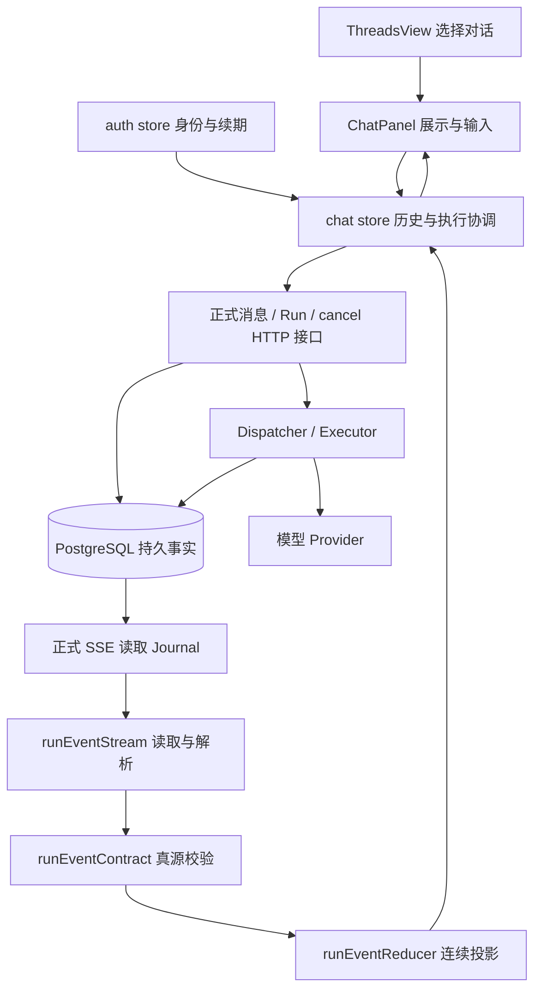

# 第 3 章：最小聊天前端

当前学习进度、理解反馈和编码授权统一见 [交接记录](../AGENT_HANDOFF.md#当前检查点)。本文件保留开章计划与讨论历史，章末保存 2026-11-09 的结章总结和实际代码框架；计划不替代验收结果。

## 开章计划

计划日期：2026-11-04。第 2 章已提供持久 Run/Message/Journal、自动执行、模型 Adapter、通知/SSE 和取消入口，本章把这些事实接到浏览器。教学只深入到职责、状态和数据流，不要求复述前端语法。

### 本章目标与范围

在现有账户和 Thread 页面上增加可用的最小聊天：读取历史、发送问题、展示流式正文与 Run 状态、断线恢复、按 Run 停止。刷新与切换对话后能够恢复已有工作，重复事件不重复追加，不同 Run 或账号的数据不串用。

复用第 2 章正式接口，不另建简化聊天 route；本章不增加 Tool、RAG、HITL、模型管理页面或生产部署。遇到真实接口缺口先说明具体问题与必要范围，不默认为前端另建一套后端事实。

### 已有基础与新增技术职责

| 技术或模块 | 当前已有基础 | 本章要增加什么 |
| --- | --- | --- |
| Vue 3、TypeScript、Vue Router、Vite | 页面、路由与构建 | 消息列表、输入区、状态和错误交互，沿用现有页面结构 |
| Pinia | 内存认证状态、Thread 列表与选择 | 按身份、Thread、Run 管理聊天投影和订阅资源 |
| 浏览器 fetch | [api.ts](../frontend/src/api.ts) 的 JSON 请求；未引入 Axios | 复用普通接口调用，单独处理 SSE 的长连接与流式读取 |
| Run Event Contract | [JSON Schema 真源](../contracts/run_event_v1.json) 与 [生成的 TS 类型](../frontend/src/generated/run-event-v1.ts) | 消费已有事件；网络输入仍需运行时校验，不能只依赖 TS 类型 |
| Event reducer、cursor、gap detection | 后端已有每 Run 的事件序号与补读接口 | 新增事件到页面状态的确定性更新、去重与连续性规则；这些是代码和算法，不是新服务 |
| Vitest、Playwright | 当前 [依赖清单](../frontend/package.json) 已包含 | 用前者验证状态转换，用后者验证浏览器链路；不是本章新换测试框架 |

当前 [普通请求封装](../frontend/src/api.ts) 有 15 秒预算并按 JSON 解码，不能直接用它读取 SSE。长连接的预算、解析、刷新身份与重连在 3.3 单独讨论；本轮不改该封装、不安装依赖。

### 子项安排

以下保留子项编号以追踪职责。按 2026-11-09 的最新节奏，常规工程不再逐项场景测验；3.2–3.6 合并为下述“前端收尾”工作包，简要说明范围后一次确认、连续实现和集中验收。

| 子项 | 目标与范围 | 依赖、技术与职责 | 计划验收场景 |
| --- | --- | --- | --- |
| 3.1 事件投影与连续性 | 先建立纯事件状态更新：归属 Run、正文分片、最终正文替换、取消请求与终态、去重和缺口 | 复用生成的 RunEvent 类型，以纯 TS 和现有 Vitest 验证；不发网络请求、不接页面 | 同一事件不重复追加；缺号不推进游标；不同 Run 隔离；message.completed 不提前宣布 Run 成功 |
| 3.2 消息历史与提交 Run | 在已有身份/Thread 基础上加载历史、提交问题、接收 Run/消息 ID，区分新意图和重发 | 复用 fetch、Pinia、正式 messages/Run 接口；服务端返回后才确认正式身份 | 相同提交重试使用原键；未知提交结果不假定未入库；失败提示不伪造持久 Run；历史与执行投影不重复拼接 |
| 3.3 SSE 消费与重连 | 流帧解析、运行时校验、原游标补读、身份到期后的恢复、连接清理 | 依赖 3.1/3.2；SSE 只传事件，reducer 更新状态，订阅控制器管理连接 | 分片边界不破坏解析；重复/缺口可恢复；401 与服务故障区别处理；EOF/心跳不等于完成 |
| 3.4 最小聊天页面 | 展示历史、输入、临时正文、最终正文和 Run 状态 | 复用 Vue/Pinia 与已有 Thread 页面样式，消费前面三步形成的状态 | 发送后可看到进度；成功用完整正文替换；失败/取消保留可靠正文并显示状态 |
| 3.5 按 Run 停止 | 发起原 Run 的取消请求，展示请求中与最终取消的区别 | 复用正式 cancel 接口和权威 Event/Run 查询；本地关闭订阅不取消任务 | 202 不能直接显示已取消；终态只按已提交事实确认；失败/响应丢失可查原 Run，其他 Run 不受影响 |
| 3.6 刷新、切换隔离与结章 | 完成刷新/历史恢复，清理旧订阅，拒绝旧上下文的迟到响应，保存整章总结和源码地图 | 复用已有 auth/thread 清理机制；按影响选 Vitest、类型/构建及 Playwright 检查 | 刷新可恢复；切换 Thread 不串正文；退出/换账号不接收旧数据；只关闭连接不改变后端 Run |

### 工程提速：前端收尾工作包（2026-11-09）

根据用户“工程底座加快、重点后续智能化”的要求，将尚未实现的 3.2–3.6 合并推进，保留原功能和验收边界，不再要求逐一补答工程题。范围一次确认后连续完成：

1. 接入真实历史、提问提交、正式 Run/消息 ID 和同一意图的幂等重试；分清已保存 Run 与历史加载失败。
2. 复用 3.1 reducer 接入带认证 SSE、帧解析/校验、原游标补读与身份恢复；历史完整正文和事件重放不重复拼接。
3. 在现有 Vue/Pinia/Thread 结构与样式上完成最小消息列表、输入、流式正文、执行/失败状态和停止交互。
4. 处理取消请求与终态、刷新恢复、切换 Thread/账号时的订阅清理及迟到响应隔离。
5. 运行受影响单测、typecheck/构建和核心浏览器流程验证；结果区分模拟接口与真实后端证据，保存整章总结和实际源码地图。

复用现有后端正式接口和数据真源；如出现确实影响范围的接口缺口再说明，不另建简化聊天入口。确认的是完整工作包，包内不在每个组件/函数前停下来重复请求开始反馈。智能化功能仍属于后续章节，本包不引入 RAG、Tool 或 LangGraph。

本节记录提出工作包时的安排；随后用户明确“开始前端收尾”，实施结果见章末总结，当前授权仍统一见交接。

### 数据流与关键边界

```text
打开 Thread → 恢复身份 → 查询已有 Message / 必要的 Run 状态
输入问题 → 同一提交意图持有幂等键 → POST 原 Run 入口 → 返回正式 Run/消息 ID
建立原 Run 的 SSE → 校验/解析事件 → reducer 更新该 Run 的投影 → Vue 展示
重连 → 从最后连续处理成功的 Event.sequence 补读 → 同一 reducer
点击停止 → POST 原 Run /cancel → 展示取消请求 → 读取持久终态后更新结果
```

- PostgreSQL 仍是持久事实，Pinia 是浏览器当前视图；页面刷新可以重建状态，不能把本地拼接结果写成后端完成事实。
- reducer 可理解为“页面状态更新规则”：输入已校验事件与当前状态，输出新状态和是否需要补读。它不访问数据库、不调用模型、不自行发起重连。
- 订阅控制器拥有每个 Run 的连接和重试，reducer 拥有投影规则，组件负责显示；从连接到来一个事件，不等于已经处理成功。
- cursor 只表示该 Run 已连续应用的事件序号。重复事件不追加，发现缺口先停止推进并补齐；Redis 提醒 ID、Thread 消息序号和浏览器网络收包数量都不能替代它。
- `message.completed` 提供原 assistant 的最终正文及消息状态，完整正文替换临时拼接；Run 成功/失败/取消仍以对应权威终态为准。取消请求是可显示的进度，不是新的持久 Run status。
- Access Token 继续只存内存，Refresh Token 只通过既有 HttpOnly Cookie；本章不为恢复游标存储令牌。没有可信 Event 游标时按明确规则重建投影，不能拿 Message.sequence 猜测 after。
- 历史正文与事件重放会重叠，需要先确定恢复基线再应用事件，不能在完整历史后直接重复追加分片。具体装载规则在 3.2/3.3 说明。
- 暂时网络错误、需要刷新身份、刷新凭据失效属于不同处理路径；不因连不上 SSE 就把后端 Run 改为失败或再次提交新问题。
- 切换 Thread 或账号时清理对应本地连接和状态；旧请求即使迟到，也必须核对当前归属后才能应用，不能仅依靠取消网络请求。

### 3.1 首轮讨论与拟定范围

先只处理事件的业务含义：正文分片追加、最终正文覆盖、Run 状态更新、按 Run 归属，以及 sequence 连续应用。采用纯状态转换，使用已生成类型与现有测试工具；不涉及组件布局、网络流读取、模型调用或后端修改。

例子：已经处理到第 10 条，重连又收到第 10 条正文事件，页面不应重复追加；随后直接出现第 12 条，不能越过缺失的 11 就把游标记成 12。订阅控制器需按原游标补读，再交给同一套状态更新规则。

当前理解反馈与明确编码授权只见 [交接记录](../AGENT_HANDOFF.md#当前检查点)。本节是讨论范围，不预填用户答案或生成实现骨架。

### 3.1 具体实现范围（2026-11-06）

目标是交付独立于网络和组件的事件状态更新规则，供后续聊天状态管理复用。沿用 TypeScript、既有生成的 RunEvent 类型和 Vitest，不安装新库。输入为当前投影和已校验的事件，输出为新投影及处理结果；网络帧解析/运行时协议校验与实际补读由 3.3 接入，不让 reducer 发请求。

本步新增两个文件：

| 文件 | 职责 |
| --- | --- |
| [runEventReducer.ts](../frontend/src/events/runEventReducer.ts) | 创建单 Run 投影并应用事件；返回应用、重复、缺口、归属不符或非法转换等结果，供调用方决定后续动作 |
| [runEventReducer.spec.ts](../frontend/src/events/runEventReducer.spec.ts) | 用事件序列验证正文、状态、游标和隔离；复用现有 Vitest 配置 |

本步需要保持的规则：

1. **归属独立**：投影绑定 Thread、Run 和原 assistant Message；其他 Run/消息的事件不更新它，不推进它的游标。不同投影不共享可变正文或状态。
2. **连续处理**：重复事件不再次追加；遇到缺口返回补读需求，不应用缺号之后的事件。只有成功应用连续事件才推进 cursor，原输入状态不被部分修改。
3. **正文更新**：message.delta 追加临时正文，message.completed 用完整正文替换并更新 Message 状态；失败/取消也使用事件中持久保存的正文。
4. **终态职责**：message.completed 不把 Run 提前标成成功；run.completed/run.failed/run.cancelled 才更新对应 Run 终态和稳定错误码。终态不能因迟到事件回退，结束后的正文不再追加。
5. **取消请求**：run.cancel_requested 仅记录已请求取消的进度；不直接改为 cancelled，保留等待权威终态的区别。
6. **规则与连接分工**：缺口/拒绝等结果只返回给调用方；本步不建立 SSE、不做 Token 刷新、不接 Pinia/组件、不改后端、迁移或 Contract 生成物。

计划定向验证：在 `MiniMew/frontend` 下运行 `npm run test -- src/events/runEventReducer.spec.ts`，覆盖正常流程、重复、缺口、归属隔离、最终正文覆盖、失败/取消和终态边界；再运行 `npm run typecheck` 及两个新增文件的 Prettier 检查。仅在出现实际关联失败时扩大范围，不默认重跑后端 PG、真实模型或浏览器全链路。

以上为 2026-11-06 确认的实现范围；实际开始反馈、理解状态和验证记录统一见交接。以下记录本步已实现的职责，不代表整个第 3 章已经完成。

### 3.1 实现后的职责走读（2026-11-06）

本步建立 `frontend/src/events/`，把事件更新规则与网络、Pinia、组件分开；现有认证、Thread 页面和后端没有改动。没有迁移旧实现或新增第二套事件协议；使用原生成类型，后续连接层将消费这个模块。

| 入口或数据 | 做什么 | 谁在后续调用它 |
| --- | --- | --- |
| `RunBinding` | 固定 Thread、Run 和原 assistant Message 的身份 | 3.2 用后端正式返回的 ID 建立绑定 |
| `createRunProjection(binding)` | 创建该 Run 的空投影：cursor=0，Run/Message 均 pending | 历史/提交层选择按 Journal 起点重放时调用 |
| `RunProjection` | 保存该 Run 的正文、消息状态、Run 状态、游标、取消请求时间和稳定错误码 | 后续聊天 store 保存、组件展示 |
| `reduceRunEvent(state, event)` | 校验归属、序号和业务转换，成功才返回新状态与新游标 | 3.3 在校验并解析事件后调用 |
| `EventReduction` | 返回处理结果，缺口携带原 after；不自行发请求 | 调用方决定应用、忽略或发起补读/恢复 |

处理结果有五种：

| kind | 返回的状态 | 含义 |
| --- | --- | --- |
| applied | 新对象，cursor 推进到本事件 | 已连续成功应用；原对象不变 |
| duplicate | 原对象 | 同一 Run 已处理过该序号，不重复追加 |
| gap | 原对象，另带 after=原 cursor | 缺少前序事件，先补齐；不自动缓存或应用缺口后的正文 |
| foreign | 原对象 | Thread、Run 或 assistant Message 不匹配 |
| invalid | 原对象 | 非安全整数/非法序号，或当前阶段不允许该转换 |

普通运行时可以按下面的例子读代码：

| 已处理事件 | 正文 | Message 状态 | Run 状态 | cursor |
| --- | --- | --- | --- | --- |
| 1 run.created | 空 | pending | pending | 1 |
| 2 run.started | 空 | pending | running | 2 |
| 3 message.delta，正文“今天” | 今天 | pending | running | 3 |
| 4 message.completed，完整正文“今天天气很好” | 今天天气很好 | completed | running | 4 |
| 5 run.completed | 今天天气很好 | completed | succeeded | 5 |

第 4 行的 running 是浏览器尚未应用 Run 终态的投影，不说明此时数据库中的 Run 还没有完成。若在 cursor=3 时先看到第 5 条，模块返回 gap/after=3，保持原正文；后续连接层补回第 4、5 条，再逐条交给同一函数。

失败结果会保存 message.completed 的完整正文与 failed 消息状态，再由 run.failed 保存 Run 失败及受控 error code。取消请求只记录时间、保留当前 Run 状态；message.completed(cancelled) 和 run.cancelled 才依次确认消息与 Run 结果。pending 的直接取消可以没有 run.started，与现有后端一致。

当前边界：投影从 cursor=0 的 run.created 开始，不提供猜测游标或任意历史快照装载。输入被视为已完成网络协议校验的 RunEvent；该模块不是完整 JSON Schema 验证器。3.2/3.3 再确定历史基线、网络帧校验、补读与重连；现在打开页面仍然没有聊天 UI。

本步实际验证（2026-11-06，命令工作目录为 `MiniMew/frontend`）：

| 实际命令 | 首次结果 | 重复执行 / 跳过 |
| --- | --- | --- |
| `npm run test -- src/events/runEventReducer.spec.ts` | 1 个文件、28 个测试全部 passed，0 failed | 重复 0、skipped 0；其余测试文件未运行，不称为 skipped |
| `npm run typecheck` | 通过 | 本步首次；未重复 |
| `npm exec -- prettier --check src/events/runEventReducer.ts src/events/runEventReducer.spec.ts` | 通过 | 本步首次；此前只对两个新文件执行格式化 |

新增 28 个不同用例覆盖正常流程、重放、缺口后恢复、拒绝后同序号重试、两个并行 Run、失败/取消、pending 直接取消、终态不可回退、消息完成后迟到正文和非法序号。断言检验原状态不变、游标不提前推进；现有认证/Thread 测试文件没有改动或弱化断言。

实施前后比对 12 个相关已有文件，依赖清单/锁、事件真源与 Python/TS 生成物、API/auth/threads 及其原测试、TS/Vite 配置的 SHA-256 均未变。未新增生产依赖、后端路由、Contract、迁移、配置或评测资产。

未执行整个前端测试集、构建、Playwright、后端 PG/真实模型检查：新增纯模块尚未接入既有页面/网络调用，影响由本步定向行为测试和项目类型检查覆盖。文档差异与链接检查结果记录在交接；本节不是浏览器聊天或 SSE 端到端验收。

### 3.2 讨论起点：历史加载与提交问题（2026-11-06）

沿用现有身份、Thread、fetch 和 Pinia，把正式消息与 Run 接到浏览器状态。本步准备处理“数据从后端取回来、一次提问如何确认与重试”；SSE 连接仍在 3.3、页面展示在 3.4，具体编码范围待讨论确认。

| 操作 | 已有正式接口 | 响应含义 |
| --- | --- | --- |
| 读取历史 | GET `/v1/threads/{thread_id}/messages` | 返回 MessagePage，含真实消息 ID、Run ID、正文、状态、Thread 内消息序号及向前翻页游标 |
| 提交问题 | POST `/v1/threads/{thread_id}/runs` | 输入原正文与 idempotency_key；成功返回正式 Run/用户消息/assistant 消息 ID 和 Run 状态，不直接返回完整答案或完整 MessagePage |
| 查询原任务 | GET `/v1/threads/{thread_id}/runs/{run_id}` | 用已知 Run ID 确认持久状态，沿用原用户/Thread 归属检查 |

浏览器应分别记录历史加载状态、提问提交状态与持久 Run 信息。一次提交的 key 和正文绑定；网络结果不明确时保留它们，用原 key/原正文重试，新的提问意图才用新 key。已有明确成功响应后，下游读历史失败不能把已创建 Run 当成不存在。

后端返回的 RunResponse 没有完整 Message 的 sequence/created_at 等字段，客户端不能凭 Run ID 拼出伪造的持久 MessageResponse；需要从正式历史接口取得消息。历史按 message.id 管理，后续流式投影绑定同一 assistant Message，不应把同一消息重复插入。历史正文与从零重放的投影、Message sequence 与 Event cursor 的基线问题在后续讨论明确，不默认混用。

首轮场景：POST 提问成功返回 Run ID，随后加载消息历史失败。应重新创建一个 Run，还是保留已创建 Run、只重试加载历史？实际反馈与授权仍以交接记录为准，本节不预填用户答案或创建实现文件。

### 验证安排

先按每步的真实影响选择测试：3.1 聚焦 reducer 的重复、缺口、归属和状态转换；3.2/3.3 覆盖请求、身份恢复、补读及清理；3.4/3.5 验证聊天/停止可见行为；3.6 再覆盖完整浏览器恢复与隔离。代码改动后运行对应类型检查，UI/构建入口变化时运行相关构建与浏览器检查，不机械重复未变化的后端 PG/真实模型检查。

具体用例、命令与首次/复验/通过/失败/跳过/未执行结果在实施后记录。无新测试或应用代码时仅校验文档，不预填测试通过。

### 计划调整

2026-11-09：用户要求工程底座相关章节加快，把重点留给后续智能化。3.2–3.6 合并为“前端收尾”工作包，保留编号、功能、不变量和验收；采用简讲、一次工作包确认、连续实现、集中复盘。此前未回答的 3.2 基础题保留历史记录，不再作为继续门槛，也不追认理解通过。3.1 已交付代码保持不变。

2026-11-04：根据第 2 章结章时的实际源码细化原九阶段路线。第 1 章已经实现身份恢复与 Thread 管理，HTTP 已用 fetch，Pinia/Vitest/Playwright 也已列入现有依赖，因此本章按“复用基础、增加聊天消费者”安排，修正旧计划将 Axios 和上述已有基础作为首次引入的表述。未改变后端事实来源或扩大应用编码授权。

## 结章文字总结（2026-11-09）

第 3 章把第 2 章的持久对话接到了浏览器。现在可以登录、创建/选择 Thread、加载历史和更早消息、输入问题、查看流式回答与每个 Run 的状态、停止某个 Run，以及刷新或断线后恢复。没有新安装前端框架或生产依赖，沿用 Vue、TypeScript、Pinia、原生 fetch、Vitest 和 Playwright。新增内容主要是事件协议消费、状态协调和聊天组件；3.1 reducer 继续作为唯一事件投影规则。

最重要的职责划分是：后端 PostgreSQL 保存正式事实；Pinia 保存当前页面需要的历史、请求状态与每个 Run 的投影；SSE 负责把 Journal 事件送来；reducer 判断事件是否重复、是否连续、怎样更新正文与终态。网络连接和页面状态不能替后端宣布任务成功、失败或取消。

### 一轮提问的完整链路

1. 页面恢复身份、确认 Thread 归属后，chat store 从正式 messages 接口加载真实消息。RunResponse 没有完整 Message 的序号/时间等字段，因此不在前端凭空构造持久消息。
2. 输入问题后，为本次提交意图保存原正文和幂等键，再 POST 正式 runs 接口。结果不明确时复用原正文/原键；刷新后也可恢复该待确认意图。明确成功后保留 Run ID，即使随后历史读取失败，也只重试读历史。
3. 后端照常由 Dispatcher/Executor 领取与执行 Run，调用 Provider，将正文、Journal 与终态持久化。浏览器不会直接调用模型，也不会因重连重新创建 Run。
4. store 为 Run 建立 Bearer fetch SSE。流读取器处理 UTF-8 和帧边界；运行时校验器直接读取 JSON Schema 真源，校验后才交给既有 reducer。
5. reducer 按 Run 独立处理连续 Event.sequence，重复事件不追加，缺号不前进。store 按它给出的游标补读。没有可信游标时从头重放到独立投影，不把已有完整历史当成分片累加起点。最终正文用 `message.completed` 的完整内容替换临时拼接。
6. Vue 根据 store 显示持久消息、投影正文和状态。完成、失败、取消依赖持久状态/事件；EOF、204、心跳、关闭窗口都不是完成信号。停止接口的 202 只表示请求被接收，最终取消仍等待持久事实。

### 恢复和失败行为

| 场景 | 当前行为 |
| --- | --- |
| 提交结果未知、用户再次点击 | 保留原问题与键，禁止并发重复提交；同一意图重试仍复用原键 |
| 已收到 Run ID，历史读取失败 | 保留正式 Run，显示历史重试入口，不重新 POST 问题 |
| SSE 断线、正常 EOF 或事件缺号 | 保留正文与最后连续游标，有界退避后从原位置补读 |
| SSE/聊天请求的 Access Token 过期 | 共享一次刷新，保持同用户投影和游标；明确 Refresh 401 才清身份/进入登录，服务异常提供恢复入口 |
| 流收到畸形/错误归属事件，或 204 却未确认终态 | 不推进投影、不伪造完成，显示明确错误和手动恢复入口 |
| 取消响应丢失/503 | 不写本地 cancelled，可查询原 Run；稍后收到持久终态即清除未确认提示 |
| 模型失败或执行取消 | 保留已提交的正文，展示对应失败/取消状态，不把半截正文当完整答案 |
| 多个 Run 等待订阅 | 同一页面最多同时打开两条 SSE，其他 Run 等空位后从 Journal 重放；后端执行不受订阅名额影响 |
| 刷新页面 | 通过 HttpOnly Cookie 恢复身份，重新查询正式历史；未结束消息按原 Run 恢复订阅 |
| 切换 Thread、退出或换账号 | 中止旧本地请求/连接，并用身份/上下文版本检查拒绝迟到响应；不取消后端 Run |

Access Token 仍只在内存，Refresh Token 仍只在 HttpOnly Cookie。sessionStorage 新保存的是按用户/Thread 隔离的待确认提交（问题正文、幂等键），不包含令牌；明确成功或退出/换账号后清除。该存储只帮助恢复提交意图，不是第二套消息库或 Run 事实来源。

### 本轮实际验证

新增 **40 个不同用例：33 个单测、7 个浏览器用例**。工作包内共 **78 个不同单测和 16 个不同浏览器用例取得通过记录**，是分组执行的结果，不是一次全量运行；已有 3.1/认证/Thread 断言没有删除或弱化。

| 实际执行 | 结果与口径 |
| --- | --- |
| `npm run test -- src/chat.spec.ts src/events/runEventStream.spec.ts src/stores/chat.spec.ts src/stores/auth.spec.ts src/stores/threads.spec.ts src/events/runEventReducer.spec.ts` | 首次定向组合 75 通过；包含既有 3.1 的 28 例和认证/Thread 回归，不把它们算新增 |
| `npm run test -- src/stores/threads.spec.ts` | 随同用户续期期间的 Thread 请求修正，新增 2 例后 11 通过，其中 9 例复验 |
| `npm run test -- src/stores/chat.spec.ts` | 随取消终态清除旧错误提示修正，新增 1 例后 12 通过，其中 11 例复验 |
| `npm run typecheck`、`npm run build`、`npm run format:check` | 类型、Vite 构建和全前端格式检查通过；最终源码改动后再次构建/类型与格式检查通过，不额外计测试用例 |
| `npm run test:e2e -- tests/chat.spec.ts tests/threads.spec.ts tests/auth.spec.ts` | 14 通过，0 跳过；新增 6 个聊天路由模拟场景，保留 8 个原认证/Thread 场景 |
| `uv run --env-file .env --no-sync python scripts/check_chat_frontend.py` | 首次已有真实认证/Thread 场景 1 通过；新增聊天场景 1 失败，原因是新测试的按钮名称遗漏“→”，页面已正确登录 |
| `uv run --env-file .env --no-sync python scripts/check_chat_frontend.py tests/chat-live.spec.ts` | 修正新增测试的精确按钮名后，新增聊天场景 1 通过；API 正常退出、临时数据库清理完成 |
| `npm run test:e2e -- tests/chat.spec.ts --grep '历史、流式重放'` | 修正桌面发送按钮宽度后复验 1 通过，重新保存桌面/手机截图；不再重复运行未受影响的浏览器场景 |
| `uv run --no-sync ruff check scripts/check_chat_frontend.py tests/frontend_process.py` 与对应 `ruff format --check` | 两个新增测试辅助文件的检查通过 |

78 个单测按文件为：DTO 3、流解析 13、chat store 12、auth store 11、threads store 11、既有 reducer 28。其中 auth 新增 3、threads 新增 2；不同用例数不与重复执行次数相加。

新增真实浏览器用例通过测试 Vite → FastAPI → PostgreSQL → 正式 Dispatcher/Executor → Journal/SSE，覆盖提问、取消、失败、刷新恢复。它使用受控 Provider，不调用真实 DeepSeek；测试夹具关闭 Redis 通知，使用正式 Journal 定时补读。因此它证明真实持久链路与前端接线，不证明线上模型质量或 Redis 通知本轮通过。测试在自有随机临时库与随机 API 端口运行，未使用开发库写测试用户/对话。

本轮启动了已有 Compose PostgreSQL，复用原数据卷；没有安装依赖或启动 Redis。收尾查询开发库仍为 1 用户、5 Thread、0 Run、0 Message、0 Run Event、0 Outbox、1 Model Profile，临时库残留 0，测试 Vite 5175 监听 0。桌面/手机截图已人工查看，无横向溢出；本机忽略产物位于 `.artifacts/chat-desktop.png`、`.artifacts/chat-mobile.png` 和真实链路的 `.artifacts/chat-live.png`，换设备可通过对应浏览器测试重新生成。

未执行：整个前端/后端全量回归、旧数据迁移回归、真实 DeepSeek 调用、Redis 在线/故障验收、依赖审计、生产部署及上级 SuperMew 门禁。原因是本包修改前端消费者与独立测试夹具，未改后端生产执行链、契约、迁移或依赖；相关历史通过记录不作为本轮新结果。所选测试没有跳过；未选择的集成文件属于未执行。

### 与下一章的衔接

现在“用户问题 → 持久 Run → 流式回答 → 浏览器恢复”已闭环。第 4 章开始加入文档知识来源：上传、不可变版本、持久索引任务和独立 Worker，再重点讨论解析/分块、Embedding、索引核验、原子发布及引用定位怎样支撑 RAG。第 4 章尚未编码，需要先保存子项计划并讨论关键智能化选择。

## 本章结束时的代码框架（2026-11-09）

### 各部分做什么

| 实际文件/目录 | 职责和状态归属 |
| --- | --- |
| [App.vue](../frontend/src/App.vue)、[router.ts](../frontend/src/router.ts) | 应用壳和受保护路由；等待身份恢复，永久失去身份后回登录 |
| [stores/auth.ts](../frontend/src/stores/auth.ts) | 身份唯一来源；内存 Access Token、恢复/刷新单飞、Cookie 协调和退出隔离 |
| [stores/threads.ts](../frontend/src/stores/threads.ts)、[ThreadsView.vue](../frontend/src/views/ThreadsView.vue) | 当前用户的 Thread 列表、分页、创建、选择和标题；把选中 Thread 交给聊天组件 |
| [components/ChatPanel.vue](../frontend/src/components/ChatPanel.vue) | 输入与消息界面，只调用 store 动作并展示状态，不持有第二套执行状态 |
| [chat.ts](../frontend/src/chat.ts) | 正式 Message/Run 响应的运行时检查，复用生成的 API 类型 |
| [stores/chat.ts](../frontend/src/stores/chat.ts) | 本章协调中心：历史、待确认提交、每 Run 投影、SSE 名额、重连、取消和上下文隔离 |
| [events/runEventStream.ts](../frontend/src/events/runEventStream.ts) | fetch 长连接、闲置超时、UTF-8/帧解析和中止；不决定消息怎样展示 |
| [events/runEventContract.ts](../frontend/src/events/runEventContract.ts) | 从已有 JSON Schema 真源检查网络事件；不支持的 schema 关键字明确拒绝，不静默放宽 |
| [events/runEventReducer.ts](../frontend/src/events/runEventReducer.ts) | 3.1 的纯投影规则：归属、连续游标、去重、完整正文替换和权威终态；不发请求 |
| [api.ts](../frontend/src/api.ts)、[generated](../frontend/src/generated) | 普通 JSON 请求封装及真源生成的静态类型；长连接不套用普通请求的 15 秒预算 |
| [api/runs.py](../src/minimew/api/runs.py)、[execution](../src/minimew/execution) | 沿用第二章正式 Run/历史/SSE/取消入口与持久执行；本章未改生产实现 |
| [frontend/tests](../frontend/tests)、各模块 `.spec.ts` | 浏览器流程、协议和状态转换验证；[chat-live.spec.ts](../frontend/tests/chat-live.spec.ts) 走真实持久链路 |
| [check_chat_frontend.py](../scripts/check_chat_frontend.py)、[frontend_process.py](../tests/frontend_process.py) | 测试专用临时库/进程编排和受控 Provider 注入，不新增正式业务 route |



以“重连后继续看回答”为例：`stores/chat.ts` 保留该 Run 的连续游标，`runEventStream.ts` 带新/原 Token 从 `after` 读取，`runEventContract.ts` 校验事件，`runEventReducer.ts` 去重并更新投影，`ChatPanel.vue` 响应状态变化。后端仍由原 Executor 执行，浏览器没有再次发送问题。

本章结构整理仅围绕真实职责增加 `components/ChatPanel.vue`、事件网络/校验模块、chat DTO 和 store；没有为了分层增加空目录或另写第二套聊天接口。依赖清单/锁、生成物、JSON Schema、数据库迁移、后端生产代码与评测资产不需要同步变更；使用说明、章节总结和交接已同步。没有 commit/push。
