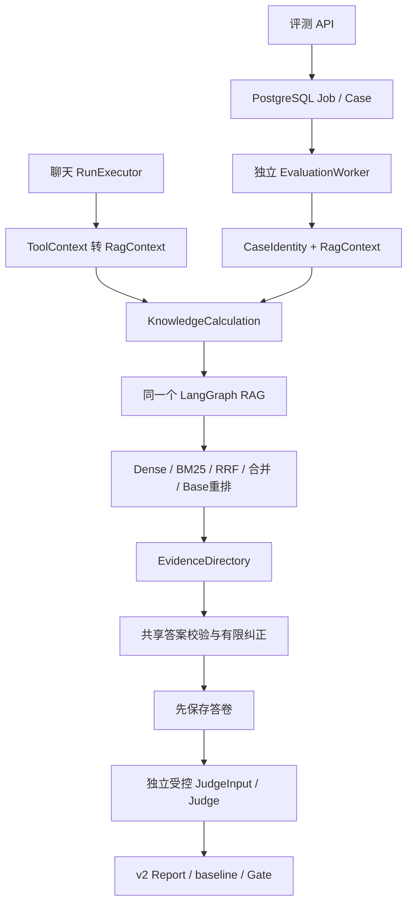

# 第 8 章：RAG 评测闭环

当前学习进度、用户真实反馈和应用编码授权只见 [交接记录](../AGENT_HANDOFF.md#当前检查点)。2026-11-15开章，2026-11-16已完成A包8.1–8.3离线闭环，实际实现见下方实施记录；B/C尚未实现或获开始授权。第七章已交付恢复能力见[上一章总结](07-HITL与故障恢复.md#结章文字总结)。

## 开章计划

计划日期：2026-11-15。

### 本章目标与范围

让“问答能运行”进一步成为“可以说明在哪些问题上正确、哪里退化、结论来自哪次执行”。在相同人工期望与明确可比的运行条件下，保存每个 Case 的观察事实、评分、错误和报告，避免只看一次回答或几条通过数字决定策略优劣。

第六章已有 11 个固定案例、真实检索对照和受控推理观察；第七章已有持久暂停、恢复与资格隔离。本章沿用这些正式执行能力，逐步新增评测契约、纯评分器、持久 Evaluation Job/Case、独立 Evaluation Worker 和最小评测工作台。Evaluation Job 不等于聊天 Run，不以另发用户问题、伪造 Thread/Run 或复制检索图实现评测。

本章以 MiniMew 自身代码为实现边界。上级 [领域语言](../../CONTEXT.md)、[ADR-0014](../../docs/adr/0014-rag-evaluation-contract.md)、[ADR-0024](../../docs/adr/0024-model-control-and-rag-evaluation-runtime.md) 只作设计参考，不导入上级业务包，也不照搬其完整管理平台。

### 本章学习节奏与工作包

遵循[功能链分包约定](../AGENTS.md#开发批次与教学小节分离2026-11-13-新增)。教学围绕“标准是什么→事实怎么采→谁来评分→报告如何决策”，工程接线集中推进，不逐函数讲语法或提简单判断题。

- **A 包，8.1–8.3：离线评测契约与评分闭环。** Dataset/Observation/Provenance/Report/GatePolicy 真源、确定性指标、baseline 可比性、离线 CLI、静态夹具及测试。模型、数据库、Milvus、Worker、浏览器均不是本包的运行前置。静态评分通过只证明评测系统按规则计算，不代表真实问答质量。
- **B 包，8.4–8.5：持久真实执行与独立评分。** 先明确共享计算接口和执行上下文，再做 Evaluation Job/Case 事务、独立 Worker、隔离索引、冻结配置与有界 Evaluator Judge。沿用既有模型与 CPU 缓存作为候选，不默认下载新模型或运行收费评测；真实 Provider 范围与费用上限须在该包开始前另行明确。
- **C 包，8.6：最小工作台与集中验收。** 数据集导入/校验、Job 发起/进度/取消、Case 错误与报告查看、baseline 比较入口，以及章节总结和实际源码框架。界面沿用现有账号作用域状态，不扩成全量模型管理中心。

以上是拟议分包，分别取得明确开始反馈后才创建对应应用、测试或资产文件。包内按依赖连续实现；小节提交/推送和测试触发仍遵守 AGENTS，不因切分提交重复验收。

### 子项安排

| 子项 | 目标 | 依赖和实施顺序 | 技术职责 | 必要验收 |
| --- | --- | --- | --- | --- |
| 8.1 | 版本化 Dataset/Case、人工期望与内容 fingerprint | 首先固定评价单位和分母 | 沿用 Pydantic、规范化 JSON、SHA-256；不把受控模型输出当人工答案 | ID 唯一；未知字段、缺失/矛盾期望拒绝；内容变化必变 fingerprint；时间/本机路径不进入内容身份 |
| 8.2 | Observation、来源与确定性评分 | 依赖 8.1，先事实后聚合 | 纯 Python 指标；事实投影与评分拆开 | 缺 Case/重复 Case/无效数值拒绝；无 gold 指标显式 unavailable；Provider 故障不变为空知识 |
| 8.3 | baseline、Gate、离线 JSON/中文报告 | 依赖 8.1–8.2，完成 A 链 | 纯评分服务与 CLI；按真源生成 schema | 同输入可重建同报告；不兼容 fingerprint/provenance 拒绝门禁；关键失败和缺失结果不能被均分掩盖 |
| 8.4 | Job/Case、冻结执行快照、独立 Worker 与正式 RAG Adapter | 先确定共享计算接口，再迁移/调度 | 沿用 SQLAlchemy/Alembic、PG lease/owner、正式检索图与 Provider | HTTP 不长跑模型；Case 状态/进度/终态原子；旧 owner 拒写；不重复未知外部调用或覆盖已提交 Case |
| 8.5 | Evaluator 角色、结构化 Judge 与人工校准 | 依赖 8.4；离线先验证 Judge 契约 | 沿用既有 Provider；独立冻结评估角色、提示版本与评分量表 | Judge 超时/格式错误显式记录；不拿在线 Grader 自评替代质量证据；人工抽样复核 |
| 8.6 | 工作台、历史报告、取消与端到端验收/结章 | 依赖 B 的持久 API | 沿用 Vue/Pinia/类型契约、定向 HTTP/浏览器检查 | 刷新可读进度；账号切换清理状态；取消/失败与质量分数分开；保存最终总结与代码职责 |

### 已有资产能复用到哪里

| 已有入口 | 已经解决的职责 | 本章需要补的部分 |
| --- | --- | --- |
| [chapter06-cases.json](../examples/rag/chapter06-cases.json) / [rag_cases.py](../scripts/rag_cases.py) | 固定问题、原文锚点、受控查询/规划/故障模式与字面覆盖检查 | 人工期望独立于编排脚本；质量案例和故障注入案例分开统计；新增评测 schema，不改写历史案例/观察 |
| [check_rag_suite.py](../scripts/check_rag_suite.py) | 真实 CPU/Milvus 检索、受控模型编排与白名单观察导出 | 正式 Evaluation Adapter/Job、稳定来源身份、结构化评分和可比 Gate；历史受控结果不能改名为 live 质量结果 |
| [knowledge.py](../src/minimew/knowledge.py) / [rag/workflow.py](../src/minimew/rag/workflow.py) | 正式知识工具、原 scope/Evidence、检索/评判/改写/澄清 | 评测观察正式接口，不在 Adapter 复制图算法 |
| [execution/reasoning.py](../src/minimew/execution/reasoning.py) / [execution/tools.py](../src/minimew/execution/tools.py) | 当前 Run 绑定的模型内部调用、ToolContext、预算与权限 | B 包需明确共有计算上下文的抽取；现有接口显式持有 Run/Thread 身份，不能直接把 Job ID 塞进 Run 字段冒充复用 |
| [model_control.py](../src/minimew/model_control.py) | 当前 Answer Profile 与 Run v1–v5 冻结目录 | Evaluator 角色和 Job 执行快照尚未实现；B 包讨论如何冻结，不回写历史 Run |
| [execution/repository.py](../src/minimew/execution/repository.py) / [documents/jobs.py](../src/minimew/documents/jobs.py) | 已有聊天/索引域的锁顺序、资格、取消与事务模式 | 复用设计，不让这两个 Repository 同时拥有 Evaluation Job；后者有自己的正式持久状态 |

### 整体位置与数据归属

```text
人工标注 Dataset + 固定语料/预期
                ↓
          校验 / fingerprint
                ↓
         Observation 输入接口
         ↙                  ↖
静态受控观察夹具       Evaluation Job → 独立 Worker（B 包）
                            ↓
                  正式 RAG/回答/澄清计算接口
                            ↓
                  事实投影 + Evaluator Judge
         ↘                  ↙
           同一个纯评分器
                ↓
      指标 / 切片 / baseline 比较 / Gate
                ↓
         Report → CLI / 工作台
```

Dataset 保存人工标准；Observation 保存某次执行的事实；Judge 是对事实的一个评分来源；Report 汇总事实与指标；baseline 是经审查选定、由评分器生成的参考报告；Gate 是“哪些条件允许接受结果”的政策。这些对象分别版本化，不让 UI、脚本输出或当前模型配置成为第二套标准。

在线 **Grader** 处在图内部，决定材料足够、不足、歧义或拆解；评测 **Evaluator** 在候选答案产生后，结合独立期望与受控证据判断正确性、完整性和依据。两者可以使用同一候选 Model Profile，但角色、输入、提示/量表和预算分开，不能因此声称评分无偏或模型彼此独立。初期不需要训练模型或引入评测 SaaS；模型角色选择在 B 包明确。

### 评分与可比性的首版建议

1. **先固定评价单位。** 以 Case 为单位，区分普通质量、关键质量和运行故障注入切片。第六章的 mode/queries 是受控编排输入，不能直接拿来要求真实模型必须走同一路线；期望应描述允许的结果、必须覆盖的事实、禁止断言和必要的补充信息。
2. **指标必须有可审查 gold。** 首版优先原文锚点/区间覆盖、结果符合率、HITL 最终完成情况、故障/缺失率和调用次数。跨度覆盖只能证明材料被提供，不能证明回答理解正确。排名指标须先有明确 gold relevance 和排序单位；没有标注时 MRR/nDCG 等为 unavailable，不用临时猜测凑出分数。
3. **分母不静默变化。** 报告保留 eligible/evaluated/missing/error 数量；没有 gold 的 Case 不计入该检索指标，却仍保留运行/结果观察。执行失败不伪装 NO_KNOWLEDGE，也不能通过丢掉失败 Case 提高平均分。HITL 需要补充后命中标注最终结果，停在等待不算完成。
4. **来源分层。** A 包静态夹具标记 contract_smoke；B 的真实本地检索加受控回答仍明确 controlled；真实生成/Judge 才按实际路径记录 live 来源。静态或受控报告不能通过要求真实语义质量的 Gate。观察中不持久化材料全文、endpoint、Secret、原始 Provider payload、异常原文或私有推理；Judge 临时所需原文受控传入，公开输出只留数值、简短理由和稳定证据身份。
5. **可比性先校验后算差值。** Dataset 内容身份之外，固定 corpus 内容、评测 schema/评分与 Judge 提示版本、源码/依赖身份、Embedding/Reranker revision、索引 manifest 和冻结模型/策略。设备绝对路径、随机资源 ID、时钟不进可移植 fingerprint；真实执行资源的私有定位与内容身份分开。首版 Gate 严格校验已声明可比维度；刻意换策略/模型的实验列明差异，不默认成为同一基线的发布结论。
6. **检索 scope 不等于 BM25 统计隔离。** 现有第六章脚本明确共享 collection 的 BM25 统计仍受其他语料影响。B 包真实评测须明确专属 collection/索引及语料绑定和自有资源清理，不能只冻结 namespace 就宣称结果可复现；开发知识库不作为默认评测沙箱。
7. **Gate 与执行成功分开。** 正常完成的评测 Job 可以得到不达标报告；Job failed 表示未能完成评测。关键案例、缺失观察、来源不符与分母下降需要显式规则，不能被总体均分抵消。阈值在 A 包根据标注与量纲明确，不为让当前实现通过倒推标准。
8. **Judge 不代替人工标准。** B 包先定义严格结构化量表与失败语义，再有界调用；独立记录 Judge 预算/失败，不退还或放大生成侧原有额度。模型给出的正确/有依据分数仍需人工抽查校准，字符重合不能冒充语义正确率。

### 代表性请求与失败场景

以原固定问题“出差餐费、住宿上限和提交期限分别是什么”走读：Dataset 的人工期望保留 150 元、350 元、返程后 5 个工作日及必要限制；候选实现可以直接检索或拆解，但最后必须依据正确材料覆盖所有方面。Worker 调正式图得到材料和候选答案，Adapter 记录最终材料身份/覆盖/错误，Evaluator 另行评价答案。若中间检索找到三方面、最终合并只留下两方面，报告必须在最终覆盖/完整性中体现缺口，不能被在线 Grader 的 sufficient 抹掉。

A 包用静态 Observation 模拟上述不同事实，只检验评分器和 Gate 算得是否正确；不运行检索。Dataset 变化后旧 Observation 拒绝，重复/缺失 Case 拒绝或按明确错误事实处理，不能默默补零。B 包 Provider/PG/向量故障保持 typed error；Judge 失败保持 Judge error，不转成模型答错或健康无知识。取消和 owner 失效以各自持久 Job/Case 事务裁决；未知结果的外部调用不盲目重放，具体恢复边界在 B 包开始前落定。

### A 包的具体实施与验收范围

拟新增 MiniMew 自身 evaluation 业务模块和正式离线 CLI，资产与 schema 使用独立版本化目录；这是编码范围提案，本轮不创建这些文件。实施顺序为 8.1 契约/人工期望 → 8.2 纯评分与严格输入校验 → 8.3 报告、可比性和 Gate/CLI 接线，连续完成后集中验证。

沿用 Pydantic 与标准库即可，不计划新增生产依赖。schema 从 Pydantic 真源生成；静态 Observation 是明确标记的测试夹具，baseline 必须由同一评分入口生成，不手调结果。第六章案例、观察和第七章代码保持原状，来源不同不静默双读混用。

必要检查：严格契约和稳定 fingerprint、Case 对齐、指标边界/分母、unavailable、故障与健康空结果区分、provenance/baseline mismatch、关键回归/缺失 Gate、JSON/Markdown 确定性、schema 漂移、CLI 成功/拒绝退出码与报告脱敏。纯离线执行不得隐式加载 CPU 模型、访问 PG/Milvus、下载资源或要求真实 Secret；若发现必须改在线协议或数据库，先说明并划回 B 包讨论。

A 包不新增数据库表、API、Worker、模型角色调用或 UI，不运行真实质量评测和收费调用。必要测试范围限于新增纯模块、CLI/生成器和直接消费者；不会因章节编号触发整个 MiniMew 或上级全仓门禁。

### 计划调整

2026-11-15：将 LEARNING_PLAN 的五项建议细化为 8.1–8.6：单列 baseline/Gate 便于 A 包离线端到端交付；真实 Job/Worker 与 Evaluator 作为 B 包，工作台/结章为 C 包。增加当前源码暴露的 Run 身份耦合与共享 BM25 统计边界，避免把 Adapter 或 namespace 误当作完整隔离。该计划没有改变在线行为，也不构成任何工作包的编码开始反馈。

## A包首轮架构走读（2026-11-16，仅设计）

用户同步最新代码/交接后回复“继续”，本轮承接第八章讲解，不开始A包编码，也不把旧第六章待开始记录当作当前阶段。以下对象是拟议评测协议，不是已创建模块。已实现的11个第六章案例与观察保持原样。

### 用一次策略对照串起各对象

以问题“接待方提供午餐后，还能报这顿吗，其他餐食如何处理”为示意。人工依据固定制度标注：已提供餐食不得重复报销，不能据此否定同日其他符合条件的实际餐饮。这些标注进入Dataset/Case，描述应该覆盖什么、禁止推出什么和所依据的语料身份，不强制模型复述某段标准答案或必须走rewrite路线。示意不代表新增了测试资产或案例结果。

正式执行将来由B包采集Observation：实际最后交给回答模型的来源片段身份/范围、业务结果、引用事实、调用计数/预算与受控错误等；真实生成答案若为评分所需，通过受控协议提供，不能夹带凭据或模型私有推理。A包先读取明确标为contract_smoke的静态观察，验证协议和计算，不联网运行RAG或从人工期望直接生成所谓真实观察。

```text
人工标准：Dataset + 固定语料身份
                   ↓
执行事实：Observation + 来源/运行条件（provenance）
                   ↓
纯评分器：按已声明规则计算各项指标
                   ↓
Report：逐Case事实/得分/缺失/错误 + 汇总
                   ↓
核对可比性 → baseline差值 → Gate判定
```

Dataset像考试题和评分依据；Observation像提交的答卷及过程记录；评分器使用明确规则计算；Report呈现结果；baseline是经审查选为参照的一份历史报告；Gate决定结果是否满足既定接受政策。baseline不反过来定义人工期望，也不因这轮不过关而自动换成当前报告。

### 每份数据归谁所有、为什么要分开

| 拟议对象/模块 | 保存或负责什么 | 不应混入的职责 |
| --- | --- | --- |
| Dataset/Case | 稳定Case ID、人工期望、必要/禁止事实、允许结果和适用标注 | 不用当前模型回答覆盖标准，不照搬受控编排mode作为质量目标 |
| Observation | 某次实际观察、稳定来源映射、完整结果/错误与计数 | 不提前填写“正确”，不因评分规则调整而重跑或改写事实 |
| Provenance | 观察如何产生：静态/受控/真实来源、模型/索引/语料/策略等身份 | 与Case内容身份分开；不把临时路径/随机数据库UUID当可移植内容指纹 |
| Scorer | Dataset和Observation到逐项指标的纯函数 | 不调用模型/数据库、不决定线上RAG路由 |
| Report/Baseline | 可复查逐项结果与选定参照 | 不手填聚合值，不覆盖历史观察以迎合新规则 |
| GatePolicy/Gate | 必需指标、来源要求、关键Case、容许退化等接受规则 | 报告成功生成与质量达标分开；不等价于自动部署/推送 |

分开后，同一份有效观察可以用不同版本的评分规则重新计算，无须再次花费模型调用；但必须记录新规则身份，不能把新规则分数与旧分数直接作提升结论。观察本身结构不足时则显式拒绝或标记不可计算，不猜测缺失事实。

### 材料覆盖、结构正确和语义正确分开

现有[rag_cases.py](../scripts/rag_cases.py)的coverage按原文锚点区间检查最终matches，并明确标为literal source-span coverage；[第六章观察](../examples/rag/chapter06-repair-observation.json)包含suite/source/模型revision与冻结策略。这些是可复用的事实采集经验，不是第八章已完成的语义评价。

即使材料包含150元及全部例外，模型仍可能答错金额或扩大禁止范围。因此报告至少区分：材料是否覆盖人工标注、结果/引用结构是否满足规则、语义是否正确且有依据。前两类可在信息充分时按程序规则计分；后一类通常需人工或B包独立Evaluator，缺少此类评分时标记unavailable，不能从覆盖率或引用格式推导“答案正确”。排名指标也须有对应gold，没标注就不生成MRR/nDCG。

在线Grader在现有[知识图](../src/minimew/rag/workflow.py)内部决定材料足够/不足/歧义等策略；Evaluator评估最后结果，输入人工期望/量表和受控证据。两者职责/提示/预算分开；即使用同一模型也不意味着评价独立无偏。静态评分测试的成功，仅证明计分程序执行了声明规则。

### fingerprint、可比性与分母

Dataset fingerprint由规范化的人工题目/期望等内容产生，内容变更即变；语料另外记录内容hash/来源区间。运行条件记录模型revision、策略、索引/构建、代码和评分器版本等。源内容hash+区间/构建描述用于跨设备比较，实际version/chunk UUID可作本次事实关联，不能拿两个临时库不同UUID就判同一文本不相同，也不能丢掉本次真实来源归属。

比较Dense与Hybrid时，策略本来就是实验变量，不能要求整个配置指纹完全相同。应声明唯一/允许变化维度，固定Dataset/语料/评分规则等控制条件，列明策略差异；未经声明的语料、模型、规则等变化会使对应Gate比较不可比。没有声明实验维度时，严格基线不自动放行差异。可比不等于模型输出确定或一次样本足以证明普遍提升。

例：10个应评Case中有2个执行故障，其余8个某项全通过。报告应显示总数10、有效8、错误2，并明确8/8属于有效样本指标，不能删除失败Case后只宣传100%。Gate可另要求无关键错误或足够完成率。缺gold、执行失败、合法无知识、Judge失败是不同状态，不能全部合成0分或从分母消失。

### A/B/C的连接方式与当前范围

A包用已有Pydantic/标准库建立Dataset/Observation/Report/GatePolicy真源与确定性评分、比较和CLI；不增加Ragas/评测SaaS/新模型，不加载本地模型、不访问PG/Milvus、不改聊天执行链。Schema从真源生成；将来CLI与UI消费同一评分结果，避免每处计算一套。

B包负责真实事实采集和独立Judge，输出A包同一Observation协议；复用正式RAG计算接口，不复制图或伪造Run。共享BM25统计隔离、Job的独立身份和资源边界仍需在B开始前讲清。C包展示Job、Case与报告。A不是额外一套RAG实现，而是先做可独立验证的记录/计分/接受规则。

本轮更新章节/交接的实际讨论状态，未创建应用/协议生成物/测试/评测资产，未运行模型/数据库/业务测试，无commit/push。没有要求简单判断题或预填用户已理解；当前仍无第八章A包编码授权。下一步可回应对象关系疑问，再围绕Case标注、首版可计算指标与Gate规则明确A包具体交付并取得开始反馈。

## A包标注、指标与交付范围（2026-11-16，待明确开始）

用户在首轮架构走读后回复“继续”，本轮进一步明确8.1–8.3的具体范围，仍只讨论/保存文档。未开始评测应用、协议生成器、测试或资产编写，不预填用户已掌握或授权。

### 一条Case如何表达标准

沿用供餐例外场景作说明，以下是字段职责，不是已经确定名称并生成的schema/样本文件：

| 标注内容 | 示例/职责 | 谁提供 |
| --- | --- | --- |
| case_id、question、slice | 稳定的meal_exception标识、问题、质量/关键质量/故障注入切片 | 人工维护 |
| corpus/source identity | 固定制度内容hash，必要原文在该内容中的字符区间 | 数据集维护者校核 |
| allowed_outcomes | 资料足够时允许的业务结果；澄清案例还可有明确补充与期望最终结果 | 人工定义结果期望，不强制某条图路线 |
| evidence_gold | “已提供餐食不得重复报销”“其他实际餐饮不是一律禁止”的必要来源锚点/范围 | 人工标注并核对原文 |
| required_claims、forbidden_claims | 必须说明的事实与不得推导“当天所有餐饮都不能报”的语义规则 | 人工期望，留给人工/Evaluator，不伪装成A包字串判真器 |
| critical | 是否属于Gate逐项检查的关键案例 | 数据集/政策制定者 |

题目标准不记录“必须rewrite一次”或“必须调用两次模型”，这些来自第六章受控编排，不是答案质量目标。资料区间采用明确的Unicode字符坐标和内容hash，不能以字节偏移或未经核验的随机chunk UUID跨设备匹配。对于无资料Case，没有evidence_gold是有意义的状态，不应凭空给材料覆盖率100%。

Dataset和Case使用严格Pydantic校验，未知字段、重复ID、无效区间/hash、矛盾结果、空的必需规则和无效数值拒绝。人工标准内容规范化后计算fingerprint，时间、存储路径、运行标识不改变题目内容身份；标注/语料/评分器的版本分别记录。

### Observation保存事实，评分单独计算

一条观察绑定Case ID、本次来源模式（contract_smoke/controlled/live等严格声明）、Dataset/语料/实现/模型/索引/策略身份、实际业务结果/错误、最终提供的来源区间及最终引用来源、调用计数等。区间必须能映射到已声明内容，引用有目录对应关系；不持久化整份材料、原始Provider payload、Secret或私有推理。评分必需的最终答案和Judge输入/输出边界，随协议显式声明，A包不调用Judge。

原则上每个Case一条有效观察；重复/未知Case或伪造来源为输入错误。执行失败可以是一条合法error观察，仍进入完成率/故障统计；完全缺失某个Case则给诊断中的missing计数，严格评测输入不形成可通过Gate的有效完整报告。缺失不能自动补成成功、无资料或零分。输入拒绝/不可比较/不达标均需稳定原因和可读诊断。

### 首版确定性指标及其分母

| 指标 | 如何计算 | 明确不能证明什么 |
| --- | --- | --- |
| 来源材料覆盖率 | 必要gold区间被最终材料区间并集覆盖的数量/该Case有效gold数量；各有gold Case再作明确宏平均 | 不证明答案理解正确；无gold为unavailable |
| 结果符合率 | 实际业务结果是否在该Case人工允许集合内；单列质量与故障注入切片 | 不把结果枚举正确当作语义正确；运行失败不能从分母消失 |
| 引用来源结构检查 | 引用是否有对应目录、来源身份/区间是否有效，要求引用的Case是否有引用 | 不证明该来源语义支持对应断言；无须引用Case不强计分 |
| 运行完整性 | expected/observed/completed/missing/error等口径明确的计数，验证其包含/分解关系；HITL等待不是最终完成 | 不将合法等待、最终完成、合法无资料与执行故障合成同一结果 |
| 调用/预算统计 | 模型尝试、检索、工具等实际计数及已声明预算检查 | 不从静态计数生成真实费用、延迟或性能结论 |

命中失败Case仍是观察；结果符合率分母按切片保留所有应评Case。合法故障注入的“预期错误码得到满足”可算该故障行为符合，但不能混入正常质量成功率。coverage在有gold且来源有效的观察上报告数值，并显式列出eligible/evaluated/error/unavailable；受执行失败影响而没有有效材料时，不以缩小分母掩盖故障，也不将其解释为健康无知识。总体可同时显示有效观察上的材料覆盖和全Case的错误/缺失率，Gate分别检查。

A包不实现语义正确性/忠实度Judge、MRR/nDCG等缺少相应标注的指标，也不将required_claims的字符串命中算作语义真值。这些字段可以为B预留明确契约，未提供评分时必须为unavailable，并附适用说明。

### baseline比较与Gate建议

Gate输出逐条规则的期望/实际/原因，不做不可解释的加权总分。首版建议区分：

1. 输入有效且完整；指标量纲和评分规则身份兼容。
2. 来源满足政策：contract_smoke仅用于计分流程验收，不能满足要求live语义质量的Gate；来源标签不是任意JSON自行声明即可证明真实执行，B包由可信执行/采集路径产生证据。
3. 关键Case的已标注材料/结果/引用结构要求逐项满足；正常质量切片不允许未声明的运行错误。故障切片按其明确期望单列。
4. 必需指标均可计算；缺语义Judge而政策要求语义指标时，为证据不足，不当作0分，也不当作通过。
5. baseline可比时才列差值；首版对声明的材料覆盖/结果符合等指标可设“不得低于baseline”，同时保留关键Case逐项要求，不能以其他Case提升抵消关键退化。

没有有效baseline可生成绝对规则报告，但不能宣称相对提升。Dataset/语料/评分器为对照的固定条件；被测实现代码或检索策略可以显式作为实验变量。每项允许差异列明，不能要求整个配置fingerprint恒等而阻止策略实验，也不能允许任意模型/数据变化后仍称同一发布对照。Gate不自动建立/覆盖baseline，不触发部署或Git推送。

结构错误、缺观察、来源不满足、比较条件不同与质量不达标，均分别输出原因。诊断报告可以保存计数，但只有满足输入完整性与必需条件的正式报告才可能通过。政策默认值仅用于A包静态协议验收，不作为真实业务质量已达标的声明，也不倒推阈值让现有11个案例通过。

### A包交付和代码职责建议

一次授权覆盖8.1–8.3，按依赖连续实现：

- 8.1：`src/minimew/evaluation/`内纯协议模型/严格加载/规范化fingerprint；`evals/rag/`内独立示例和预期，以及从模型真源确定性生成的JSON Schema。上述均为拟议路径，本轮不创建。Pydantic模型是离线评测类型真源，生成schema标记不可手改；既有Run Event wire真源及前后端契约不改变。
- 8.2：独立纯评分模块，把人工标准与观察投影成逐Case指标及切片/完整性汇总。与RAG图和数据库零耦合；语义评分扩展接口有明确缺失状态，不调用模型。历史`chapter06-*`事实与生成脚本不改写成第八章资产，选取场景时另建带人工说明的静态协议样本。
- 8.3：baseline可比性/逐条Gate、统一Report与离线CLI；JSON和中文可读报告消费同一份结果。CLI只读显式文件，可明确导出报告；baseline由明确操作选定，不在计分时自动覆盖。具体命令名/退出码实现时统一记录，不在文档中假称已存在可运行命令。

沿用现有Pydantic/标准库与锁定依赖，不新增评测SaaS、Ragas、数据库表、API、Worker、模型角色调用或前端页面。B包未来将正式RAG事实采集接到同一Observation/Scorer，C包展示同一Report，不另写一套UI评分逻辑。

### 定向验收和下一步

验收范围为新增纯模块/生成器/CLI及直接消费者：严格schema、fingerprint随内容变化且跨路径稳定、区间并集覆盖/重叠去重、空gold、计数/分母、错误与故障切片、关键Case、缺失/重复/未知Case、baseline固定条件/声明变量、必需指标unavailable、来源限制和确定性报告；用事先明确期望的静态样本验证，而不是拿实现输出反写gold。检查无隐式模型加载/联网、数据库连接或Secret要求。

定向pytest、受影响源码静态检查、schema生成漂移、CLI端到端确定性检查和文档链接足够覆盖本包；不运行PG迁移/Milvus/浏览器/全仓回归，也不将静态结果写成真实模型质量验证。完成后按8.1/8.2/8.3可审阅边界提交/推送个人main并记录有效结果，切分提交不重复全量测试；若实际无法合理分拆，则按现有约定另说明合并边界。

下一步等待本包明确开始反馈（例如“开始第八章A包”），或回应对象/指标/政策疑问；开始后包内连续实施不逐节重新询问。当前只保存设计与交接、检查差异/本地链接，无应用/测试/生成物/资产创建、业务测试、模型/数据库操作或commit/push，不预填理解通过。

## A包实施记录（2026-11-16）

用户明确“开始第八章 A 包”，连续实施8.1–8.3；下列记录按实际完成更新，不授权B/C包。

### 8.1 已完成：协议真源、内容身份与静态输入

新增`evaluation/protocol.py`的Dataset/Case、Corpus、ObservationSet/Provenance、来源区间与调用计数；严格未知字段/状态/重复JSON键/ID/内容hash/跨文件身份和缺失Case验证。来源采用Unicode字符区间；原文仅在显式Corpus输入，Observation不保存材料全文。`generate_evaluation_schema.py`从Pydantic真源生成三个schema，`evals/rag/fixtures`保存四条人工静态样本，明确contract_smoke，未修改chapter06历史资产。

实际命令（MiniMew目录）：`uv run --no-sync pytest -q --confcutdir=tests/evaluation tests/evaluation/test_protocol.py`，23个新用例通过、0跳过，无旧用例计入；对应Ruff/格式和schema生成漂移检查通过。首次23项被全局在线App夹具阻止（本机缺LangGraph），一次最小诊断确认原因；迁入独立离线目录并用confcutdir隔离，未删除/放宽断言或修改现有全局夹具。此前4项行长由Ruff格式化修正。失败/诊断不累计为新增或通过。

未运行在线应用/PG/Milvus/模型/浏览器或完整回归；本包纯协议无此依赖，未安装环境、修改DDL或线上契约。8.2评分与8.3 Gate/CLI仍属已授权包，连续进行。

### 8.2 已完成：纯评分与可核验报告

新增`evaluation/scoring.py`，以已验证输入计算区间并集覆盖、允许结果、引用目录结构、预算，以及全体/质量/故障切片和明确分母。等待不计最终完成；失败留在结果分母和coverage错误计数，无gold/语义指标为unavailable，不伪造100%。Report反向加载时验证逐Case与聚合一致，拒绝手改总计或填写并不存在的语义评分；schema从真源生成。

`uv run --no-sync pytest -q --confcutdir=tests/evaluation tests/evaluation/test_scoring.py`：14个新用例通过、0跳过；本次未重跑23个未变8.1行为，用例不叠加复跑计数。对应Ruff/格式和schema生成通过，8.1提交`f28628d`已推送personal/main。8.3仍在同一授权包连续实施，未增加在线依赖或真实模型质量结论。

### 8.3 已完成：baseline、逐条Gate与离线CLI

新增`evaluation/gate.py`：严格GatePolicy、来源/关键Case/完整性/预算/指标要求、声明实验变量的baseline比较及受Report指纹绑定的EvaluationArtifact。不可比时不生成差值；必需指标缺失为insufficient；关键失败为fail。`cli.py`提供validate/score/compare和同结果JSON/中文输出，退出码0/1/2区分通过、已形成未达标报告、无效输入。显式output拒绝覆盖任一输入或baseline，比较不自动更新参照；缺Case诊断提供expected/observed/missing计数，错误不回显输入。

新增gate-policy/artifact生成schema和显式选定的contract_smoke baseline/policy；baseline由四条人工样本经评分器生成，测试核对其逐题事实与聚合，不作为模型质量证明。生成schema增加LF属性保证跨Windows设备字节一致；新增模块指南保存真源、评分版本、离线测试边界。8.3连同一个故障恢复允许多结果的评分修正验证：如果Case明确允许answered/error，恢复成功不因存在expected_error而误判；只有实际error才比错误码。

#### 本包实际验证

从MiniMew目录执行：

```powershell
uv run --no-sync pytest -q --confcutdir=tests/evaluation tests/evaluation
uv run --no-sync ruff check src/minimew/evaluation tests/evaluation scripts/generate_evaluation_schema.py
uv run --no-sync ruff format --check src/minimew/evaluation tests/evaluation scripts/generate_evaluation_schema.py
uv run --no-sync python scripts/generate_evaluation_schema.py --check
```

最终68个不同新增用例通过，0 skipped、0既有在线用例计入；23个8.1+14个8.2+31个后续新例=68。8.3首轮29例已通过，随后新增保存baseline/故障恢复期望两例；因共享protocol错误诊断/评分修正与新CLI/生成消费者需要包末协作验证，统一复验最终68项，不将此前复跑累计为新增。Ruff通过、11个受影响Python文件格式检查通过，6份schema无漂移。初次行长检查/全局App夹具阻塞与处理见8.1；8.3两个报告长字符串及一条测试字符串行长在定向格式检查中修正，无删断言/放宽指标。

CLI子进程验证校验、评分、显式保存baseline/对照、中文报告、三类退出码、缺Case计数、Secret不回显和不覆盖输入；并在禁止网络socket及torch/langgraph/sqlalchemy/pymilvus/openai/redis/在线App导入的环境中验证评分CLI成功。报告schema/政策不宣称离线JSON的live标签可证明真实来源。

未运行PG/Milvus/真实模型/收费Provider/迁移/浏览器或全仓门禁：本包未改变这些行为/协议，仅新增独立离线模块。未添加依赖或修改lock；旧chapter06素材/观察和在线Run Event保持。本包8.1 `f28628d`、8.2 `07dd1c7`已推送个人main；8.3最终提交推送以Git记录为准。不夹带独立设备记录。

#### A包实际代码框架与一次调用

```text
evals/rag/fixtures：人工Corpus/Dataset/静态Observation/显式policy与baseline
          ↓ 严格文件加载
evaluation/protocol.py：类型真源、内容指纹、区间与输入身份
          ↓ 完整有效事实
evaluation/scoring.py：纯逐Case计分 → 全体/quality/fault Report
          ↓ 选定baseline与政策
evaluation/gate.py：可比性/差值/逐条规则 → GateResult
          ↓ 同一个EvaluationArtifact
evaluation/cli.py：JSON或中文输出、明确退出码、显式文件导出

scripts/generate_evaluation_schema.py → evals/rag/schema（生成物）
tests/evaluation/：离线协议/评分/Gate与进程级CLI验证
```

一次请求就是显式读取三份输入，核验内容身份后按人工gold评分，再按政策比较选定baseline，输出可重建报告；整个链不创建Thread/Run/Job，不调用在线Grader或Evaluator。A包已完成，下一步先讨论B包8.4–8.5的共享RAG计算接口、Job身份/冻结配置、真实语料隔离与独立Judge预算，再取得具体开始反馈。第八章尚未结章。

## B包首轮架构讨论（2026-11-16，仅设计）

用户在A包完成后回复“继续”，本轮开始8.4–8.5设计讨论，不沿用A授权写B代码或更改数据库。A的三个提交f28628d/07dd1c7/f06a95c已推送personal/main，68项为前轮有效结果，本轮不重复运行。独立设备记录不纳入本轮改动。

### 从已有计算接口看需要拆什么

现有[RagPipeline.search](../src/minimew/rag/pipeline.py)接受query/scope/user/policy/deadline，负责召回、融合、补全与重排。更上层[knowledge.py](../src/minimew/knowledge.py)拥有Run会话授权、scope、材料准备/Evidence登记，并调用[run_workflow](../src/minimew/rag/workflow.py)完成Grader/改写/拆解等。

当前ToolContext显式要求user_id/thread_id/run_id，EvidenceLedger绑定该三元组；RunModelCaller使用聊天ProviderRequest与Run快照，图日志、HITL检查点也使用Run身份。因此B不能仅把Job UUID传给run_id，或者给每题创建虚构Thread/Run来调用聊天服务。真正共享需要明确抽取计算上下文与宿主适配，不绕过已有发布/权限约束。

拟议结构如下，名称仅用于职责讲解：

```text
聊天：RunExecutor → 聊天工具/权限适配 ─┐
                                    ├→ 唯一共享RAG/答案计算 → 结果与事实
评测：EvaluationWorker → Case适配 ───┘
        │                                  │
        ├─EvaluationJob/Case资格与状态      ├─聊天宿主写原Message/Journal
        └─独立Evaluator → Observation      └─评测宿主写Case结果/观察
                                ↓
                      A包Scorer / Report / Gate
```

共享层拟接受可信资料scope、冻结策略/模型、私有材料/证据目录、预算与deadline、取消/资格检查及结构化调用接口；计算返回草稿/最终材料/引用/计数等，不自行写聊天终态或Evaluation Job。聊天保留原Run与HITL生命周期，评测使用job_id/case_id/attempt_id的真实身份和独立Repository。

共享模型调用同样要从Run专属请求/日志中提取宿主无关部分，再由聊天和评测适配提供各自可信身份；不能只给底层函数加几个可空run_id就宣称边界清楚。权重/客户端可由进程生命周期管理，共享只读资源；材料、Evidence、预算、trace和图状态必须逐Case隔离。替换后两条宿主调用同一正式计算实现，不保留一份复制的评测RAG算法。

### Job、Case与Worker分别管理什么

- Dataset/Case（A包）定义人工标准；EvaluationJob是一次按固定数据/语料/配置开展的评测任务；持久Case执行记录保存本次每题的状态/阶段产物/错误。相同Case ID可以属于不同Job，不能因题目ID相同覆盖历史结果。
- API负责权限、校验、创建Job并返回身份，读取进度/报告和请求取消；不在HTTP请求中长跑模型。初期入口可按B包实际范围收敛，C包再接最小工作台，不提前重设计UI。
- 独立EvaluationWorker领取Job/Case，加载冻结执行资源，执行共享计算、保存生成结果、调用Evaluator、投影观察并汇总。PG保存事实，Worker内存只暂存当前Case，不让模型输出或Redis提醒成为任务完成依据。
- 复用既有lease/owner和条件写入的设计，但由评测Repository拥有评测状态；Worker失去资格后不能保存结果。已持久完成的Case不重跑；未开始Case可继续处理；运行中外部结果未知时明确记录失败/不确定，不退还预算或重新生成假装恢复。B包需在具体范围中确定阶段提交和恢复策略。

初步倾向逐Case串行执行，先测真实本地资源，不为吞吐引入新队列/集群。每题有私有生成预算，Job有总体期限/资源上限，Evaluator额度单独声明但计入Job总限制；取消、租约检查和最终写入不能因分开额度而绕过。具体数值/收费运行范围尚未选定。

### Evaluator怎样评价，怎样避免标准泄漏

生成侧只接收问题、明确允许的澄清补充和受权限约束的资料；Dataset里的required_claims/forbidden_claims、gold答案和期望结果只提供给评分侧，不能用于引导答案或伪造“模型已经覆盖”。固定语料本身是可检索资料，与人工gold的用途不同。

拟议Evaluator在生成结果提交后读取问题、候选答案、实际最终材料/引用，以及独立人工标准和量表；返回严格结构化的正确性/完整性/依据等评价与简短可核查理由/证据身份，不索取私有思维链。它不重写候选答案，也不参与在线Grader的路线决策。同一模型可担任两种角色，但角色/输入/提示/冻结配置/预算独立，不因此声称统计独立或无偏。

Evaluator超时、格式无效或不具备充分证据时，单独保存judge_error/unavailable，不冒充答案语义0分或生成失败。生成已保存不等于评分完成；Job成功跑完评测仍可能得到Gate不通过的报告。Judge结果需人工抽查校准，不能用“模型给了高分”作为唯一质量证据。具体模型角色与真实调用费用在B范围/授权中明确，本轮不新选模型或发请求。

现有A包Observation没有答案/Judge产物，CaseScore.semantic_correctness明确只能是null；B接真实评价必须显式定义答案/量表/Judge结果协议并同步版本、schema和评分规则，不能将分数塞进counts、改旧v1字段含义或重写静态baseline。保留历史A结果可解释，真实与受控观察来源继续区分。

### 固定语料与HITL如何进入评测

Job冻结Dataset、模型/策略、语料内容和索引构建身份，采用评测专属collection/受控统计语料边界；现有用户published scope的过滤不隔离共享BM25统计。只换namespace或随机用户仍可能被其他资料影响词项排序，不能据此宣称严格可复现。资料/索引由显式准备流程构建核验，Worker不偷偷重建线上库，也不能删其他Job/用户资源。

聊天需要澄清时等待真人；评测若覆盖此类Case，应事先单独标注允许提供的补充输入，再由评测宿主按实际共享流程续接，补充内容不能从gold答案自动生成。无预设补充则记录waiting/incomplete，不能编一个答案把流程跑完。哪些HITL路线进入首版B包、是否先只跑无需补充的Case，留具体范围讨论，不擅自创建第二条聊天恢复路径。

### 本轮结论与下一步

B包首先确定共享计算接口及真实身份、再实现独立持久执行与受控事实采集，最后接独立Evaluator。它沿用A包的事实/评分/Gate主线，但会显式扩展真实评价所需协议；A包静态通过不升级成live质量证明。

下一步集中讲一次Job从创建到报告的数据流，明确最小B范围、Case/HITL覆盖、语料准备与Evaluator模型/费用政策，然后取得具体开始反馈。当前没有B包编码授权，也未宣称用户已完全理解；本轮只更新章节/交接和文档检查，不改应用/协议/生成物/依赖/数据库，不运行测试/模型/服务或commit/push。

## B包端到端执行与首版范围讨论（2026-11-17，仅设计）

用户“继续”，本轮按一次Job走读创建、执行、持久观察与报告，并提出两个真实范围问题：首轮受控生成/Judge还是另定上限后调用现有DeepSeek；只覆盖无需澄清Case还是包括预标注补充的Case。提问只确认方案，不代表B包开始、下载或收费调用授权；答案未收到前不预填选择。

本轮工作区已有BUG-001提交9752dd2及其他未提交的预算/最终回答修复和测试，全部保留，不评审/改写或把其临时实现认定为B包已交付。B共享调用须以实际最终稳定的执行接口为准，不能据设计讲解退回旧预算行为。本轮仅在既有章节/交接中追加说明，不commit/push或运行应用测试。

### 一次Job的完整数据流

| 阶段 | 所属模块 | 保存或使用什么 |
| --- | --- | --- |
| 0. 显式准备语料 | 评测资料准备与正式索引Adapter | 确认用户权限，固定来源内容与真实文档版本映射，核验专属collection及统计语料；产物就绪后才允许创建可运行Job |
| 1. 创建Job | 评测API/Repository | 冻结Dataset内容/指纹、语料/索引产物、生成与Judge角色、提示/量表/评分版本、Case/Job预算，事务创建Case执行记录并返回Job ID |
| 2. 领取任务 | 独立EvaluationWorker/Repository | 在PG事务领取资格、owner/lease与Case状态，不在HTTP内运行模型 |
| 3. 生成答案 | Case宿主适配→共享RAG与答案计算 | 只提供问题/允许补充/可信scope，私有Evidence/trace/预算/取消检查，不提供人工gold |
| 4. 保存生成结果 | Case Repository | 原子保存候选答案、实际最终材料/引用身份、生成计数和阶段状态；不依赖Worker内存保留答卷 |
| 5. 独立评价 | Evaluator | 从保存结果取得答案/材料，再加人工标准与冻结量表，受控执行Judge并保存结构化结果或judge_error |
| 6. 投影观察 | Observation适配 | 记录逐阶段来源/计数/错误、Case结果和Judge结果，真实输入符合协议后交给评分器 |
| 7. 汇总报告 | Scorer/Gate/Job Repository | 形成逐Case与切片报告，比较显式baseline，保存报告/接受判定及Job完成事实 |
| 8. 查询与取消 | 原评测API，后续C工作台消费 | 返回PG持久进度和报告；取消请求写入数据库，Worker检查并以资格条件终结 |

初版倾向先将已发布的真实文档版本作为语料输入，显式把Dataset source_id/内容hash映射到版本，再准备独立检索产物；不让评测Job/Case ID冒充document/version ID。是否支持直接导入Corpus文本为新文档属于实际范围选择，不能不知情向用户当前知识库插入示例资料。正式Adapter需承认可信的评测索引绑定，不能靠修改冻结manifest中的collection或绕过payload验证“复用”。

Job引用的是有生命周期管理的冻结产物；不能在每题重新读取Document.current，也不能把聊天55分钟scope直接当成任意长Job的有效期。评测数据、索引与保留期需要相互匹配，专属资源仍在使用时不得清理。本文只定义职责和约束，尚未创建表、API或迁移。

### 快照分为评价标准与执行条件

人工Dataset决定“应该是什么”，包括必要/禁止事实；执行快照决定“这次如何测”，包括生成模型、检索策略、Embedding/Reranker revision、专属索引、Judge模型/提示/量表及额度。控制面修改只影响以后创建的Job。

生成侧不能读取gold/正确答案/允许结果来填答案；语料是可检索资料，gold是独立评分依据。Evaluator读取gold也不能改写已生成结果或使失败Case消失。Job中的模型身份应与角色对应，不能仅保存一个笼统model哈希后把生成/Judge/内部Grader混作同一次调用。

### 生成、评价、报告为何分阶段保存

模型已输出但未提交时，仍不能宣称Case生成结果已保存；生成结果持久化后，Judge失败不应丢掉答卷或触发再次生成。Judge完成但回包/提交不确定时，也按持久阶段和单一重试所有者处理，未知外部结果不自动重发。已保存的完整Case不可被后续owner覆盖，未开始Case可按Job策略继续。

拟议Case阶段是“待生成→生成中→答卷已保存→评价中→观察已保存”，失败/取消/评价不可用明确区分；这是职责图，不是已落库状态枚举。Job跑完所有Case可以形成Gate失败报告，Job基础设施失败则是执行未完成；两者不能共享一个模糊success字段。缺失Case的Job不能借A包严格输入器静默补齐并通过Gate。

### 预算与来源必须分阶段说明

每Case生成预算覆盖正式RAG内部Grader/Planner/Rewrite和最终回答；Judge有单独冻结额度，但生成/Judge两侧仍受Job总调用/token/时间和费用政策约束。不能只给“每题最多一次Judge”就宣称限制了整轮费用，生成侧也可能多次调用。具体收费上限未确认，不采用任何真实调用示例数字作为默认授权。

本地真实检索＋受控生成/Judge得到的是controlled流程观察，能够验收共享计算/阶段持久化/隔离/取消和评分接线；不证明生成模型或Judge语义质量。真实生成和真实Judge才分别记录各自live来源，也仍需人工抽查。单个mode标签不能完整说明混合路径，B必须显式扩展Observation/Provenance及评分版本，而不是改A v1旧观察的含义。

本轮推荐首轮先受控生成/Judge、不收费，仍使用真实本地Embedding/Base/Milvus；模型下载与其他Reranker/API不纳入。若用户选择现有DeepSeek，须先明确小批Case、调用/token/费用上限和角色配置，再另行运行真实测量，不能沿用聊天API Key配置作为无限评测授权。没有新增模型推荐或实际外部调用。

### 首版HITL的两种明确范围

方案一：先覆盖无需补充的Case，若实际进入澄清则记录waiting/incomplete或按冻结规则受控结束，不伪造答案；报告不把等待算最终完成。这能先交付Job/共享计算/Evaluator完整链。

方案二：同时支持预标注补充输入及其适用条件；共享流程真正产生澄清后，评测宿主只能在条件匹配时提供该输入并继续。输入与gold分开，不从期望答案自动推导；没有匹配补充时仍是不完整。是否将这些Case纳入首版，需要用户选择，不能因第七章已有人机界面就直接让后台Worker等待浏览器。

### 待选项与当前范围

已通过异步问题请求用户选择“受控生成/Judge还是现有DeepSeek真实调用”和“首版是否包含预标注澄清”。这两项决定B包大小、验证性质及费用政策；不重问已选Base或原片段引用。不要求用户复述或回答简单异常判断题。

下一步结合实际反馈收敛B包的明确共享接口、持久模型/协议升级、语料准备、角色/额度、测试与提交范围，再取得“开始第八章B包”等具体开始指令。当前无B编码授权，无新应用/测试/schema/迁移/环境/资产改动，仅章节/交接差异和本地链接检查；不重复A的68项，不执行真实服务/模型、收费调用或提交推送。

## B包范围选择确认（2026-11-17）

用户已明确回复两项方案选择：首轮“先用受控生成与评分，不收费”；澄清范围“同时覆盖有预设补充的澄清问题”。本节优先于上文待答/推荐先非澄清的历史状态，不重复询问这两项。选择方案不等于已开始B包应用编码。

### 已确认的执行边界

- 使用真实本地检索、现有Embedding与已选Base；生成、在线策略模型输出和Evaluator评价采用明确受控输入/输出，不调用收费Provider，不要求评测API Key，不新增模型或外部Rerank服务。这样的观察是controlled流程验收，不是live生成/评价质量证明。
- B包首版同时包含无需澄清与有预设补充的Case；不能在实施时静默缩为非澄清子集。澄清必须由共享流程实际产生，不能把补充预先拼入问题后宣称验证了暂停/续接。
- 预设补充属于测试场景输入，例如用户确认“我问的是国内培训”；required/forbidden claims等人工gold仍只进入评分侧。补充不携带期望金额/答案来帮生成侧过关，也不从gold自动生成。
- 受控评价结果用于验证Judge协议、持久阶段、错误/不可用、评分汇总与Gate接线；人工期望仍独立维护，不把受控Judge分数当模型语义能力证据。真实生成/Judge及费用实验待用户后续明确授权。

### 澄清Case的拟议数据流

```text
Case原始问题 → 共享RAG实际触发澄清
                ↓
保存该Case的检查点、待补充信息和已用预算
                ↓
按预标注触发条件匹配，应用允许的补充输入
                ↓
持久记录补充接收 → 同一Job/Case续接共享流程
                ↓
保存最终答卷 → 受控Evaluator → Observation/报告
```

触发条件需在B协议中明确（例如本Case期望的澄清类型或受控提示契约），不能任何澄清都盲填同一个文本。匹配规则确定且可测试，不让模型阅读gold后自己决定该提供什么补充。澄清次数沿冻结策略限制，续接保持同一Case、原语料/模型/资料范围和已用预算，资格由评测Repository拥有，不伪造聊天Run或调用依赖Thread的恢复接口。

没有预标注补充或条件不匹配时，记录无可用补充与waiting/incomplete，并受Job期限/终结政策约束；未恢复不能计为最终完成。若人工标准要求澄清但实际没有触发，应在相应行为指标中明确反映；最终答案即使正确，也不将未发生的HITL流程计作已验证。

B观察协议需要分别记录实际是否请求澄清、是否匹配/接收补充、是否续接及最终结果，不只保存一个answered状态。检查点与补充接收的持久事务、失去资格/取消与跨进程续接必须进入对应集成验收；这部分不能用单纯把两个函数串起来的静态测试替代。具体状态/字段/迁移及测试在最终B包范围中收敛，不在本轮创建。

### 接续与本轮记录

下一步按上述已选范围给出B包共享接口、持久Job/Case/检查点、语料准备、观察/Judge协议升级、验证与提交边界，再取得“开始第八章B包”等具体开始指令。包内开始后连续完成，不重问受控调用或澄清范围；不预填用户理解通过。

本轮只更新本章、LEARNING_PLAN和交接记录，并检查文档差异/本地链接；既有预算修复源码/测试/BUG记录保留。未写B应用/迁移/生成物/测试/资产、未运行服务或业务测试、未下载模型/收费调用，也不commit/push。

## B包最终实施范围建议（2026-11-17，待明确开始）

用户在确认“受控生成/评分、不收费，且覆盖预设补充澄清”后回复“继续”。本轮把8.4–8.5收敛为明确工作包，仍无开始编码反馈；下列为待实施范围，不预填模型/数据库/测试通过，也不重问已选方案。

### 包的目标与边界

交付一轮可持久查询、取消与跨进程续接的受控评测：冻结人工Dataset与真实资料索引，独立Worker逐Case调用唯一共享RAG/答案计算，实际暂停并应用匹配的预设补充，保存答卷、受控Judge和逐阶段Observation，复用并显式扩展A包Report/Gate。不创建虚构Thread/Run、不复制知识图、不把受控Judge分数写成live语义质量。

沿用已有Python/Pydantic、SQLAlchemy/Alembic/PG、LangGraph、Milvus和本地Embedding/Base；先核对现有锁定依赖/缓存，缺依赖按项目锁同步，不自动升级版本、下载其他模型或准备GPU环境。生成/内部模型/Judge均受控，不读取真实API Key，不调用收费Provider或新外部服务。

### 8.4：共享计算、语料和持久执行

| 实施顺序 | 具体交付 | 保持的边界 |
| --- | --- | --- |
| 1. 抽取共享执行上下文 | 类型明确的宿主身份、可信scope、冻结模型/策略、私有预算/Evidence/trace、资格检查与模型调用/暂停接口；聊天和Case各自适配 | Provider日志/错误/检查点保留真实Run或Job/Case身份，不能仅把run_id设空或换成Job UUID |
| 2. 统一正式计算 | 从现有knowledge/执行器中提取材料准备、工作流与最终答案/格式纠正所需纯计算，聊天也迁到此入口 | 现有聊天授权、Message/Journal、终态与HITL持久事务仍由聊天宿主拥有；正式替换后不留旧计算副本 |
| 3. 显式准备评测语料 | Dataset来源映射到当前用户可访问的真实已发布Document Version，按固定版本构建核验专属collection/统计语料，形成就绪CorpusArtifact | 不改用户current、KB默认配置或旧manifest；不往用户KB自动插示例文档，不复用共享BM25统计集合假装隔离 |
| 4. 版本化持久模型 | EvaluationJob、逐Case执行记录、语料产物引用、Case检查点/补充接收和阶段结果的正式表与前向迁移 | 独立领域状态/Repository，用户归属和幂等；不把Job写入Run表或修改旧Run快照 |
| 5. 最小API | 拟POST /v1/evaluation-jobs创建，GET /{job_id}查询状态/Case进度，POST /{job_id}/cancel请求取消，GET /{job_id}/report读取结果 | 认证/所有权服务端核验；HTTP不跑模型；C包工作台以后消费同一API，不新增平行入口 |
| 6. 独立Worker | 独立启动入口，PG领取/心跳/条件写入，串行Case，受控生成到实际最终材料及答案保存 | 原回答/检索额度服从所选正式冻结策略，临时源码预算修复不在B讨论中回退或擅自固定为旧行为 |
| 7. 持久澄清与续接 | 实际图暂停→原子保存Case检查点/待补充信息/已用预算→条件匹配→幂等保存补充→同Case新资格续接 | 不提前拼补充、不从gold造输入；保留原模型/语料/计数，只续接已提交状态，等待不等于最终完成 |

最小创建接口接收显式Dataset与就绪CorpusArtifact引用，Job事务冻结内容/指纹、角色/量表/政策和Case目录。Corpus准备通过专用受控命令/服务复用正式解析/分块/索引Adapter；来源映射须内容hash/版本匹配。缺少映射/未发布/无权限/产物不就绪时不能隐式另查当前知识库或联网补资料。

CorpusArtifact的内容/manifest/index身份与物理随机名称分开；索引对Job只读，Job引用期间保留，清理只针对明确所属且无活动引用的评测产物，不删除源Document/Version/聊天索引。评测scope有效期按Job和产物生命周期管理，不偷用聊天55分钟scope去支撑长任务，也不绕过scope校验。先在自有隔离资料/数据库验证准备与精确回收，不自动升级/重建开发知识库。

建议初版每个Worker一次一个Case；短租约/心跳沿已验证的5秒/20秒思路，计算活动期限与资格分开，具体配置在Job快照中明确。生成侧沿用正式预算策略、Judge额度独立但受Job总限额；初版Judge建议最多2次尝试（含1次明确可重试失败），结构化输出上限1024 token，Case/Job总体期限采用显式有限配置并在实际适配时核对资源耗时。受控路径无用量费用，但仍记录完整尝试/预算，不能因为假Provider而绕过计数。

Job取消/期限到达时保留已完成Case、当前阶段和剩余未执行数量，给出取消/未完成诊断；不凭空补成功观察以通过A包完整性要求。可续接的只包括已提交等待/已接收补充/阶段结果与未开始工作；未知外部结果的运行中Case明确失败/不确定，不重新执行来冒充任意恢复。资格失效后的迟到保存、重复补充、提交回包丢失都由PG事实与条件写入裁决。

### 8.5：受控Evaluator、协议和报告

1. 明确生成/在线策略与Evaluator两个角色。生成只读取问题、允许补充和检索材料；Evaluator在答卷保存后读取固定人工标准、候选答案及实际材料。受控脚本分别维护，不在运行时读gold来生成答案或补充。
2. 定义严格JudgeResult与量表：拟正确性/完整性/依据各为0不满足、1部分满足、2满足，附有长度限制的简短理由/必要来源身份；格式错误、超时和证据不足独立为judge_error/unavailable，不能等同语义0分。受控Judge可验证此协议，不证明模型评价有效。
3. 显式增加Evaluation Snapshot与Observation/Provenance/Report版本：记录生成与Judge阶段来源、冻结角色/提示/量表、生成与Judge计数、实际澄清/匹配/接收/续接/最终结果。A v1历史schema/样本与source-span-v1分数不回写，新指标不得悄悄改变旧报告含义。
4. 扩展同一评分/Gate接口，按量表版本计算可用评价指标与澄清行为/最终结果，保留原材料/结构/错误/分母。新旧报告按显式版本加载，不做猜字段或异常兜底；评分规则不同的baseline不作为同条件对照。报告标明controlled阶段，不满足live质量Gate。
5. 新协议schema/最小API/OpenAPI消费者从正式真源生成，相关必要迁移和历史数据检查同步；不手改生成类型，不新增C包页面。报告/观察不公开整份材料、原始Provider payload/异常/Secret；Judge临时取回原文须核验固定来源，受保护检查点只保留续接必要状态。

预设补充Case拟增加独立scenario字段：允许的澄清触发契约、补充文本、是否要求实际暂停/续接。匹配规则确定且可测试，不采用模型从gold自由生成输入。未触发要求的澄清、无匹配补充、仅接收未恢复与真正恢复完成分别记录；缺匹配时受Job期限约束记录incomplete，不让Worker无限占槽等待真人浏览器。

### 拟议实际源码归属

- `evaluation/protocol.py/scoring.py/gate.py/cli.py`：沿用A包正式入口并显式版本化；A包纯离线能力仍不导入在线运行依赖。
- 新评测运行/语料准备/Repository/API/Worker模块：归属评测域，管理Job/Case和受保护阶段状态，具体文件按实际职责建立，不创建空层。
- 共享RAG与模型调用/答案准备模块：由现有正式实现抽取，聊天与评测宿主共同调用；聊天Run/Message/Journal的写入留在现有执行Repository/Store。
- `evals/rag`：新受控场景、资料映射、观察/量表与明确基线，不改chapter06历史观察或用结果倒推人工标准。

### 必须覆盖的验收

| 改动风险 | 验收范围 |
| --- | --- |
| 共享计算替换影响聊天 | 定向工具/知识图/答案校验/预算及HITL回归，必要PG链；原Thread/Run/Message/终态与权限不变量保持 |
| 新评测表与状态 | 相关迁移及现有数据保留、所有权/幂等/Job快照、Case阶段原子性、错误与报告语义 |
| Worker资格/取消 | 定向PG并发、旧owner迟到拒写、取消与心跳/期限、未知结果不重复执行、不同Case材料/预算隔离 |
| 真实本地检索 | 使用自有临时CorpusArtifact/collection及现有缓存Embedding/Base，核验固定来源/独立BM25语料/精确清理；不调用收费生成或评分 |
| 澄清与跨进程 | 受控触发真实共享图暂停，独立进程保存/接收后退出，另一Worker同Case续接；同时验证不匹配/重复补充、取消/资格和计数不重置 |
| Judge与新报告 | 结构化有效/无效/超时、量表/来源/版本、gold不进生成、controlled不能充live，A指标/分母和旧样本保持 |
| 新API/生成物 | 身份/输入/查询/取消/报告定向HTTP、schema与OpenAPI漂移、直接消费者类型；无前端交互变化则不跑全浏览器 |

包内按新行为最小测试；集中覆盖共享接口与持久链后复用未变化结果，不按切分提交重复全仓或收费验收。旧A纯测试在协议/评分消费者受影响时定向复验，不能将历史68项直接写成本轮通过，也不能为过关删除原断言。

### 开始与提交边界

取得“开始第八章B包”等明确反馈后，按共享计算→资料/Job持久化/Worker与澄清→Evaluator/报告的依赖顺序连续完成8.4–8.5，包内不再逐模块询问开始。B不包括C的工作台/全章结章、真实付费质量实验、新模型下载/GPU部署或其他外部能力。

按8.4与8.5可独立审阅边界组织必要测试/记录/提交，并依既有持续授权推送个人main；若实际耦合无法分开，则先说明具体合并提交范围。实施前重新核对工作区已有预算修复和用户文件的归属，保留全部未提交改动；不能把无关存量一并提交，不能为“干净工作区”回滚。若必要共享文件的前置修复尚未稳定、接口或范围实际变化，再说明具体差异，不在本轮预判已完成。

本轮仅保存具体建议/交接与计划入口、检查文档差异/本地链接；无B代码/迁移/生成物/测试/依赖/语料创建，无模型/DB/服务/收费操作，无测试或commit/push。当前仍待明确开始，不预填理解通过。

## B包实施检查点（2026-11-17，实施中）

用户明确“开始第八章 B 包”，已授权上述8.4–8.5连续实施，不再逐模块请求开始。前置BUG-002已独立提交f327a4e，保留IDE与已有设计文档变更。

第一步新增execution/identity.py的ChatIdentity和CaseIdentity，宿主字段不混用；Case的检查点键绑定Job/Case且不随领取attempt改变，Evidence归属则包含attempt，避免旧资格共用目录。ToolContext提供明确聊天身份。evidence.py把引用分配/去重/预算/提交提取到EvidenceDirectory，由原EvidenceLedger继承，保留既有owner三元组与owns校验；没有复制一套引用分配实现，也没有创建虚构Thread/Run。

实际验证：`uv run --no-sync pytest -q --confcutdir=tests/evaluation tests/evaluation/test_identity.py`的5个新身份隔离用例通过；`uv run --no-sync pytest -q tests/test_evidence.py tests/test_tools.py tests/test_knowledge.py`的75个已有用例通过，0跳过。4个受影响Python文件Ruff/格式通过。合计80个不同用例（5新/75旧），不是整个B包验收；未运行新迁移/Worker/真实检索/Judge或跨进程评测，因为这些仍未实现。

当前8.4尚未完成，不创建小节完成提交/推送。下一步从此代码继续共享知识/模型调用与答案计算上下文，再实现语料、Job/Case迁移、最小API、Worker和持久澄清，最后完成8.5受控Evaluator/版本化报告及集中验证。既有B包授权持续有效，不重问受控费用或澄清范围，不将此基础步骤标成完整交付。

## 结章文字总结（完成后填写）

尚未实施。结束时按真实结果填写：交付能力、核心取舍、完整数据流、失败/复验记录、离线与真实质量证据、限制和第九章衔接；不提前填写模型质量通过或用户理解通过。

## 本章结束时的代码框架（完成后填写）

A包实际模块与调用关系见上方实施记录。真实Job/Worker/Evaluator和工作台仍为B/C计划；章末基于全部实际源码集中保存最终框架，不将拟议模块画成已实现。

## B包实现与架构复盘（2026-11-17）

本次覆盖已授权8.4–8.5：正式知识计算共享、独立持久评测、真实本地专属检索、预设补充的实际暂停/跨进程续接、受控Evaluator及v2报告。
用户明确继续本包，不要求重复逐模块开始；不将实现结果等同用户已掌握全部细节。C工作台/第八章结章尚未开始。

### 两条入口、一套知识计算



图中的共享对象都是代码模块，不是新服务进程。聊天仍由Run拥有状态，评测由Job/Case拥有状态；两者各有真实身份和私有Evidence/预算/检查点。
API、Index Worker、Evaluation Worker是独立进程，PG/Milvus是基础设施；评测不依赖Redis通知驱动，不创建聊天Thread或Run。

### 代码对应与拆分理由

| 入口/模块 | 职责和上游下游 |
| --- | --- |
| `api/evaluations.py` | 正常身份鉴权、创建/查询/请求取消/报告；不在HTTP内跑模型；生成OpenAPI与TS类型 |
| `evaluation/runtime_protocol.py` | Job输入、受控角色/Scenario与冻结配置、有限预算；不是执行器 |
| `evaluation/corpus.py`、`manage.py` | 明确映射真实已发布Version，核验源文与manifest，复制到专属Milvus集合；不改用户发布目录 |
| `models.py`、迁移0018、`evaluation/store.py` | 三张表及Job/Case事务事实；幂等、领取、租约、owner fencing、补充接收和阶段保存 |
| `evaluation/worker.py` | 独立串行宿主；恢复已保存阶段、调用共享计算，先存答卷再评价；心跳/取消和联合模型次数由PG裁决 |
| `rag/context.py`、`execution/identity.py` | ChatIdentity/CaseIdentity区分宿主；RagContext只保存本次计算所需依赖，不拥有任务终态 |
| `knowledge.py` | KnowledgeService保留聊天目录/权限适配；KnowledgeCalculation供两宿主复用相同检索/图/证据算法 |
| `execution/reasoning.py`、`budget.py`、`grounded.py` | 通用ModelCaller、相同预算和答案校验/纠正；RunModelCaller保留聊天限制，RunExecutor继续拥有聊天终态 |
| `evidence.py` | EvidenceDirectory管理本执行引用；EvidenceLedger保留原聊天owner/owns协议，不以全局变量共享材料 |
| `evaluation/judge.py` | 答卷保存后才构造JudgeInput，人工gold仅进入这里；受控结果/故障与生成侧分别配置 |
| `evaluation/result_protocol.py`、`runtime_result.py` | 纯v2类型与评分/Gate，保留v1结构指标，Judge单独给分和比较，保存完整baseline血缘 |
| `evaluation/versioned.py`、`cli.py` | 显式版本分派与离线消费者；未知版本/跨版本baseline明确拒绝，不加载数据库/模型 |
| `evaluation/environment.py`、`model_protocol.py` | 冻结源码/安装依赖摘要；模型类型与SQL控制面分离，旧聊天快照hash语义保持 |
| `vector_store/adapter.py`、`milvus.py` | 完整产物复制核验和服务端专属namespace；Dense/Hybrid集合分开，评测BM25统计不混用户资料 |

### 一道题如何流转

1. 显式准备Dataset与Version映射，核验原文并复制可信向量产物，得到ready Corpus。该Corpus拥有独立集合与7天scope。
2. POST Job时冻结Dataset、受控Scenario、v5策略/模型配置、源码/依赖指纹与有限额度，创建各Case；同幂等键返回原Job。
3. Worker用独立短事务领取Job和owner资格，再在事务外启动本地模型与专属索引。不同Case有独立身份/材料/额度。
4. Case调用相同KnowledgeCalculation/图。需要补充时先保存graph、Evidence、预算与剩余时间；实际prompt精确匹配预设触发条件才持久接收。
5. 新进程读取同Case的accepted和检查点，以原图状态/预算继续；澄清节点后按补充问题再次检索，不重新问初始题或重放已完成grader。
6. 将真实检索结果交给受控生成，使用相同引用/正文校验与一次有限格式纠正。先提交generated答卷，再构造含gold的JudgeInput。
7. Judge每Case最多两次尝试；永久格式/超时/缺失为明确错误或未评价。保存阶段结果，再汇总v2 Observation/Artifact/Gate并写Job完成。

### 事实与故障边界

- PG是Job/Case阶段事实来源。取消请求不是取消终态；旧owner和过期lease不能写结果。取消/期限终止保留已完成答卷和计数，标记剩余Case。
- waiting/accepted/generated可从持久边界续接；领取到过期generating/judging时标记结果未知，不假定外部调用可任意重放。
- 进程环境变化明确报错，不静默换模型或重新生成。Job总尝试包含策略/生成/纠正/Judge，调用前保存计数；预算失败的阶段写入回滚。
- 专属语料构建中断保留ready=false归属记录；清理只删除该记录的专属集合，仍被Job引用时拒绝。
- 检索故障仍是错误，不变成无资料。结构覆盖不变成语义正确；受控Judge通过只证明本包流程，真实语义质量评测仍未执行。

### 实际验证与交付边界

- 82项纯离线评测测试（原68＋身份5＋v2报告9）、10项索引隔离/Judge依赖测试、107项共享聊天/知识/模型快照回归通过。
- 真实PG：迁移/原聊天与HITL及评测初版共31项通过；新增并发领取/语料过期后，评测7项再次通过。去重为32项PG，共231个不同测试，重复执行不累加。
- 0017→0018→0017→0018保留既有用户/Thread，Alembic check无元数据漂移；真实HTTP覆盖鉴权/用户隔离/幂等/取消/报告与严格JSON输入。
- `scripts/check_evaluation.py`使用真实缓存BGE-small/Base、Milvus和PG，三个独立进程得到同Case和同检查点；generation尝试1→1→3，Judge1，共4次、收费0；初次与澄清后共两次检索。
- 精确清理1个本次源候选和评测独立集合，临时数据库已删除，原文档current version保持。验收摘要见`.artifacts/evaluation-check.json`（本机生成物不纳入版本控制）。
- OpenAPI/TS已由真源生成，前端typecheck通过；未增加页面交互，因此不运行全量浏览器。旧六份A schema/fixture/baseline未更改，未执行收费API/下载/GPU、全仓门禁或C工作台。
- 开发数据库未升级/应用未重启部署；上面的迁移只在自有临时库执行。部署需将API/Index Worker代码与0018同步。

8.4的Worker/报告API已直接依赖8.5的Judge协议与v2结果，必要测试也共同验证先存答卷再评分；本包实现无法按原小节分成两个各自完整可运行的提交。
拟合并提交8.4–8.5的上述实现、迁移、测试、schema/OpenAPI生成物和学习交接；排除`.idea/MiniMew.iml`用户改动。
用户已于2026-11-17明确选择“合并提交并推送（推荐）”，批准上述合并范围；本轮提交后核对personal/main与本地HEAD一致，IDE修改继续保留。
