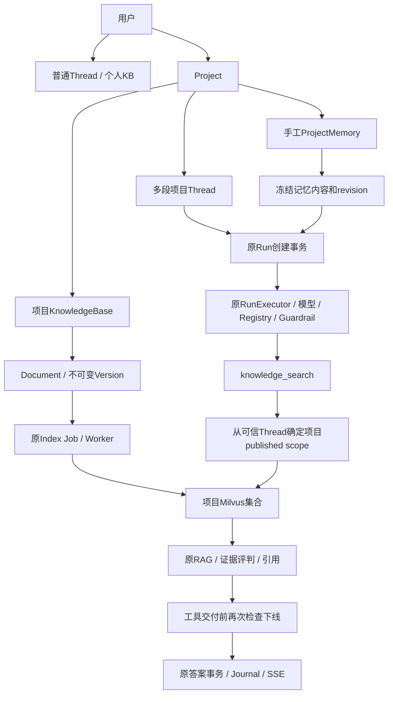

# 第九章：扩展能力与交付

当前学习进度、选择与编码授权只见[交接文档](../AGENT_HANDOFF.md#当前检查点)。

## 开章计划

计划日期：2026-11-18。用户在第八章结章后“继续”，本轮开展第九章设计讨论，不视为整章或首包编码授权。

### 目标与已有基础

在持久Run、正式工具入口、知识计算和受控评测之上，组织可选择的任务能力，增加明确授权的外部工具，最后整理独立进程与交付方式。
本章重点讲模块关系与选择原因；认证/CRUD/UI常规工程集中推进，不再默认使用简单异常判断题。

实际MiniMew已有：`execution/tools.py`的ToolRegistry/ToolContext与执行检查，RunExecutor的工具循环，`model_control.py`的Profile/冻结快照，以及既有API、Index Worker、Evaluation Worker。
本轮源码目录核对未发现MiniMew正式Skill、Web Research、SQL Assistant或Sandbox实现，不能把上级SuperMew已有模块计作MiniMew完成。

### 子项安排

| 子项 | 内容与目标 | 关键实现/依赖 |
| --- | --- | --- |
| 9.1 | Project与文档作用域、文档删除生命周期 | 区分普通Thread/项目Thread；项目知识库归属；删除下线、构建/发布竞态与异步回收 |
| 9.2 | 项目独立记忆 | 区分Thread历史与跨Thread项目记忆，明确写入方式、来源/版本、读取预算与失效 |
| 9.3 | Agent/ReAct执行过程可视化 | Run→模型回合→ToolCall→检索/重排等子步骤；公开有序事件、SSE重放、前端过程面板 |
| 9.4 | 内置版本化Skill与能力运行时（原9.1） | 保留已选内置包方案；复用Registry/Guardrail/Run冻结，纳入项目上下文 |
| 9.5 | 模型与能力控制面、必要UI（原9.2） | 明确个人/维护者权限及配置归属；变更只影响后续工作 |
| 9.6 | Web Research与来源引用（原9.3） | Tavily Search/Extract、同Run Source ID；接入9.3过程事件 |
| 9.7 | 只读SQL（原9.4） | SQLGlot AST、独立只读账号、allowlist/预算；接入同一过程面板 |
| 9.8 | Sandbox（原9.5） | 固定Docker镜像/资源/文件/网络边界，先Guardrail再隔离 |
| 9.9 | 运行与交付、集中验收/结章（原9.6） | 三进程/共享设施/迁移/健康检查、真实基础设施检查与文档框架 |

2026-11-18因用户新增项目、删除与过程可视化需求重排。第九章尚未编码，因此采用清晰的连续编号；此前9.1内置Skill选择继续有效，改称9.4，后文原9.1建议作为历史设计保留，不误用旧编号开始实现。
建议9.1–9.2组成项目与记忆工作包，9.3单独提供公共过程事件，再按新编号扩展Skill/工具。具体范围、记忆/删除政策待讨论；当前不授予任一包编码权限。
新依赖只在对应包开始时核验官方接口与版本并由uv/npm锁定；技术选型以具体包决定为准。

### 模块关系与数据流

规划链路：

```text
用户选择任务能力/Skill
  → 服务端核验该账号可使用的版本与配置
  → 创建Run时冻结Skill/模型/能力摘要及私有session
  → Skill提供任务指引与有限可见工具
  → 模型发起ToolCall
  → ToolRegistry识别与严格参数校验
  → Guardrail检查本次执行资格
  → knowledge / web / sql / sandbox 的正式handler
  → 受限结果与来源回到同Run
  → 沿用答案校验、Journal、持久终态和SSE投影
```

上图是本章规划，不代表Skill或新handler已实现。资源读取与工具执行均须检查获准范围，manifest或提示文本不能自行授予权限。
Skill可以类比“带任务指引和工具清单的业务功能包”；LangGraph仍负责执行步骤与条件路由，Provider仍负责模型请求，Registry仍负责识别工具，Guardrail仍负责是否允许执行。
本章不会默认让Evaluation Case获得外部网络、SQL或Sandbox能力；扩展评测执行范围须单独列出，保持已交付RAG评测的事实与可比性边界。

### 第一个关键选择：Skill从哪里来

先建议**项目内置、版本化Skill**。例如“知识问答”包只组织已存在的knowledge_search与任务指引，再增加需要新工具的包。这样能先理解加载、工具披露、版本固定和执行权限，不需要同时实现上传包、校验/发布和内容来源管理。
另一方案是**网页上传自定义Skill包**，会额外引入包格式、路径/资源校验、发布归属、不可变版本与生命周期，须扩大首包范围。
这是待用户选择的产品范围，当前没有预填答案，也没有编码开始授权。

### 控制面需要单独讲清的事实

当前model_control.py是服务端模型控制逻辑。新增网页入口前要明确配置是个人所有还是受限维护者管理，不能将可信CLI的操作权限直接给所有登录用户。
已创建工作固定配置；新工具/Skill是否启用、哪些工具对模型可见、一次调用是否获准，属于不同层，不能用一个前端开关代替全部判断。

### 不变量与验证策略

- 正式执行继续沿Run/Journal/Checkpoint；不复制Agent循环、知识图或另造平行工具入口。
- Skill/session、工具资格、来源与预算属于本次执行；不能使用模块级“当前Skill”或共享可变上下文。
- 模型/Skill版本变更不改变已开始/暂停的工作；Secret不进入公开配置、Run/Event或浏览器状态。
- Web调用、SQL、Sandbox各包实施前明确真实访问对象、费用/资源预算与必要验收；规划不授权联网调用、下载模型、拉取镜像或执行外部查询。
- 以定向离线测试验证协议与隔离；状态/权限/迁移变化增加对应PG检查，工具实际集成使用显式受控资源；UI变化按消费链选择类型/浏览器验证。

本轮仅文档与源码只读核对，未运行模型、业务测试、迁移或部署。发现用户已有`evidence.py`和IDE修改，保留且不纳入本轮计划变更。

## 结章文字总结与实际代码框架

待本章实际完成后填写。不以此计划预填能力交付、测试通过或用户已完全掌握。

## 9.1内置Skill方案与首包建议（2026-11-18，待开始）

用户已选择“项目内置、版本化Skill”，不再询问上传/内置。当前只确认选择与设计，尚未取得9.1编码开始反馈。

### 一个Skill包含什么

- **manifest**：稳定ID、版本、说明、允许披露的工具名和资源ID目录。它描述包内容，不自行授予账号权限。
- **任务指引**：告诉模型如何处理这类任务；不能覆盖固定答案契约、Guardrail或来源要求。
- **只读资源**：例如引用规范或任务步骤，按明确resource_id读取。若通过工具读取，handler只在本次选定包的允许目录内解析，不能把任意路径交给模型。
- **内容摘要**：覆盖manifest、指引与资源内容，用于识别同版本内容被原地修改；不是权限令牌或答案质量证明。

知识问答示例：指引要求基于检索材料回答，披露现有knowledge_search，并提供引用规范资源。通用对话示例不披露知识工具。
它们共用原RunExecutor；Skill不再实现Agent循环或复制LangGraph。

### 接入已有模块

服务端读取/验证内置包 → 用户请求选择Skill → 创建Run时验证可用性并冻结选定内容/身份 → 每Run构造私有Skill session → 生成任务指引及工具可见集合 → 原ToolRegistry/Guardrail/handler → 原答案/Journal/终态链。
可见工具是Skill清单与服务端实际许可的交集；模型即使请求清单外工具，也不能绕过执行前检查。包资源读取同样经过正式工具入口和权限核验。
固定版本不能只保存字符串再在恢复时读“当前同名包”；需要在实现前结合现有Run/Checkpoint核对冻结内容、摘要与恢复方式。
旧Run/默认Skill处理通过明确迁移与协议完成，保留现有聊天/HITL语义，不用隐藏fallback或额外执行路径掩盖状态差异。

### 建议首包覆盖范围

1. 内置Skill类型、目录、加载/校验/摘要与受限资源读取，先用已有对话/知识能力示范。
2. 选定Skill在Run中的冻结及私有session、默认选择、旧数据迁移和同Run恢复接线；必要Contract/OpenAPI/生成消费者一起同步。
3. 复用Registry、Guardrail与工具循环，实现有限工具披露与资源读取；不授予新的网络、数据库或宿主命令能力。
4. 提供最小目录/选择接口供API使用；完整管理与选择UI留9.2。既有评测Case不默认启用这些新能力。
5. 集中验证不同Run的Skill隔离、摘要/资源边界、现有聊天/知识/HITL恢复、所需PG迁移与契约；更新源码导航并按9.1提交推送。

沿用Pydantic、现有存储/工具/模型入口和Python文件读取；内置包具体manifest格式及体积限制在实际源码接线时确定，不新增一个Agent框架。
当前不安装新依赖、不运行收费模型，不编写9.1应用代码。完整模型与能力控制面、Web/SQL/Sandbox及部署不在本首包范围。


## 新增项目、删除与过程可视化设计讨论（2026-11-18）

用户要求：(1)新建项目不同于新建对话，项目有独立文档/记忆，非项目对话保持现模式；(2)普通与项目文档支持删除；(3)等待过程中展示实际关键词、文档和可能的ReAct步骤。本轮讨论可行性/技术关键并重排计划，不实施。
“react”先按ReAct推理—行动循环理解；前端仍为Vue，React UI框架不是本功能的必要技术。

### 项目作用域

规划为User拥有普通Thread/个人知识库，以及多个Project；每Project拥有多Thread、项目知识库与项目记忆。Thread.project_id可为空，普通模式继续当前个人范围。
当前实际Thread只按user_id归属，KnowledgeBase对user_id唯一，published_scope只接user_id；不能仅加前端项目标签。需要关系/约束迁移、项目授权、可信上下文、工具范围和向量索引接线。
每次请求校验用户及项目归属，项目Run不得把个人/其他项目资料静默混入。首版按逻辑隔离设计，不为每个项目建立整套PG服务；检索统计独立时需项目索引namespace/collection，不仅依赖metadata过滤。

### 独立记忆

Thread消息/Checkpoint不等于跨对话项目记忆。建议记忆存PG，记录项目、条目内容、类型、来源、版本/更新时间、启用/失效；创建Run时固定本轮采用的版本和预算。
项目记忆首版可以是可编辑的目标/约束/偏好/已确认结论，不必立即增加向量记忆库。自动提取时应有候选、来源与冲突/修订规则，避免将模型错误直接变成长期事实。
不将其他Thread整份原始聊天自动塞入本轮。与删除文档有关的派生记忆须追踪来源并失效/重建，用户独立写入的偏好不随意删除。
待选择：首版显式保存/可编辑，还是首版就自动提取并确认。

### 文档删除

当前有退休索引的IndexCleanupJob，但源码注明不删除源文件；没有据此认定用户删除API已完成。建议同一生命周期覆盖个人/项目资料：授权后事务下线、禁止新检索、标记构建/发布不可复活，再由持久清理任务精确回收向量及符合保留政策的原文。
PG与Milvus/文件删除不能靠一个数据库事务一起回滚；必须有持久待办、重试和可查询结果，不能仅删除界面列表。
需要明确在途Run/固定检索范围、历史引用与评测专属副本的政策。删除原文档不等于自动擦除既有引用文本、评测Corpus副本或派生记忆，不能把下线宣传为全量擦除。
待选择：默认下线且保留历史引用供追溯，还是完整擦除流程（覆盖原文/索引/引用/评测副本/派生记忆，并说明历史不可再读）。

### 过程可视化

实际RunExecutor目前tool.started/tool.completed仅提供tool_call_id/tool_name，失败附error_code，不能据此显示完整内部检索过程。已有算法trace不能直接当可恢复的公开Journal。
规划公开事件提供阶段ID/父ToolCall ID、明确状态与有界安全摘要，如query/重写query、检索模式、已返回的文档/Version与片段数量、重排/证据评判摘要、用时/失败。版本化schema及Python/TS/reducer同步，沿原Journal/Outbox/SSE链保存和重放。
“正在检索关键词”来自实际已开始的查询；“从A/B找到材料”必须等真实命中后展示，不能把候选范围伪装成正在逐个读取所有文档。
ReAct可展示公开行动说明、真实ToolCall、工具观察摘要及下一步，LangGraph内部路由也可展示为执行阶段；不提供原始隐私思维链、不把内部推理文本自动公开。前端过程面板属于Run投影，不把每一步都建成Message，也不自称终态。
9.3先接现有知识检索，后续Web/SQL/Sandbox复用同一事件骨架；参数与原始输出不全量公开，遵守当前用户/项目可见范围。

本轮只修改计划/交接，不运行测试、迁移、真实删除或外部服务；现有evidence.py和IDE修改保留。用户尚未对记忆/删除政策作选择，不预填理解通过或实施授权。

## 项目与记忆首包：政策确认及具体范围（2026-11-18，待开始）

用户已明确选择：项目记忆由用户显式保存；文档默认下线并保留历史追溯。不再重问这两项，不将选择视为编码授权。

建议将新9.1–9.2组成项目与记忆工作包，沿现有Vue/PG/Run/RAG连续接通：

1. Project创建/列表/选择与项目内Thread；非项目Thread保留当前个人模式，已有对话/文档不自动搬入项目。
2. 项目独立知识库与文档上传/发布/检索范围，后端同时核验用户与项目归属；关系约束、默认个人KB迁移和索引统计隔离一并设计验证。
3. 个人/项目文档共用下线接口。提交后新发起的检索不提供该文档，在途检索接收结果时核验下线状态；已经交付给模型的Evidence不从历史中撤回。冻结版本只限制可用来源，不绕过文档撤销，也不自动替换新版本。
4. 下线阻止旧构建/发布者复活文档；检索向量按在途使用/保留范围安全回收。原Version与历史引用保留，并在查看时标识已下线；不是物理擦除，不连带删除独立评测Corpus。首次下线不额外提供恢复/项目整库删除或自动清空历史功能。
5. 项目记忆支持用户新增、查看、修改、停用/删除。可提供“保存为项目记忆”草稿入口，但由用户确认最终内容；不自动提取，不新增记忆生成模型调用。
6. 记忆跨同项目Thread读取，不跨项目/个人范围；条目有版本与来源，创建Run时固定采用的条目/版本及明确预算。之后修改影响后续Run，不重新绑定进行中执行。用户手工记忆不因文档下线被自动擦掉，关联来源需如实标记。
7. 交付项目/文档/记忆必要API、迁移、生成类型和UI；验证跨项目/账号隔离、普通模式回归、下线/构建/检索竞态、历史引用、记忆版本与上下文预算，以及浏览器代表性流程。

本包仍不包括9.3过程面板、9.4Skill应用编码、Web/SQL/Sandbox、项目删除、完整擦除或生产部署。内置版本化Skill的选择继续保留。
具体数据模型和迁移在开始实现前结合现有代码核对，不通过平行执行入口、客户端权限或隐式fallback实现隔离。按9.1/9.2实际可审阅边界组织提交，若必须合并则按仓库规则另说明。
当前仅写方案/交接并检查diff，无应用编码、业务测试、数据下线或真实删除；待明确“开始项目与记忆工作包（9.1–9.2）”。

## 项目与记忆工作包实施记录（2026-11-18）

用户随后明确“开始项目与记忆工作包”，授权新9.1–9.2连续实施。以上“待开始”段落是当时的设计记录，不是当前门槛。本记录只总结本包，第九章尚未结章；当前交付/待办见handoff，不据此启动9.3或Skill。

### 实现与选型

沿用Vue/Pinia、FastAPI/Pydantic、SQLAlchemy/PostgreSQL、Milvus和原Run执行链，无新增依赖、Agent框架或记忆生成模型。新增的是业务对象及作用域，不是新服务进程。

| 对象/模块 | 本包职责 | 选择原因 |
| --- | --- | --- |
| Project | 用户拥有的工作空间，关联多段Thread与一个项目KB | 跨对话共享资料需要独立归属，Thread仍只管理一段聊天 |
| ProjectMemory | 手工内容、revision、enabled、deleted_at | 这批少量目标/约束用PG精确读取和编辑；无需另建向量记忆库 |
| Thread.project_id | 可为空；普通Thread保持个人范围 | 新功能不自动搬迁已有对话 |
| KnowledgeBase.project_id | 一个个人KB/用户、一个KB/项目；复合外键核验owner | 数据库约束和服务端权限协作，客户端项目ID不是授权 |
| Milvus项目namespace | 每项目独立Dense/Hybrid集合；个人保持原集合 | 除召回过滤外，也隔离BM25文档频率统计 |
| Run.memory_snapshot | 新Run冻结启用条目的ID/revision/content | 编辑记忆只影响后续Run；幂等重试仍返回原Run和快照 |
| Document.deleted_at | 下线事实；推进publication_fence并取消候选任务 | 不把删列表等同于撤销检索/阻止旧Worker发布 |

Document的project_id是从所属KB计算出的公开投影，不额外持久化另一份项目归属。记忆来源明确为用户手工输入，没有自动提取或文档派生记忆协议。

### 关系与完整请求



1. 网页选择项目，创建Thread时发送project_id；API验证用户拥有项目，数据库复合FK防止归属混用。普通Thread不带项目。
2. 提问仍调用原Run入口。在同一创建事务中锁Thread、固定模型配置与手工记忆；每条最多500字符、最多20条启用，序列化快照最多12000字符。项目锁将记忆写入与Run取快照串行化。
3. Executor读取Run的快照，作为明确标注的用户上下文接在当前问题之前。它不是新的system权限，也不登记为Evidence；现有历史上下文与总字符预算继续有效。标题、Message、幂等和终态不另建路径。
4. 模型若请求knowledge_search，仍先走Registry和Guardrail。服务端从当前Run的可信Thread查所属项目，再冻结此scope；模型不能选择另一个账号或项目来搜索。
5. Index Worker上传发布和RAG读取使用同一服务端namespace。namespace view共享客户端连接，但不修改全局“当前集合”；scope仍固定版本/manifest，新增文档不会偷偷加入已取得的scope。
6. 检索前/向量返回后检查下线；耗时重排、证据评判或HITL恢复后，在知识工具交付点再查一次。若候选在交付前撤销，则报KNOWLEDGE_SCOPE_INVALID，不把撤销材料交给模型，也不提交本次候选Evidence。已经交付的材料与历史回答不追溯撤回。
7. 答案、Message、Journal与SSE继续使用原生命周期。评测Case读取其专属冻结副本，不把原文档下线解释为删除评测记录。

### 下线生命周期

DELETE文档入口先查owner并锁Document；同事务设置deleted_at、推进publication_fence、清除pending指针，取消pending/running/staged候选及登记IndexCleanupJob。旧owner即使仍在本地编码，也不能用旧fence发布；不清空终态Job的旧owner字段来绕过已有数据库guard。

新scope排除下线文档。向量产物退休后按现有持久清理流程延后1小时回收，scope有效期55分钟；源文件、Version、AnswerRecord与引用片段保留。历史回答读取时只增加当前withdrawn_document_ids投影，不重写旧Evidence。点击引用可重读状态。已下线文档不能再上传新版本，也没有本包“恢复”按钮。

### 实际代码框架

| 文件 | 做什么 / 谁调用 |
| --- | --- |
| [models.py](../src/minimew/models.py)、[0019](../migrations/versions/0019_projects_memories.py) | 领域关系、复合归属约束、个人/项目KB部分唯一索引和升级；旧Thread/KB的project_id为空，旧Run快照为[] |
| [projects.py](../src/minimew/projects.py) | 项目/记忆API、owner验证、revision冲突、项目锁和记忆预算；conversations调用memory_snapshot |
| [api/threads.py](../src/minimew/api/threads.py) | 同一Thread入口接入项目创建/筛选，不开第二套项目聊天API |
| [conversations.py](../src/minimew/conversations.py)、[execution/repository.py](../src/minimew/execution/repository.py) | 创建时冻结记忆，执行时读取旧快照并构造输入 |
| [api/documents.py](../src/minimew/api/documents.py)、[documents/catalog.py](../src/minimew/documents/catalog.py) | 个人/项目同一上传/查询/下线生命周期，归属从KB取得 |
| [documents/worker.py](../src/minimew/documents/worker.py)、[vector_store/milvus.py](../src/minimew/vector_store/milvus.py) | 构建/清理使用项目集合；集合视图不共享可变作用域，未知layout拒绝 |
| [documents/retrieval.py](../src/minimew/documents/retrieval.py)、[knowledge.py](../src/minimew/knowledge.py)、[rag/pipeline.py](../src/minimew/rag/pipeline.py) | trusted Thread→scope→原RAG；回读/交付下线检查，原策略不复制 |
| [evaluation/corpus.py](../src/minimew/evaluation/corpus.py) | 新评测语料从对应个人/项目集合复制；既有专属副本与历史保留 |
| [answers.py](../src/minimew/answers.py) | 保存答案不变，查询投影增加当前下线ID |
| [ProjectsView.vue](../frontend/src/views/ProjectsView.vue)、[stores/projects.ts](../frontend/src/stores/projects.ts) | 项目列表/详情、手工记忆编辑；账号/选择切换丢弃迟到响应。单项保存/新增/删除不清掉其他未保存草稿 |
| [ThreadsView.vue](../frontend/src/views/ThreadsView.vue)、[DocumentsView.vue](../frontend/src/views/DocumentsView.vue)及对应store | 项目query进入原页面；普通入口复原个人范围；上传重试意图不跨项目复用 |
| [AnswerBody.vue](../frontend/src/components/AnswerBody.vue)、[ChatPanel.vue](../frontend/src/components/ChatPanel.vue) | 引用可读、下线标记和打开来源时刷新状态 |
| [export_frontend_contract.py](../scripts/export_frontend_contract.py)、OpenAPI/生成TS | 从正式路由生成两端协议；Run Event schema未新增类型 |

### 验证记录与边界

隔离库通过项目/账号越权、个人/项目列表、记忆revision/预算/Run冻结及实际Provider输入、下线fence、向量返回中下线与工具交付前下线；已有知识和HITL定向用例复验。0018→0019验证旧个人Thread保持、Alembic metadata一致与空项目降级/再升级；有项目或已下线资料时降级拒绝，避免丢失语义。

实际命令与分项结果继续在下方验收补记；重复执行不累计为新增用例。模型/API费用0，原文档内容与引用只在自有测试范围创建/下线。开发库没有自动升级，未启动消费其旧任务的常驻Worker；未重启用户API，不声称用户浏览器已运行新版。0019需在后续启用时显式迁移。

已完成的浏览器链路使用真实PG/API、独立Index Worker、CPU轻量Embedding、Milvus和受控生成/评判：两个项目与个人三份文档分别发布；项目记忆进入模型输入、检索不串项目；下线后新问答无文档、旧引用仍可读并标记；刷新恢复已保存记忆；桌面1280/移动390无横向溢出。新增双条目草稿保留场景另作复验，具体最终状态见下方补记。

未执行收费DeepSeek语义质量评测、GPU/M3、全仓/生产门禁或部署。9.3过程面板、9.4Skill等未编码。用户未反馈本包架构已完全掌握，不预填理解结论。

### 最终验收补记

| 实际执行 | 结果/口径 |
| --- | --- |
| pytest test_knowledge.py / test_rag.py / test_reasoning_graph.py / test_hitl.py | 45通过，最终交付检查接入后复验 |
| pytest test_vector_store.py + tests/evaluation | 112通过，包括新增namespace布局拒绝；无模型/网络 |
| check_runtime.py test_documents_pg.py / test_runs_pg.py | 31通过，真实临时PG，已有普通上传/Run回归 |
| check_runtime.py test_projects_pg.py / test_knowledge_pg.py / test_hitl_pg.py | 29通过、1个新增fixture缺reranker失败；补齐Dense受控runtime后该专项1通过，未删断言。此处是30个用例的覆盖，不将重复结果相加 |
| check_runtime.py test_evaluation_runtime_pg.py / test_evaluation_workbench_pg.py | 11通过，受控依赖；Case副本/工作台原流程 |
| check_runtime.py test_projects_migration.py + memory_is_explicit_versioned_and_frozen_per_run | 最终2通过；0018升级、metadata/降级保护、快照数据库改写拒绝和真实ProviderRequest旧内容 |
| npm test 定向projects/documents/threads/chat/answers | 最终52通过；早期164全前端通过在追加修复前，不冒充最终全量结果 |
| npm run build | 最终类型检查与生产构建通过 |
| Prettier变更文件检查 / Ruff check、format --check | 通过；全前端format:check另报告11个未改旧文件，未扩大格式化 |
| OpenAPI导出 + npm run contracts | 从路由真源生成OpenAPI和TS；另核对语义漂移，不以导出前后Prettier字节差异误判schema变化 |
| generate_event_contract.py --check / generate_evaluation_schema.py --check | 均通过；本包没有新增Event或评测schema |
| MINIMEW_PROJECT_BROWSER_TESTS=1 check_documents_frontend.py | 最终1通过(19.0s)，三份文档/三个Job真实发布，双条目草稿保留与刷新通过；收费0。此前重复浏览器通过不另算新增用例 |

本地最终报告：`.artifacts/document-browser-fcd342417f584fa688f8b6fd0a95385b/report.json`；截图为`.impeccable/review/desktop.png`(1280宽)、`mobile.png`(390宽)，是测试证据，不随Git传设备。临时PG、源数据、受控进程与本次索引清理完成；曾发现本次空Hybrid集合残留，按精确名称/创建时间/零行核对后清理4个，并修正layout常量及未知layout拒绝测试，不清用户集合。新场景首次浏览器失败源于重复dialog处理器，去掉重复监听后通过，功能断言保留。

界面复核修复“保存一条导致其他记忆未保存草稿丢失”，现仅替换目标行并保留其他revision未变的草稿。独立评审最终`disposition: ship`只覆盖该唯一修复项；检测器对ProjectsView无确定性问题。输入框对齐现有控件，未新增忽略规则，既有字体/全局文档状态不在本包重设计范围。

界面文档复核检查PRODUCT、surface brief及实际Vue/CSS，结论No changes：沿用既有系统，不新建全局DESIGN来掩盖历史文档缺口。OpenAPI最终按解析后的语义比较导出一致，生成TS已通过正式contracts脚本同步。

9.1–9.2共享迁移、归属与记忆冻结事务及页面，不适合拆出未经验证的中间提交；本包验收后用户已明确选择“合并提交并推送”。按已核对个人仓库personal/main交付，只纳入本包，保留IDE/evidence.py未提交修改；实际提交和推送结果见本轮回复及Git记录。
