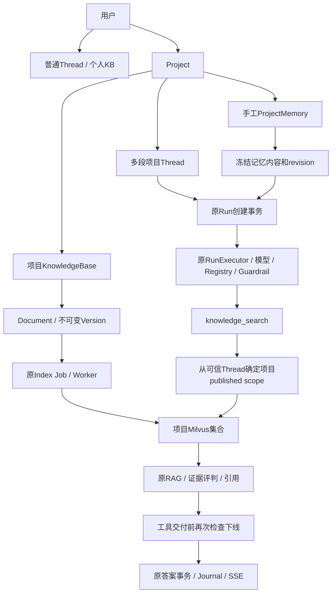

# 第九章：扩展能力与交付

当前学习进度、选择与编码授权只见[交接文档](../AGENT_HANDOFF.md#当前检查点)。

## 开章计划

计划日期：2026-11-18。用户在第八章结章后“继续”，本轮开展第九章设计讨论，不视为整章或首包编码授权。

### 目标与已有基础

在持久Run、正式工具入口、知识计算和受控评测之上，组织可选择的任务能力，增加明确授权的外部工具，最后整理独立进程与交付方式。
本章重点讲模块关系与选择原因；认证/CRUD/UI常规工程集中推进，不再默认使用简单异常判断题。

实际MiniMew已有：`execution/tools.py`的ToolRegistry/ToolContext与执行检查，RunExecutor的工具循环，`model_control.py`的Profile/冻结快照，以及既有API、Index Worker、Evaluation Worker。
本轮源码目录核对未发现MiniMew正式Skill、Web Research、SQL Assistant或Sandbox实现，不能把上级SuperMew已有模块计作MiniMew完成。

### 子项安排

| 子项 | 内容与目标 | 关键实现/依赖 |
| --- | --- | --- |
| 9.1 | Project与文档作用域、文档删除生命周期 | 区分普通Thread/项目Thread；项目知识库归属；删除下线、构建/发布竞态与异步回收 |
| 9.2 | 项目独立记忆 | 区分Thread历史与跨Thread项目记忆，明确写入方式、来源/版本、读取预算与失效 |
| 9.3 | Agent/ReAct执行过程可视化 | Run→模型回合→ToolCall→检索/重排等子步骤；公开有序事件、SSE重放、前端过程面板 |
| 9.4 | 内置版本化Skill与能力运行时（原9.1） | 保留已选内置包方案；复用Registry/Guardrail/Run冻结，纳入项目上下文 |
| 9.5 | 模型与能力控制面、必要UI（原9.2） | 明确个人/维护者权限及配置归属；变更只影响后续工作 |
| 9.6 | Web Research与来源引用（原9.3） | Tavily Search/Extract、同Run Source ID；接入9.3过程事件 |
| 9.7 | 只读SQL（原9.4） | SQLGlot AST、独立只读账号、allowlist/预算；接入同一过程面板 |
| 9.8 | Sandbox（原9.5） | 固定Docker镜像/资源/文件/网络边界，先Guardrail再隔离 |
| 9.9 | 运行与交付、集中验收/结章（原9.6） | 三进程/共享设施/迁移/健康检查、真实基础设施检查与文档框架 |

2026-11-18因用户新增项目、删除与过程可视化需求重排。第九章尚未编码，因此采用清晰的连续编号；此前9.1内置Skill选择继续有效，改称9.4，后文原9.1建议作为历史设计保留，不误用旧编号开始实现。
建议9.1–9.2组成项目与记忆工作包，9.3单独提供公共过程事件，再按新编号扩展Skill/工具。具体范围、记忆/删除政策待讨论；当前不授予任一包编码权限。
新依赖只在对应包开始时核验官方接口与版本并由uv/npm锁定；技术选型以具体包决定为准。

### 模块关系与数据流

规划链路：

```text
用户选择任务能力/Skill
  → 服务端核验该账号可使用的版本与配置
  → 创建Run时冻结Skill/模型/能力摘要及私有session
  → Skill提供任务指引与有限可见工具
  → 模型发起ToolCall
  → ToolRegistry识别与严格参数校验
  → Guardrail检查本次执行资格
  → knowledge / web / sql / sandbox 的正式handler
  → 受限结果与来源回到同Run
  → 沿用答案校验、Journal、持久终态和SSE投影
```

上图是本章规划，不代表Skill或新handler已实现。资源读取与工具执行均须检查获准范围，manifest或提示文本不能自行授予权限。
Skill可以类比“带任务指引和工具清单的业务功能包”；LangGraph仍负责执行步骤与条件路由，Provider仍负责模型请求，Registry仍负责识别工具，Guardrail仍负责是否允许执行。
本章不会默认让Evaluation Case获得外部网络、SQL或Sandbox能力；扩展评测执行范围须单独列出，保持已交付RAG评测的事实与可比性边界。

### 第一个关键选择：Skill从哪里来

先建议**项目内置、版本化Skill**。例如“知识问答”包只组织已存在的knowledge_search与任务指引，再增加需要新工具的包。这样能先理解加载、工具披露、版本固定和执行权限，不需要同时实现上传包、校验/发布和内容来源管理。
另一方案是**网页上传自定义Skill包**，会额外引入包格式、路径/资源校验、发布归属、不可变版本与生命周期，须扩大首包范围。
这是待用户选择的产品范围，当前没有预填答案，也没有编码开始授权。

### 控制面需要单独讲清的事实

当前model_control.py是服务端模型控制逻辑。新增网页入口前要明确配置是个人所有还是受限维护者管理，不能将可信CLI的操作权限直接给所有登录用户。
已创建工作固定配置；新工具/Skill是否启用、哪些工具对模型可见、一次调用是否获准，属于不同层，不能用一个前端开关代替全部判断。

### 不变量与验证策略

- 正式执行继续沿Run/Journal/Checkpoint；不复制Agent循环、知识图或另造平行工具入口。
- Skill/session、工具资格、来源与预算属于本次执行；不能使用模块级“当前Skill”或共享可变上下文。
- 模型/Skill版本变更不改变已开始/暂停的工作；Secret不进入公开配置、Run/Event或浏览器状态。
- Web调用、SQL、Sandbox各包实施前明确真实访问对象、费用/资源预算与必要验收；规划不授权联网调用、下载模型、拉取镜像或执行外部查询。
- 以定向离线测试验证协议与隔离；状态/权限/迁移变化增加对应PG检查，工具实际集成使用显式受控资源；UI变化按消费链选择类型/浏览器验证。

本轮仅文档与源码只读核对，未运行模型、业务测试、迁移或部署。发现用户已有`evidence.py`和IDE修改，保留且不纳入本轮计划变更。

## 结章文字总结与实际代码框架

待本章实际完成后填写。不以此计划预填能力交付、测试通过或用户已完全掌握。

## 9.1内置Skill方案与首包建议（2026-11-18，待开始）

用户已选择“项目内置、版本化Skill”，不再询问上传/内置。当前只确认选择与设计，尚未取得9.1编码开始反馈。

### 一个Skill包含什么

- **manifest**：稳定ID、版本、说明、允许披露的工具名和资源ID目录。它描述包内容，不自行授予账号权限。
- **任务指引**：告诉模型如何处理这类任务；不能覆盖固定答案契约、Guardrail或来源要求。
- **只读资源**：例如引用规范或任务步骤，按明确resource_id读取。若通过工具读取，handler只在本次选定包的允许目录内解析，不能把任意路径交给模型。
- **内容摘要**：覆盖manifest、指引与资源内容，用于识别同版本内容被原地修改；不是权限令牌或答案质量证明。

知识问答示例：指引要求基于检索材料回答，披露现有knowledge_search，并提供引用规范资源。通用对话示例不披露知识工具。
它们共用原RunExecutor；Skill不再实现Agent循环或复制LangGraph。

### 接入已有模块

服务端读取/验证内置包 → 用户请求选择Skill → 创建Run时验证可用性并冻结选定内容/身份 → 每Run构造私有Skill session → 生成任务指引及工具可见集合 → 原ToolRegistry/Guardrail/handler → 原答案/Journal/终态链。
可见工具是Skill清单与服务端实际许可的交集；模型即使请求清单外工具，也不能绕过执行前检查。包资源读取同样经过正式工具入口和权限核验。
固定版本不能只保存字符串再在恢复时读“当前同名包”；需要在实现前结合现有Run/Checkpoint核对冻结内容、摘要与恢复方式。
旧Run/默认Skill处理通过明确迁移与协议完成，保留现有聊天/HITL语义，不用隐藏fallback或额外执行路径掩盖状态差异。

### 建议首包覆盖范围

1. 内置Skill类型、目录、加载/校验/摘要与受限资源读取，先用已有对话/知识能力示范。
2. 选定Skill在Run中的冻结及私有session、默认选择、旧数据迁移和同Run恢复接线；必要Contract/OpenAPI/生成消费者一起同步。
3. 复用Registry、Guardrail与工具循环，实现有限工具披露与资源读取；不授予新的网络、数据库或宿主命令能力。
4. 提供最小目录/选择接口供API使用；完整管理与选择UI留9.2。既有评测Case不默认启用这些新能力。
5. 集中验证不同Run的Skill隔离、摘要/资源边界、现有聊天/知识/HITL恢复、所需PG迁移与契约；更新源码导航并按9.1提交推送。

沿用Pydantic、现有存储/工具/模型入口和Python文件读取；内置包具体manifest格式及体积限制在实际源码接线时确定，不新增一个Agent框架。
当前不安装新依赖、不运行收费模型，不编写9.1应用代码。完整模型与能力控制面、Web/SQL/Sandbox及部署不在本首包范围。


## 新增项目、删除与过程可视化设计讨论（2026-11-18）

用户要求：(1)新建项目不同于新建对话，项目有独立文档/记忆，非项目对话保持现模式；(2)普通与项目文档支持删除；(3)等待过程中展示实际关键词、文档和可能的ReAct步骤。本轮讨论可行性/技术关键并重排计划，不实施。
“react”先按ReAct推理—行动循环理解；前端仍为Vue，React UI框架不是本功能的必要技术。

### 项目作用域

规划为User拥有普通Thread/个人知识库，以及多个Project；每Project拥有多Thread、项目知识库与项目记忆。Thread.project_id可为空，普通模式继续当前个人范围。
当前实际Thread只按user_id归属，KnowledgeBase对user_id唯一，published_scope只接user_id；不能仅加前端项目标签。需要关系/约束迁移、项目授权、可信上下文、工具范围和向量索引接线。
每次请求校验用户及项目归属，项目Run不得把个人/其他项目资料静默混入。首版按逻辑隔离设计，不为每个项目建立整套PG服务；检索统计独立时需项目索引namespace/collection，不仅依赖metadata过滤。

### 独立记忆

Thread消息/Checkpoint不等于跨对话项目记忆。建议记忆存PG，记录项目、条目内容、类型、来源、版本/更新时间、启用/失效；创建Run时固定本轮采用的版本和预算。
项目记忆首版可以是可编辑的目标/约束/偏好/已确认结论，不必立即增加向量记忆库。自动提取时应有候选、来源与冲突/修订规则，避免将模型错误直接变成长期事实。
不将其他Thread整份原始聊天自动塞入本轮。与删除文档有关的派生记忆须追踪来源并失效/重建，用户独立写入的偏好不随意删除。
待选择：首版显式保存/可编辑，还是首版就自动提取并确认。

### 文档删除

当前有退休索引的IndexCleanupJob，但源码注明不删除源文件；没有据此认定用户删除API已完成。建议同一生命周期覆盖个人/项目资料：授权后事务下线、禁止新检索、标记构建/发布不可复活，再由持久清理任务精确回收向量及符合保留政策的原文。
PG与Milvus/文件删除不能靠一个数据库事务一起回滚；必须有持久待办、重试和可查询结果，不能仅删除界面列表。
需要明确在途Run/固定检索范围、历史引用与评测专属副本的政策。删除原文档不等于自动擦除既有引用文本、评测Corpus副本或派生记忆，不能把下线宣传为全量擦除。
待选择：默认下线且保留历史引用供追溯，还是完整擦除流程（覆盖原文/索引/引用/评测副本/派生记忆，并说明历史不可再读）。

### 过程可视化

实际RunExecutor目前tool.started/tool.completed仅提供tool_call_id/tool_name，失败附error_code，不能据此显示完整内部检索过程。已有算法trace不能直接当可恢复的公开Journal。
规划公开事件提供阶段ID/父ToolCall ID、明确状态与有界安全摘要，如query/重写query、检索模式、已返回的文档/Version与片段数量、重排/证据评判摘要、用时/失败。版本化schema及Python/TS/reducer同步，沿原Journal/Outbox/SSE链保存和重放。
“正在检索关键词”来自实际已开始的查询；“从A/B找到材料”必须等真实命中后展示，不能把候选范围伪装成正在逐个读取所有文档。
ReAct可展示公开行动说明、真实ToolCall、工具观察摘要及下一步，LangGraph内部路由也可展示为执行阶段；不提供原始隐私思维链、不把内部推理文本自动公开。前端过程面板属于Run投影，不把每一步都建成Message，也不自称终态。
9.3先接现有知识检索，后续Web/SQL/Sandbox复用同一事件骨架；参数与原始输出不全量公开，遵守当前用户/项目可见范围。

本轮只修改计划/交接，不运行测试、迁移、真实删除或外部服务；现有evidence.py和IDE修改保留。用户尚未对记忆/删除政策作选择，不预填理解通过或实施授权。

## 项目与记忆首包：政策确认及具体范围（2026-11-18，待开始）

用户已明确选择：项目记忆由用户显式保存；文档默认下线并保留历史追溯。不再重问这两项，不将选择视为编码授权。

建议将新9.1–9.2组成项目与记忆工作包，沿现有Vue/PG/Run/RAG连续接通：

1. Project创建/列表/选择与项目内Thread；非项目Thread保留当前个人模式，已有对话/文档不自动搬入项目。
2. 项目独立知识库与文档上传/发布/检索范围，后端同时核验用户与项目归属；关系约束、默认个人KB迁移和索引统计隔离一并设计验证。
3. 个人/项目文档共用下线接口。提交后新发起的检索不提供该文档，在途检索接收结果时核验下线状态；已经交付给模型的Evidence不从历史中撤回。冻结版本只限制可用来源，不绕过文档撤销，也不自动替换新版本。
4. 下线阻止旧构建/发布者复活文档；检索向量按在途使用/保留范围安全回收。原Version与历史引用保留，并在查看时标识已下线；不是物理擦除，不连带删除独立评测Corpus。首次下线不额外提供恢复/项目整库删除或自动清空历史功能。
5. 项目记忆支持用户新增、查看、修改、停用/删除。可提供“保存为项目记忆”草稿入口，但由用户确认最终内容；不自动提取，不新增记忆生成模型调用。
6. 记忆跨同项目Thread读取，不跨项目/个人范围；条目有版本与来源，创建Run时固定采用的条目/版本及明确预算。之后修改影响后续Run，不重新绑定进行中执行。用户手工记忆不因文档下线被自动擦掉，关联来源需如实标记。
7. 交付项目/文档/记忆必要API、迁移、生成类型和UI；验证跨项目/账号隔离、普通模式回归、下线/构建/检索竞态、历史引用、记忆版本与上下文预算，以及浏览器代表性流程。

本包仍不包括9.3过程面板、9.4Skill应用编码、Web/SQL/Sandbox、项目删除、完整擦除或生产部署。内置版本化Skill的选择继续保留。
具体数据模型和迁移在开始实现前结合现有代码核对，不通过平行执行入口、客户端权限或隐式fallback实现隔离。按9.1/9.2实际可审阅边界组织提交，若必须合并则按仓库规则另说明。
当前仅写方案/交接并检查diff，无应用编码、业务测试、数据下线或真实删除；待明确“开始项目与记忆工作包（9.1–9.2）”。

## 项目与记忆工作包实施记录（2026-11-18）

用户随后明确“开始项目与记忆工作包”，授权新9.1–9.2连续实施。以上“待开始”段落是当时的设计记录，不是当前门槛。本记录只总结本包，第九章尚未结章；当前交付/待办见handoff，不据此启动9.3或Skill。

### 实现与选型

沿用Vue/Pinia、FastAPI/Pydantic、SQLAlchemy/PostgreSQL、Milvus和原Run执行链，无新增依赖、Agent框架或记忆生成模型。新增的是业务对象及作用域，不是新服务进程。

| 对象/模块 | 本包职责 | 选择原因 |
| --- | --- | --- |
| Project | 用户拥有的工作空间，关联多段Thread与一个项目KB | 跨对话共享资料需要独立归属，Thread仍只管理一段聊天 |
| ProjectMemory | 手工内容、revision、enabled、deleted_at | 这批少量目标/约束用PG精确读取和编辑；无需另建向量记忆库 |
| Thread.project_id | 可为空；普通Thread保持个人范围 | 新功能不自动搬迁已有对话 |
| KnowledgeBase.project_id | 一个个人KB/用户、一个KB/项目；复合外键核验owner | 数据库约束和服务端权限协作，客户端项目ID不是授权 |
| Milvus项目namespace | 每项目独立Dense/Hybrid集合；个人保持原集合 | 除召回过滤外，也隔离BM25文档频率统计 |
| Run.memory_snapshot | 新Run冻结启用条目的ID/revision/content | 编辑记忆只影响后续Run；幂等重试仍返回原Run和快照 |
| Document.deleted_at | 下线事实；推进publication_fence并取消候选任务 | 不把删列表等同于撤销检索/阻止旧Worker发布 |

Document的project_id是从所属KB计算出的公开投影，不额外持久化另一份项目归属。记忆来源明确为用户手工输入，没有自动提取或文档派生记忆协议。

### 关系与完整请求



1. 网页选择项目，创建Thread时发送project_id；API验证用户拥有项目，数据库复合FK防止归属混用。普通Thread不带项目。
2. 提问仍调用原Run入口。在同一创建事务中锁Thread、固定模型配置与手工记忆；每条最多500字符、最多20条启用，序列化快照最多12000字符。项目锁将记忆写入与Run取快照串行化。
3. Executor读取Run的快照，作为明确标注的用户上下文接在当前问题之前。它不是新的system权限，也不登记为Evidence；现有历史上下文与总字符预算继续有效。标题、Message、幂等和终态不另建路径。
4. 模型若请求knowledge_search，仍先走Registry和Guardrail。服务端从当前Run的可信Thread查所属项目，再冻结此scope；模型不能选择另一个账号或项目来搜索。
5. Index Worker上传发布和RAG读取使用同一服务端namespace。namespace view共享客户端连接，但不修改全局“当前集合”；scope仍固定版本/manifest，新增文档不会偷偷加入已取得的scope。
6. 检索前/向量返回后检查下线；耗时重排、证据评判或HITL恢复后，在知识工具交付点再查一次。若候选在交付前撤销，则报KNOWLEDGE_SCOPE_INVALID，不把撤销材料交给模型，也不提交本次候选Evidence。已经交付的材料与历史回答不追溯撤回。
7. 答案、Message、Journal与SSE继续使用原生命周期。评测Case读取其专属冻结副本，不把原文档下线解释为删除评测记录。

### 下线生命周期

DELETE文档入口先查owner并锁Document；同事务设置deleted_at、推进publication_fence、清除pending指针，取消pending/running/staged候选及登记IndexCleanupJob。旧owner即使仍在本地编码，也不能用旧fence发布；不清空终态Job的旧owner字段来绕过已有数据库guard。

新scope排除下线文档。向量产物退休后按现有持久清理流程延后1小时回收，scope有效期55分钟；源文件、Version、AnswerRecord与引用片段保留。历史回答读取时只增加当前withdrawn_document_ids投影，不重写旧Evidence。点击引用可重读状态。已下线文档不能再上传新版本，也没有本包“恢复”按钮。

### 实际代码框架

| 文件 | 做什么 / 谁调用 |
| --- | --- |
| [models.py](../src/minimew/models.py)、[0019](../migrations/versions/0019_projects_memories.py) | 领域关系、复合归属约束、个人/项目KB部分唯一索引和升级；旧Thread/KB的project_id为空，旧Run快照为[] |
| [projects.py](../src/minimew/projects.py) | 项目/记忆API、owner验证、revision冲突、项目锁和记忆预算；conversations调用memory_snapshot |
| [api/threads.py](../src/minimew/api/threads.py) | 同一Thread入口接入项目创建/筛选，不开第二套项目聊天API |
| [conversations.py](../src/minimew/conversations.py)、[execution/repository.py](../src/minimew/execution/repository.py) | 创建时冻结记忆，执行时读取旧快照并构造输入 |
| [api/documents.py](../src/minimew/api/documents.py)、[documents/catalog.py](../src/minimew/documents/catalog.py) | 个人/项目同一上传/查询/下线生命周期，归属从KB取得 |
| [documents/worker.py](../src/minimew/documents/worker.py)、[vector_store/milvus.py](../src/minimew/vector_store/milvus.py) | 构建/清理使用项目集合；集合视图不共享可变作用域，未知layout拒绝 |
| [documents/retrieval.py](../src/minimew/documents/retrieval.py)、[knowledge.py](../src/minimew/knowledge.py)、[rag/pipeline.py](../src/minimew/rag/pipeline.py) | trusted Thread→scope→原RAG；回读/交付下线检查，原策略不复制 |
| [evaluation/corpus.py](../src/minimew/evaluation/corpus.py) | 新评测语料从对应个人/项目集合复制；既有专属副本与历史保留 |
| [answers.py](../src/minimew/answers.py) | 保存答案不变，查询投影增加当前下线ID |
| [ProjectsView.vue](../frontend/src/views/ProjectsView.vue)、[stores/projects.ts](../frontend/src/stores/projects.ts) | 项目列表/详情、手工记忆编辑；账号/选择切换丢弃迟到响应。单项保存/新增/删除不清掉其他未保存草稿 |
| [ThreadsView.vue](../frontend/src/views/ThreadsView.vue)、[DocumentsView.vue](../frontend/src/views/DocumentsView.vue)及对应store | 项目query进入原页面；普通入口复原个人范围；上传重试意图不跨项目复用 |
| [AnswerBody.vue](../frontend/src/components/AnswerBody.vue)、[ChatPanel.vue](../frontend/src/components/ChatPanel.vue) | 引用可读、下线标记和打开来源时刷新状态 |
| [export_frontend_contract.py](../scripts/export_frontend_contract.py)、OpenAPI/生成TS | 从正式路由生成两端协议；Run Event schema未新增类型 |

### 验证记录与边界

隔离库通过项目/账号越权、个人/项目列表、记忆revision/预算/Run冻结及实际Provider输入、下线fence、向量返回中下线与工具交付前下线；已有知识和HITL定向用例复验。0018→0019验证旧个人Thread保持、Alembic metadata一致与空项目降级/再升级；有项目或已下线资料时降级拒绝，避免丢失语义。

实际命令与分项结果继续在下方验收补记；重复执行不累计为新增用例。模型/API费用0，原文档内容与引用只在自有测试范围创建/下线。开发库没有自动升级，未启动消费其旧任务的常驻Worker；未重启用户API，不声称用户浏览器已运行新版。0019需在后续启用时显式迁移。

已完成的浏览器链路使用真实PG/API、独立Index Worker、CPU轻量Embedding、Milvus和受控生成/评判：两个项目与个人三份文档分别发布；项目记忆进入模型输入、检索不串项目；下线后新问答无文档、旧引用仍可读并标记；刷新恢复已保存记忆；桌面1280/移动390无横向溢出。新增双条目草稿保留场景另作复验，具体最终状态见下方补记。

未执行收费DeepSeek语义质量评测、GPU/M3、全仓/生产门禁或部署。9.3过程面板、9.4Skill等未编码。用户未反馈本包架构已完全掌握，不预填理解结论。

### 最终验收补记

| 实际执行 | 结果/口径 |
| --- | --- |
| pytest test_knowledge.py / test_rag.py / test_reasoning_graph.py / test_hitl.py | 45通过，最终交付检查接入后复验 |
| pytest test_vector_store.py + tests/evaluation | 112通过，包括新增namespace布局拒绝；无模型/网络 |
| check_runtime.py test_documents_pg.py / test_runs_pg.py | 31通过，真实临时PG，已有普通上传/Run回归 |
| check_runtime.py test_projects_pg.py / test_knowledge_pg.py / test_hitl_pg.py | 29通过、1个新增fixture缺reranker失败；补齐Dense受控runtime后该专项1通过，未删断言。此处是30个用例的覆盖，不将重复结果相加 |
| check_runtime.py test_evaluation_runtime_pg.py / test_evaluation_workbench_pg.py | 11通过，受控依赖；Case副本/工作台原流程 |
| check_runtime.py test_projects_migration.py + memory_is_explicit_versioned_and_frozen_per_run | 最终2通过；0018升级、metadata/降级保护、快照数据库改写拒绝和真实ProviderRequest旧内容 |
| npm test 定向projects/documents/threads/chat/answers | 最终52通过；早期164全前端通过在追加修复前，不冒充最终全量结果 |
| npm run build | 最终类型检查与生产构建通过 |
| Prettier变更文件检查 / Ruff check、format --check | 通过；全前端format:check另报告11个未改旧文件，未扩大格式化 |
| OpenAPI导出 + npm run contracts | 从路由真源生成OpenAPI和TS；另核对语义漂移，不以导出前后Prettier字节差异误判schema变化 |
| generate_event_contract.py --check / generate_evaluation_schema.py --check | 均通过；本包没有新增Event或评测schema |
| MINIMEW_PROJECT_BROWSER_TESTS=1 check_documents_frontend.py | 最终1通过(19.0s)，三份文档/三个Job真实发布，双条目草稿保留与刷新通过；收费0。此前重复浏览器通过不另算新增用例 |

本地最终报告：`.artifacts/document-browser-fcd342417f584fa688f8b6fd0a95385b/report.json`；截图为`.impeccable/review/desktop.png`(1280宽)、`mobile.png`(390宽)，是测试证据，不随Git传设备。临时PG、源数据、受控进程与本次索引清理完成；曾发现本次空Hybrid集合残留，按精确名称/创建时间/零行核对后清理4个，并修正layout常量及未知layout拒绝测试，不清用户集合。新场景首次浏览器失败源于重复dialog处理器，去掉重复监听后通过，功能断言保留。

界面复核修复“保存一条导致其他记忆未保存草稿丢失”，现仅替换目标行并保留其他revision未变的草稿。独立评审最终`disposition: ship`只覆盖该唯一修复项；检测器对ProjectsView无确定性问题。输入框对齐现有控件，未新增忽略规则，既有字体/全局文档状态不在本包重设计范围。

界面文档复核检查PRODUCT、surface brief及实际Vue/CSS，结论No changes：沿用既有系统，不新建全局DESIGN来掩盖历史文档缺口。OpenAPI最终按解析后的语义比较导出一致，生成TS已通过正式contracts脚本同步。

9.1–9.2共享迁移、归属与记忆冻结事务及页面，不适合拆出未经验证的中间提交；本包验收后用户已明确选择“合并提交并推送”。按已核对个人仓库personal/main交付，只纳入本包，保留IDE/evidence.py未提交修改；实际提交和推送结果见本轮回复及Git记录。

## 9.3过程可视化工作包设计（2026-11-18，待明确开始）

9.1–9.2已提交46acba6并推送个人仓库main。用户随后“继续”，本轮沿新编号讲解9.3设计，不将其视为尚未说明范围的应用编码授权。

### 当前实现与缺口

实际已有ToolActivity.vue、runEventReducer的tool.started/completed/failed投影，RunExecutor调用ExecutionRepository持久记录后经Outbox/SSE重放。但payload只有ToolCall ID、名称及失败码，无法恢复具体查询词/命中文档/内部阶段。

RagPipeline生成RetrievalTrace，workflow执行评判/拆解/重写；这些私有状态与服务日志不是浏览器的持久过程协议。knowledge.py已有context.progress用于执行控制检查，不改名或直接当作公开进度。执行控制和公开观察各有职责。

### 层级与职责

```text
Run：一次完整执行，终态仍由原事务拥有
├─ 模型回合：实际请求开始、结束或失败
└─ ToolCall：原工具调用ID，可能多次调用knowledge_search
   └─ 检索轮次：首次查询、改写查询、拆解子问题查询
      ├─ Dense / BM25召回与融合
      ├─ 同节材料补全、Rerank（实际启用时）
      └─ 证据评判 / 后续路由 / 必要的HITL等待
```

每步属于原Run，通过稳定step_id及parent_step_id/ToolCall ID关联。两个并行子问题分别显示，不用一个全局“当前步骤”相互覆盖；Journal sequence继续表示已持久记录顺序，不假装是并行计算的唯一执行顺序。恢复沿原Run/Checkpoint接续，避免重启一遍已保存步骤冒充恢复。

### 模块怎样协作

建议在执行上下文增加Run私有的公开过程报告接口：业务模块只报告固定类型和有界摘要，宿主绑定当前claim/owner并通过原Repository/append_event保存。不能让RAG直接拥有终态、当前HTTP连接或前端状态，也不使用全局callback/Queue。

RunExecutor报告模型回合及原ToolCall；RagPipeline报告实际查询、召回/融合/补全/重排；workflow报告评判结果、已确定的改写/子问题与路由。公开事实经PG Journal同事务Outbox→Redis提醒/SSE补读→前端reducer按Run/sequence去重→现有执行过程组件呈现。Redis停机仍由SSE超时补查恢复。

沿用现有FastAPI/Pydantic/PG/Redis/SSE/Vue，无新进程、前端框架、Agent框架或展示专用模型调用。新的是版本化过程协议和上下文中的报告职责。Event Contract、生成Python/TS、持久guard/必要迁移与消费者需同步；沿现有正式入口扩展，不开第二条临时进度流。

### 展示规则

- 开始时可显示“正在检索：国内出差 餐费上限”；真实返回后才显示“候选来自《报销制度》v2”等文档名/版本/数量。尚未召回不能说正在逐个读取所有候选文档。
- “召回18个候选”“保留6个片段”“最终引用2个来源”各对应实际环节，不能混为一个命中数；首版用有界标题列表和数量，不整份公开原始工具输出。
- 有效配置为Dense时不编造BM25或重排过程。重排有界降级须展示实际状态/错误code，不能伪装重排成功；无需合成百分比。
- ReAct展示真实Action、Observation摘要与实际选定的下一动作。内部LangGraph路由可用中文阶段名解释；不公开原始隐私思维链、不增加一个模型调用来生成“思考动画”。前端继续使用Vue。
- 暂停、取消、故障与Run终态沿原权威事实收束，不能因SSE断开或某个步骤完成提前宣布整个Run完成。历史未记录细节的旧Run如实显示现有工具记录，不补造关键词。
- 默认显示当前阶段，历史细节可展开；不为每一步新增Message。普通/项目Run采用同一协议，范围由原可信Thread和检索scope决定。

### 拟议实施顺序与验收

1. **9.3a 过程协议/上下文**：固定事件、关联ID/状态与摘要边界；Run私有报告接口、原owner检查、Journal/Outbox和生成消费者；同步持久guard/必要迁移。
2. **9.3b 正式链路报告**：实际模型回合、ToolCall、关键词/命中来源、检索/补全/重排/评判、改写/子问题和HITL接线。步骤级记录，不按token或每个候选写一条事件；不改变原RAG预算/排序/答案逻辑。
3. **9.3c 前端投影**：扩展原reducer/执行过程组件，支持父子步骤、并行分支、当前状态、展开来源与历史重放；具体UI沿用现有应用样式。
4. **9.3d 集中验证/记录**：定向Contract/去重/关联测试，真实PG的owner隔离/取消/同Run恢复，受控浏览器验证实时和刷新一致；覆盖普通/项目隔离以及并行子问题不串步骤，旧Run无详情保持可读。不为展示重复调用收费模型或重建整批索引。

包内连续完成9.3a–d，避免协议和消费者反复拆交付。正式实施前仍需用户明确“开始9.3过程可视化工作包”或同义反馈。9.4Skill、Web/SQL/Sandbox、部署与收费语义质量实验不在本包。当前只保存设计/源码导航，无应用代码、迁移、生成物、安装或业务测试；不预填用户已完全理解。


## 9.3实施与代码框架（2026-11-18）

用户明确“开始9.3过程可视化工作包”，包内连续完成协议、正式报告、前端投影与定向验收。它仍是原Run的观察能力，不新增Agent循环、模型调用、进度服务器或独立事实表。

### 实际职责与链路

```text
RunExecutor（模型回合 / ToolCall）
  → ToolContext.process → RagContext.process
  → RagPipeline（查询 / Dense / BM25 / 融合 / 同节补全 / 重排）
  → workflow（评判 / 拆解 / 子问题 / 改写）
  → Run私有ProcessReporter → ExecutionRepository.record_process
  → 原Journal + Outbox → 原SSE → reducer.steps → ToolActivity
```

- [execution/process.py](../src/minimew/execution/process.py)：报告接口和步骤作用域；Run ID、逻辑路径生成稳定step_id，parent_step_id和ToolCall ID关联分支。没有模块级当前步骤。错误仅输出稳定code，不序列化异常、模型思维链、完整工具原文或Secret。
- [execution/service.py](../src/minimew/execution/service.py)：绑定当前claim、期限与存储sink；模型每次实际尝试报告起止，工具调用传入私有分支报告器。保存过程失败只重试同一payload，不重跑模型或工具。
- [execution/repository.py](../src/minimew/execution/repository.py)：原Run锁、owner/lease/deadline/取消检查，同一步骤状态幂等；沿append_event原子写Journal/Outbox。
- [rag/pipeline.py](../src/minimew/rag/pipeline.py)：报告实际启用的检索阶段、保留数量和有界来源；来源展示真实标题与Version标识，候选来源不冒充最终答案引用。重排故障保留原有有界降级及code。
- [rag/workflow.py](../src/minimew/rag/workflow.py)：报告真正的评判/改写/拆解，子问题分别拥有父子步骤；补充前后的检索保留同Run。评判公开结果在代表材料缺口修正之后生成，避免展示虚假的“充分”。
- [contracts/run_event_v1.json](../contracts/run_event_v1.json)：增加process.step闭合payload；身份、kind/status、查询/摘要、count、最多6个来源、outcome与耗时。schema_version保持1的增量扩展，原事件形状不变。生成器及前端解释器增加有界数组/数值上限支持，不手改生成物；OpenAPI/TS也从正式入口重新生成。
- [0020迁移](../migrations/versions/0020_process_steps.py)：扩展原事件类型和数据库guard，验证开始/结束/父步骤、ToolCall、来源owner与有效执行；有过程历史时拒绝降级，无过程数据时可退到0019。Index Worker门槛同步0020，开发库未自动迁移。
- [runEventReducer.ts](../frontend/src/events/runEventReducer.ts)：原sequence与Run归属检查下维护steps数组；父子/工具关联检查、重复事件去重。终态仍来自原Run事件，关闭详情不取消执行。
- [ToolActivity.vue](../frontend/src/components/ToolActivity.vue)：当前阶段与可展开明细、父子缩进、查询/来源版本/耗时，沿原聊天滚动区域。失败显示“本阶段未完成”；实际完成且降级的重排显示“保留召回顺序”。普通无工具Run已有模型步骤时不误提示没有记录。旧Run仅显示其已有工具记录，不补造过程。

知识范围继续来自可信Thread/项目scope。评测Case可不订阅聊天过程，继续使用原正式计算；观察不改变RAG排序、预算、Evidence编号或HITL恢复协议。没有新增生产依赖或展示用模型请求。

### 实际验证与限制

- 初轮执行/知识/RAG/HITL离线78通过；过程专项与路由复验16通过（含重复）。前端原事件/聊天77通过、新过程协议2通过，分别覆盖重放/去重、外国Run/孤儿父节点拒绝、数组/数值/私有字段拒绝。
- 在不包含并行长表格/项目提示修改的暂存源码导出中，过程、正式RAG路线和重试共24离线通过；过程PG、项目升级/降级保护、知识PG共10通过。真实PG覆盖原Run锁下幂等补写、Outbox、旧owner/终态拒写及同Run新Executor暂停恢复；历史生命周期断言保留，专用过程用例显式恢复报告器。
- 真实浏览器/API/PG/独立CPU Index Worker/Milvus完成项目文档问答、过程查询/来源显示、刷新恢复及原项目下线回归，最终1通过19.3s，收费调用0。报告在本机`.artifacts/document-browser-b0d0e804cd22465fbd26e184be99216c/report.json`；临时数据库、源文件、测试进程与候选索引由原runner清理。首次跨项目回读曾失败，增加网络诊断后的受控复验通过；未据单次失败修改业务归属规则。
- 失败/成功降级的浏览器协议夹具1通过4.5s，断言两类中文说明并捕获1280/390；它是展示状态验证，不称为真实Provider故障实验。独立界面评审最终ship仅覆盖失败误称降级的唯一修复项。文档复核沿既有Operate设计，无全局DESIGN重建；无新增忽略规则。
- build/typecheck通过，正式Event生成漂移检查通过；静态检查和提交差异在隔离暂存源码核对。OpenAPI和生成TS同步。测试源导出不含Secret，临时产物不提交。
- 未调用收费DeepSeek、未下载模型、未执行全仓门禁/生产部署、未升级开发库或替用户重启API/Worker。启用时需显式迁移到0020并重启配套进程。

提交只覆盖9.3，保留用户IDE/evidence.py、长表格修复及并行项目上下文工作。用户后续“继续”用于本包收尾，不扩大到9.4Skill或其他工具。用户尚未反馈已完全掌握，不预填理解结论。


## 9.3执行过程展示体验修复（2026-11-18，BUG-006）

用户反馈过程默认未展开、内容少且当前步骤一闪而过，明确要求运行时像对话一样逐行显示，最终答案输出后再收起。本次只调整现有聊天过程组件，不实施第十章工作区重构，也不改Run执行、检索、事件协议或数据库。

- ToolActivity使用组件私有展开状态：pending/running/等待补充/恢复排队时默认展开；收到成功Run终态才自动收起。失败与取消保留展开，历史可手工重新查看。用户主动折叠后不因每条新步骤强行重新展开。
- 删除短暂的“最后一个当前步骤”单行作为主展示，原steps按稳定ID持续逐行保留，原行更新完成状态；补充真实阶段的中文动作描述、查询词、候选数和来源。文字14px/1.7行高，仍使用既有绿白界面和有界父子缩进。
- ChatPanel将过程放在答案之前；已有过程的pending执行暂缓显示临时正文，持久message.completed后可展示结果，成功Run终态后收起过程。失败的半截正文仍保留，原取消/错误提示仍可读；未记录过程的旧Run继续原展示。
- 正在底部阅读时，新的过程步骤会跟随到底部；用户向上查看时不强制拉回。历史过程重开或加载不主动跳到底部，原步骤继续由Journal重放，不在页面另建执行事实。

源码仍为[ToolActivity.vue](../frontend/src/components/ToolActivity.vue)、[ChatPanel.vue](../frontend/src/components/ChatPanel.vue)；没有新增依赖、Contract、迁移或后端路径。

验证：受控HTTP/SSE浏览器10通过（8个既有聊天、2个过程），追加HITL/过程4通过（2个HITL、2个过程重复），共12个不同浏览器用例；涵盖分批步骤、旧行保留、临时正文暂缓、成功自动收起、历史重开/刷新、取消失败与暂停恢复，1280/390截图核对。首轮失败为新增描述导致旧截图定位文本重复，已消除重复失败文案并保留其断言。前端事件/聊天Vitest79通过；build/typecheck通过；组件检测器无确定性问题。没有运行收费模型、后端PG或重建索引，本轮为展示层变更，不把协议夹具当真实模型质量验收。

本机截图位于`.impeccable/review/process-feed/`，不随Git提交。独立界面复核ship、文档复核No changes；当前应用源码和测试可审阅，本次不自动重启用户服务，不迁移数据库。其他未提交学习计划、长表格修复、IDE/evidence.py修改继续保留。

## 9.3任务主线与检索详情方案（2026-11-19，方向确认记录）

用户提供一次43条过程记录并要求讨论重复、冗余和补充内容，随后明确选择“简洁任务主线，检索算法细节按需展开”。该问题原文注明“这里只确认展示方向，不开始编码”；本轮只保存选择与具体建议，不把选择视作应用编码授权。

### 已确认的信息层级

- 默认主线按任务解释：检索项目资料 → 检查覆盖情况 → 必要时拆解/补查 → 合并后再检查 → 必要时调整查询 → 组织最终回答。只呈现实际发生的路线，不预画全部算法步骤或固定成功叙事。
- 每次检索提供“检索详情”，内部展示向量/BM25召回、融合、同节补全、重排、完整查询、明确单位的数量与阶段耗时。取消重复的阶段名/完成文案，不删除原Journal事实。
- 子问题按父子关系分别组织；同一子问题的长查询只在其任务入口出现一次。并行分支不会因事件交错而被摊平成看似重复的步骤；不按相邻文字相同直接去重。
- 来源每轮集中显示可读文件名，章节/完整版本标识进详情。区分文件和章节；按文档版本去重后展示的一处标题不能被解释为全部片段只来自该章节。无法取得名称时明确“文档名称暂不可用”，技术ID保留在详情。
- 将“项”改为真实单位，如候选片段、保留材料片段、子问题；保留数量不等于文档数或材料充分。融合后保留数不自动称为去重总数。子任务总耗时包含其内部阶段，不能与阶段耗时重复相加；小于0.1秒可明确标识而不是展示0.0秒。
- 首次、子问题、合并后和补查后的材料检查分别命名；公开实际结构化缺口和后续动作，避免只重复“材料不足”。若最终仍不足，完成执行和证据覆盖状态分别表示，不假称已解决全部缺口。
- 模型阶段依据真实用途区分生成回答、格式修复和重试，不能把两个模型请求直接删成一个，也不能仅从前端调用顺序猜测目的。

运行展开、逐步保留、成功后收起、历史可重开、失败/等待可见及用户上滚不被强制拉回的现有交互继续保留。详细事实仍属于同一Run/Journal，通过前端投影组织两层阅读，不增加进度专用模型调用或第二套事实来源。

### 下一工作包建议

1. **补齐公开摘要事实**：核对评判missing、阶段/调用目的、可读文档名/章节的来源；定义有界公开字段，必要时同步Contract/生成消费者及持久guard。字段来自实际计算或目录，不另调模型编写进度，不暴露原始提示或私有思维链。
2. **任务树与简洁主线**：根据Run/ToolCall/step父子身份及实际路线生成主线；每轮检索与各子问题分别组织，技术细节按需展开。没有发生的路线不展示；无新摘要字段的旧Run保留其真实旧记录，不补造缺口/用途。
3. **中文表达与数量/来源整理**：移除重复式状态句、明确单位、集中来源和耗时；原始错误与重试事实仍可追溯。
4. **集中验收与交接**：首次直接回答、拆解/并行、改写、缺口仍在、故障/暂停恢复、断线和刷新、旧事件记录；代表性长名称/长查询和手机阅读。按实际Contract/存储变更决定定向PG检查，前端交互用受控浏览器，不默认收费模型评测或重建索引。

以上为开始前的方案记录。当时只有方向和建议范围，尚未编码；用户之后明确“开始任务主线与检索详情工作包”，对应实现与验收见下一节。第十章工作区重构、9.4Skill及当前并行的模型响应修复不属于本次展示方案。用户没有反馈已完全理解全部设计，不预填结论。


## 9.3任务主线与检索详情实施（2026-11-19）

用户明确“开始任务主线与检索详情工作包”，授权上述四项连续实现。以下是现有9.3的后续改进，不启动9.4、收费质量评测或第十章工作区重设计。应用、定向验收与界面独立复核已完成；Git交付按handoff中的持续授权执行。

### 模块职责与完整数据流

```text
实际RAG计算 / 模型请求
  ├─ pipeline：本轮查询、算法阶段、保留材料、命中文档/章节
  ├─ workflow：首次/子问题/合并/补查评判、结构化缺口、真实子问题
  └─ RunExecutor：实际模型用途、当前尝试次数、回答格式纠正
        ↓ Run私有ProcessReporter
原ExecutionRepository → 原Journal + Outbox → 原SSE/事件分页
        ↓ reducer.steps + reducer.stepDetails（同Run投影）
processTasks：按ToolCall / parent_step_id生成任务树
        ↓ ToolActivity / ProcessTask
简洁任务主线 + 每轮按需展开的检索详情
```

此处有两个展示层级，没有第二套执行状态。`process.step`继续记录原起止事实；新`process.detail`是同一步骤的有界公开摘要，start/result最多各一条，result先于该步骤结束保存。旧v1 payload和旧Journal原样保留，通过新增事件分支表达新事实，避免重放旧记录时要求其拥有从未保存的字段。API、生成类型和网页须配套更新。

| 代码 | 职责与选择原因 |
| --- | --- |
| [documents/retrieval.py](../src/minimew/documents/retrieval.py) | 在原已发布范围的同一SELECT冻结文档名称、版本号；范围仍属于当前用户/项目。旧Checkpoint无目录字段时使用空目录，不重新猜测历史名称。 |
| [rag/pipeline.py](../src/minimew/rag/pipeline.py) | 从实际保留片段汇总最多6份文档，每份最多6个命中章节；文件名与章节分开，按Version去重，不改变排序或Evidence。 |
| [rag/workflow.py](../src/minimew/rag/workflow.py) | 报告实际phase、代表材料修正后的missing、规划问题与子问题结果，不增加模型调用编写过程文案。 |
| [execution/process.py](../src/minimew/execution/process.py)、[service.py](../src/minimew/execution/service.py)、[repository.py](../src/minimew/execution/repository.py) | 报告器随Run/分支传递，执行器提供用途/尝试与原claim/期限，存储继续同一owner/lease/取消规则及幂等事务。保存失败只补写同一payload。 |
| [run_event_v1.json](../contracts/run_event_v1.json)、[0021](../migrations/versions/0021_process_details.py) | 新详情闭合字段与长度上限；数据库验证活动Run、步骤顺序、来源用户/项目/版本，Journal/Outbox沿原原子链。 |
| [runEventReducer.ts](../frontend/src/events/runEventReducer.ts) | 同一sequence/Run校验下接收步骤元信息；孤立、重复阶段、迟到及外Run详情不推进游标。 |
| [processTasks.ts](../frontend/src/events/processTasks.ts) | 纯投影：算法记录归所属检索，子问题按同ToolCall与真实计划顺序归组，保留不同分支的独立事实。 |
| [ToolActivity.vue](../frontend/src/components/ToolActivity.vue)、[ProcessTask.vue](../frontend/src/components/ProcessTask.vue)、[ChatPanel.vue](../frontend/src/components/ChatPanel.vue) | 外层展开/收起，内层递归任务、缺口/来源/技术详情，以及尊重用户阅读位置的实时滚动。 |

### 实际可见行为

- 检索主线只显示任务、保留片段数和集中来源；长查询在详情出现，子问题则在其入口显示一次。并行完成顺序不同也按计划序号展示，不把相同“向量召回”文本误去重为同一次调用。
- “检查完成”与“材料充分”分开：实际不足/有冲突/待澄清仍显示其结果。缺口默认展示前两项，更多可展开；合并前后、改写前后分别命名，不宣称全部问题已解决。
- 模型根据实际结果区分工具选择/回答；外层重试显示尝试次数，答案格式修复有专门用途。未知旧用途保留“模型请求”，不凭调用位置推断。
- 内部详情保留有单位的片段数、耗时和稳定降级/错误码，小于0.1秒明确显示。父任务时间包含内部阶段，并行阶段不相加。降级原因在主线仍可见。
- 新来源显示真实文件名、章节、版本号/完整ID。旧事件显示“来源摘要（旧记录）”；旧scope没有名称时显示“文档名称暂不可用”，不把一个章节误称文件名。
- 保留运行展开、成功终态后收起、历史重开、失败/取消/暂停可见；回看上方不被拉回底部。关闭详情不改变Run生命周期。

### 本包验证记录

- 离线后端：`pytest -q tests/test_process.py tests/test_rag.py tests/test_reasoning_graph.py tests/test_hitl.py tests/test_knowledge.py tests/test_execution_retry.py tests/test_migrations.py` 65通过；追加真实执行器尝试/用途测试单独1通过；`tests/test_execution.py`契约/生成器24通过，共90个不同用例。早期61与11的运行属于重复/中间结果，不累加。首个新来源序列化测试将测试UUID误设为字符串，已改正夹具类型后通过。
- 真实PG：`uv run --env-file .env --no-sync python scripts/check_runtime.py tests/test_process_pg.py tests/test_process_details_migration.py tests/test_projects_migration.py tests/test_projects_pg.py` 11通过，覆盖幂等/Outbox、旧owner/终态拒写、来源用户/项目/版本隔离、同Run暂停恢复、0020旧Journal原样升级、元数据一致与有详情历史拒降级。补齐SQL来源字段类型约束后，仅重跑受影响的process_pg/process_details_migration，4通过（重复，不加总）。自有临时库均清理。
- 前端Vitest177通过，build/typecheck通过；新增/更新协议、元信息重放、任务分组、跨ToolCall、编号顺序、旧算法记录回读测试，Prettier定向检查通过。Event生成漂移检查通过，OpenAPI/TypeScript已正式生成；不手改生成物。
- 受控浏览器：旧过程/失败降级3通过；新任务树1通过；原聊天8与HITL2回归通过，共14个不同用例。新夹具初轮用错已有滚动区域类名、第二轮未按正式100条分页，均修正测试接线；没有为通过修改生产分页或弱化断言。任务树覆盖首次检索/缺口/三方向并行/合并/改写/回答修复、成功收起与刷新分页重放，1280/390图像核对。重复截图复验不另计新用例。
- 真实本地闭环：`MINIMEW_PROJECT_BROWSER_TESTS=1 uv run --env-file .env --no-sync python scripts/check_documents_frontend.py` 1通过，浏览器23.2s（含启动）；真实CPU轻量编码/重排、Milvus、PG、API及独立Index Worker，三个文档Job成功。报告`.artifacts/document-browser-00c4a27cfe5f4f4f835c9559b958dd4f/report.json`，paid_model_calls=0。生成受控，不等同真实DeepSeek回答质量；自有数据库、进程、源和索引由runner清理。
- 没有新依赖、额外展示模型请求、评测资产/算法/baseline变更；未跑全仓门禁或收费Provider质量实验。新迁移只在隔离库验收，未升级开发库/重启服务。启用需显式升级0021并配套更新API、Index Worker、前端；旧Run不补造新字段。

独立界面复核结论ship，无必要修复；文档复核No changes，未改变全局视觉体系。检测器对ToolActivity/ProcessTask/ChatPanel无发现，未新增忽略规则；既有全局DESIGN缺失不在本包修理。复核图像在本机`.impeccable/review/taskline/`（忽略目录，不随Git提交），实际代码及学习记录随本包交付。暂停后用户明确“继续”，从提交前核对续接，没有重复已满足最终状态的业务验收。最终提交/推送状态见Git记录及完成反馈。用户的方向与开始反馈已记录，尚无“完全掌握”反馈，不预填学习结论。


## 9.4内置Skill与能力运行时：接线讨论（2026-11-19）

9.3后续包已由53b808c交付，用户回复“继续”，进入下一项架构讨论；没有将该回复扩展为9.4应用编码或部署授权。用户此前已选“项目内置、版本化Skill”，该来源选择保持。前文“9.1内置Skill”是重排前编号，本节使用当前9.4。

### 整体位置与职责

Skill组织一类任务的指引、工具清单和只读参考资源。Tool提供具体可执行能力；RAG实现文档检索/材料处理；RunExecutor继续驱动同一执行循环。首版沿用Python/Pydantic、文件读取、现有PG快照/Checkpoint、Registry/Guardrail，不引入新的Agent框架，也不下载模型。

```text
内置版本化Skill包（manifest / 任务指引 / 资源）
  → 创建Run时解析选择、校验许可、冻结内容与摘要
  → RunExecutor构造本Run私有Skill session
      ├─ prompts：固定系统规则 + 任务指引 + 原项目/证据状态
      └─ Registry：已注册 ∩ Skill工具清单 ∩ 服务端许可
           → prepare/invoke的Guardrail与参数/资源归属检查
           → 原handler / RAG → 原Evidence / Journal / SSE / 终态
```

模型可以在已披露的工具集合中决定行动；Skill选择方式是另一层产品规则。关闭展示、改变当前配置、发布新版Skill都不应改变进行中Run的执行身份和冻结内容。Skill不扩大用户/项目文档范围，固定答案格式与引用规则继续生效。

### 现有代码与计划新增职责

| 现有入口 | 当前职责 | 9.4拟接线 |
| --- | --- | --- |
| [conversations.reserve_run](../src/minimew/conversations.py) | 幂等预留Run、消息、模型及项目记忆快照 | 在同一预留事务校验并冻结Skill；重复请求仍返回原选择，冲突语义需同步定义 |
| [RunExecutor.execute](../src/minimew/execution/service.py) | 从持久Run构造ToolContext、绑定私有会话、生成工具定义 | 从冻结Skill生成本次指引/资源目录/可见工具集合，继续同一循环 |
| [chat_instructions](../src/minimew/execution/prompts.py) | 首轮、工具返回和恢复后组装固定规则/项目/本Run证据状态 | 组合任务指引；不能用Skill覆盖固定答案或权限规则 |
| [ToolRegistry.visible/prepare/invoke](../src/minimew/execution/tools.py) | 当前按服务端capability披露与执行前检查，尚未有Skill工具名过滤 | 将Skill工具名限制纳入披露与执行核验；仅从模型可见清单删名字不够 |
| [hitl/checkpoint.py](../src/minimew/hitl/checkpoint.py)及恢复路径 | 受限JSON编码和同Run恢复 | 使用原Run冻结Skill；恢复不重新加载“当前同名包” |

### 建议一个连续工作包

1. **包目录与加载**：类型、manifest、稳定ID/版本/内容摘要、说明和有限只读资源；不把包当可执行插件加载。
2. **Run冻结与恢复**：创建/幂等选择语义、内容快照、必要迁移、旧Run明确处理以及HITL同Run恢复；不能只存ID后重读最新文件。
3. **工具与指引接线**：复用原Executor、Registry/Guardrail、项目scope；资源读取只接受已选包的resource_id，不接受任意路径。
4. **最小使用入口**：内置目录/选择契约，保持现有模式可继续使用；具体选择方式待下述反馈，完整维护控制面留9.5。
5. **集中验收**：两Run不同Skill隔离、同Run版本不漂移、未披露工具执行前拒绝、资源归属/预算、原聊天/检索/HITL及必要PG/契约；有UI变更时再覆盖实际页面链路。收费调用、Web/SQL/Sandbox及部署不在本包。

可先以已有聊天与知识问答验证组织能力。例：同样的knowledge_search由RAG执行；文档问答Skill组织“查阅资料→整理结论/缺口→遵守原引用规则”的指引与资源，既不复制检索实现，也不能凭指引访问其他项目。具体manifest格式、存储字段、字数与资源预算仍需实现前设计，不把本段当已完成schema。

### 选择方式已确认

用户已明确选择“保留默认模式，需要时手动指定Skill”。保留现有聊天/自动检索作为默认，首版每个新Run确定一个模式；模型继续自动决定何时调用该模式可见的工具，本包不新增模型自动选择/动态加载Skill的路由。模式选择影响后续新Run，已创建/暂停的Run使用其冻结内容。

该回复原问题注明“这里只确认设计”，不是应用编码开始反馈。下方列明可以一次开始的具体工作包，尚未获得开始授权。


## 9.4内置Skill工作包具体范围（2026-11-19，待明确开始）

### 产品与数据决定

- 默认助手保持现有聊天、项目资料优先及自动工具选择。另以内置“文档问答”任务包验证Skill指引、工具范围和资源读取；不把默认模式改成强制纯聊天或强制每题检索。
- 使用现有创建Run接口提交选择，聊天输入增加最小模式选择入口、运行与历史可见其实际模式。选择针对后续新Run，不新增Thread级持久Skill偏好；完整模型/能力维护台留9.5。
- 新Run冻结选定ID、版本、内容摘要、任务指引、允许的工具名和受限资源内容。资源读取只接受本Run已选包的resource_id，不在恢复时重新读可变的当前文件。
- 幂等先核对原提交意图：相同key/正文/选择返回原Run与原快照，不因默认版本升级而重选；同key换显式选择属于冲突。默认解析与请求意图区别需在存储设计中明确。
- 新发布版本只影响之后的新Run；同Run的工具反馈、回答修复和HITL恢复共用原Skill。冻结的是任务配置，执行前的服务端权限/用户与项目归属仍需检查。
- 旧终态不回填猜测的Skill内容，历史可标识“未记录”。建议新增迁移对旧pending/running/waiting_input/resume_pending先明确拒绝，说明须以旧版完成或取消后再升级；本包不自动取消、改写或升级用户开发数据，也不增加旧/新两套运行协议来掩盖不兼容。

### 包内安排与验收

| 子项 | 实施内容 | 验收结果 |
| --- | --- | --- |
| 9.4a | 内置目录、manifest/Pydantic校验、内容摘要、只读资源；默认助手和文档问答示例 | 内容可识别、资源有界；同版本内容改动可检测，未知/损坏包明确失败 |
| 9.4b | 创建Run选择/幂等意图、不可变Skill快照、迁移及历史展示 | 重试返回原Run，新版本不影响旧快照，旧历史不伪造；存量活动协议升级不静默处理 |
| 9.4c | 原Executor/提示组装/Registry/Guardrail、资源Tool与HITL接线 | 可见范围与执行检查一致，两Run隔离，资源/文档不能跨包或跨项目读取，同Run恢复不漂移 |
| 9.4d | 最小目录/选择API、输入模式选择与实际模式展示，正式契约/生成消费者 | 默认行为保持，显式选择确实传入并冻结；刷新显示持久模式，失败/取消仍走原链 |
| 9.4e | 定向离线、真实PG迁移/隔离/HITL与必要浏览器验收；源码导航和交接 | 覆盖最终变更，不以受控生成当真实语义质量；包末按既定授权提交推送 |

这是一包连续开发，不按a–e反复索取确认。沿用Python/Pydantic、PostgreSQL/Alembic、Vue及既有Executor、Tool与Checkpoint，不引入新Agent框架。包元信息/资源长度、总输入预算、错误契约在实现时按现有限额集中设计，不能悄悄放大模型轮数、工具次数或期限。资料查询仍用原RAG/Evidence；Skill任务指引不能覆盖固定系统规则、引用契约或项目隔离。

不包含自定义上传包、模型动态选择Skill、第三方工具、付费质量实验、控制面全量UI、第十章布局或生产部署；不下载模型、不自行重建用户索引。以上为开始前的范围记录。用户随后明确“开始9.4内置Skill工作包”，按a–e连续实施；实际结果见下一节。


## 9.4内置Skill工作包实施（2026-11-19）

用户已明确开始9.4a–e，保留默认模式、需要时手动选择的决定。此包沿原执行/知识/恢复链实现，未接入第三方Skill、动态加载、其他模型、Web/SQL/Sandbox或9.5控制台；没有新生产依赖。业务实现、最终PG组合检查、定向检查和界面修复复核完成，Git交付状态见handoff与完成反馈。

### 三层协作与源码框架

```text
聊天表单：默认/文档问答 + 本次问题
  → 原创建Run接口：校验选择、先查幂等意图
  → 同一事务冻结 Model / 项目记忆 / Skill + Message对 + run.created
  → 原claim/activate → 读取Run中的Skill，不重读当前目录
      → chat_instructions组合任务指引，固定答案/项目/证据规则保留
      → ToolRegistry按Skill工具名与服务端capability披露/绑定私有会话
      → prepare/invoke再检查Guardrail → 原RAG或只读资源handler
      → 原Evidence / Journal / Outbox / SSE / Message与Run终态
  → 暂停：Checkpoint绑定Skill摘要 → 恢复同Run读取原快照
```

| 文件/模块 | 实际职责与设计理由 |
| --- | --- |
| [skills/schemas.py](../src/minimew/skills/schemas.py) | 选择、包、资源、快照和公开摘要类型；frozen对象/tuple保证深层不变，规范JSON摘要验证内容完整性。 |
| [skills/catalog.py](../src/minimew/skills/catalog.py)、[builtin](../src/minimew/skills/builtin) | 显式读取包内固定文件、ID/版本/内容摘要校验；发布索引有固定摘要，同版本内容漂移明确拒绝。导入不加载模型或创建用户状态。 |
| [skills/runtime.py](../src/minimew/skills/runtime.py) | `read_skill_resource` Tool，参数仅为resource_id；内容从当前Run快照获取，正常进入原工具校验、次数预算及Journal。 |
| [conversations.py](../src/minimew/conversations.py)、[0022](../migrations/versions/0022_builtin_skills.py) | 原预留事务保存skill_request与skill_snapshot，幂等先比较原意图；DB保护新Run存在配置、快照/意图不可改、旧活动协议拒升级及有历史拒降级。旧终态允许NULL且不补猜。 |
| [execution/repository.py](../src/minimew/execution/repository.py)、[provider.py](../src/minimew/execution/provider.py)、[service.py](../src/minimew/execution/service.py) | 从持久Run校验快照并传入私有ToolContext；宿主只授予受限资源读取资格，模型/工具次数和期限不扩大。 |
| [execution/tools.py](../src/minimew/execution/tools.py)、[prompts.py](../src/minimew/execution/prompts.py) | 可见集合是已注册工具、Skill清单、服务端capability交集；prepare与invoke仍核验同一限制及原资源权限。组合指引不替代固定答案/证据/项目规则。 |
| [hitl/store.py](../src/minimew/hitl/store.py) | Checkpoint保存Skill摘要，发布与恢复核对原Run快照；目录下线/换版不会使恢复变成另一个任务包。 |
| [api/skills.py](../src/minimew/api/skills.py)、[conversation_schemas.py](../src/minimew/conversation_schemas.py) | 有鉴权、no-store的目录摘要；原Run输入/响应增量增加选择与摘要，公开响应不带任务指引/资源正文。OpenAPI/TS正式生成。 |
| [frontend/skills.ts](../frontend/src/skills.ts)、[stores/chat.ts](../frontend/src/stores/chat.ts) | 解析目录/模式，未知提交保存原id/version，刷新原意图重试；本地skillName只用于草稿显示，不进入请求、幂等比较或权限。 |
| [ChatPanel.vue](../frontend/src/components/ChatPanel.vue)、[ToolActivity.vue](../frontend/src/components/ToolActivity.vue) | 原生选择器与持久模式/版本标签；目录失败可重试、默认模式入口保留，原版本退出目录后待确认选项仍显示身份。资源工具显示“读取任务参考资料”。 |

内置首版为default/1.0.0与document-qa/1.0.0。包名最多80、说明240、任务指引2000字符；最多8个工具、4份资源，每份资源正文4096字符，规范快照JSON上限24000字符。合并指引/工具结果仍受原4096系统指引、60000输入和12000工具结果限制，不放大既有模型/工具预算。资源提供任务规范，不写入文档Evidence；知识检索仍遵守原已发布用户/项目scope。

### 生命周期与迁移

- 新Run保存提交意图和实际解析结果。省略选择与显式选择分别记录；同key原请求意图相同则返回原Run，不因当前默认版本变化重选，换选择则409。未知/损坏包在预留事务内明确失败，不留下半对消息。
- 默认助手任务指引为空，沿现有聊天与项目资料优先策略；文档问答增加资料核对/缺口整理指引及answer-guide参考资源，模型仍自行决定调用已许可工具，不新增路由模型或强制额外模型请求。
- 只读资源不接收路径/URL；执行前再次检查模式与资格。旧owner、取消、终态、Journal/Outbox和SSE依旧由原链处理。Skill不改变文档下线、项目隔离、答案分区或引用规则。
- 0022先拒绝任何旧pending/running/waiting_input/resume_pending，要求旧版完成或取消；不替用户操作旧任务。终态保留NULL模式，读取/同原请求重放不会捏造默认Skill；新协议只有一套快照执行路径。
- 历史迁移夹具改为在对应历史schema使用显式SQL，避免最新Run ORM访问旧库的0022字段。check_models对旧活动先构造旧协议终态后升级，保留“不补猜模型、历史不变、禁止再次调用Provider”的检查；终态领取结果按新边界验证not_claimed。

### 实际验证与边界

- 离线：`pytest -q tests/test_skills.py tests/test_tools.py tests/test_tool_provider.py tests/test_execution.py tests/test_execution_retry.py tests/test_hitl.py tests/test_project_chat_policy.py tests/test_knowledge.py tests/test_process.py tests/test_migrations.py` 144通过。新增包完整性/深层不变、同版本漂移、工具双重限制、跨Run资源隔离、原执行器资源回合和预算检查。
- 真实PG：`uv run --env-file .env --no-sync python scripts/check_runtime.py tests/test_skills_pg.py tests/test_skills_migration.py tests/test_runs_pg.py tests/test_process_pg.py tests/test_process_details_migration.py tests/test_hitl_pg.py tests/test_project_chat_policy_pg.py tests/test_knowledge_pg.py` 最终48通过（100.83秒），自有临时库清理成功。覆盖新迁移/幂等/不可变快照/原预留/过程历史/HITL/项目策略/真实知识工具宿主；此前分组与重复复验不累加。首次夹具遗漏新必填Skill、历史SQL未分开claim/activate或取消时间不一致均已纠正，未削弱相关归属/原子性断言。组合测试首次自动宿主消费前序用例遗留待办导致调用次数超出，修正仅限已核对名称和连接的自有测试库，通过正式取消事务收拢残留，原“两次目标调用”断言保留；修正后的前序Skill+自动知识4项及最终组合均通过。
- 迁移脚本：`uv run --env-file .env --no-sync python -c 'import sys,asyncio; sys.path.insert(0,"scripts"); import check_models; asyncio.run(check_models.main([]))'` 空库/历史库、结构一致性与自有库清理通过，不运行其默认整套旧业务测试。0022已有数据保护与拒降级另有专用PG测试。修正历史探针时曾误构造缺模型的新Run，被既有DB guard拒绝；最终保留旧终态并验证其不能重新领取，没有放宽模型约束。
- 既有PG异常单列：`tests/test_execution_pg.py`的历史消息裸正文预期及30ms计时/调用次数两类用例，在HEAD归档隔离复验3项失败。该归档使用旧源码/0021，与9.4改动隔离；本包保留这3项断言，不计通过、不称全仓全绿。当前宽范围首轮也出现同类失败，其他执行用例通过。
- 前端：Vitest180、build/typecheck通过；最终待确认显示名修复后store18、typecheck与新增浏览器2复验通过。受控浏览器14个不同用例通过（Skill2、原聊天8、HITL2、失败/降级2），覆盖原模式/原版本重试、目录故障、历史、SSE和窄屏。历史恢复夹具补等待失败界面后再切服务端成功，原断言保留；旧版退出目录后的空选择及模式名缺失已修复。
- 真实本地链：`MINIMEW_PROJECT_BROWSER_TESTS=1 uv run --env-file .env --no-sync python scripts/check_documents_frontend.py` 1通过，Playwright23.0s（用例18.3s）；真实API/PG、轻量CPU编码与Base重排、Milvus、独立Index Worker，手选document-qa/1.0.0、引用/刷新/项目隔离/下线回归通过，三个索引Job成功。报告`.artifacts/document-browser-33728326aded4672b65de15e33ab749f/report.json`，paid_model_calls=0；生成受控，不代表真实DeepSeek语义质量。早轮热更新期间及Chromium资源不足未计成功，仅自有项目验收浏览器限制renderer进程并禁GPU后通过，未改用户环境或停止其进程；临时数据库/文件/索引与自有进程清理。
- 打包：`uv build --wheel --out-dir .artifacts/skill-wheel`成功；独立子进程从wheel导入catalog并校验两内置包，确认JSON资源可读取。未安装新生产依赖/下载模型。
- 图像1280/390在本机`.impeccable/review/skills/`，真实链另有`.impeccable/review/skills-real/`；这些忽略产物不提交。独立界面复核唯一旧pending身份显示项已resolved，最终ship；设计文档复核No changes，沿用既有视觉体系，不新增全局设计或忽略规则。最终28个本包Python文件Ruff检查/格式通过，OpenAPI与TypeScript从真源重生成，差异检查通过。

本包没有修改Run Event真源或评测资产，HTTP选择/摘要从正式OpenAPI生成。没有升级开发库或重启用户API/Worker；部署前先处理旧活动任务、显式升0022并更新前后端。第十一章并行规划保留，9.5与其控制面边界需后续统一讨论，当前不启动新的应用编码。用户授权与实际反馈均以handoff为准，不预填完全理解。

## 9.5与11.1控制面衔接讨论（2026-11-19，范围已确认）

9.4已提交`9b56411`并推送个人`personal/main`，用户随后“继续”。本轮只读核对现有配置、Provider、工具与第十一章计划，未将继续当作9.5或11.1编码授权。

### 真实现状与目标的区别

- `model_control.py`的`set_current_model`管理当前全实例answer配置；`freeze_current_snapshot`在原预留事务读取ModelAssignment/ModelProfile，保存无密钥快照。当前没有账户模型设置API或网页，也不能把全局CLI操作直接开放给所有账号。
- `model_protocol.py`声明`openai_compatible`配置形状，但`execution/dispatcher.py`仍创建DeepSeekProvider，`execution/deepseek.py`限制DeepSeek端点；仅增加模型下拉框不能得到多厂商支持。
- `settings.py`目前从环境读取DeepSeek Key，聊天具体模型配置仍来自持久Profile/Assignment。第十一章提出的“账户未设置时用.env默认”是待实现目标，不是当前已存在的账户回退路径。
- `knowledge_runtime.py`由应用生命周期按服务端设置加载编码器、Milvus和重排资源；Registry/Guardrail沿Run检查工具。用户的使用偏好只能在已具备且获准的能力内选择，不能从网页开关启动模型、安装工具或自行获得权限。

### 建议合包及备选

建议将9.5与11.1组成一个“账户模型与能力设置”包，保留编号和单一设置入口。账户模型归属/凭据/Provider适配在同一功能链设计；Embedding/Rerank来源与索引重建仍留11.2–11.3，第十章工作区布局不提前实现。用户已明确选择合并9.5＋11.1；原问题注明只确认范围，本轮尚未获得编码开始反馈。

拟讨论与实施顺序（不是已确认范围）：

1. 明确账户可编辑项、部署方限制、凭据保存和首版Provider协议；这些决定表单、持久化与执行权限。
2. 在现有模型控制入口增加账户归属与默认配置解析，创建新Run时冻结实际选择；旧Run、重试、HITL恢复保持原快照。
3. 在同一Registry/Guardrail前接入能力状态与账户使用偏好；区分部署支持、账号许可、用户选择和Skill工具范围，不重复维护另一套工具目录。
4. 账户设置页显示配置来源、可用能力与限制原因；按实际受影响范围验证账户隔离、冻结/幂等/恢复、凭据不回显及必要迁移/浏览器链。

沿用Pydantic、SQLAlchemy/PostgreSQL/Alembic、Vue/Pinia与既有Provider/Registry/Run；是否新增凭据加密依赖或Provider SDK待方案确定。当前没有新增依赖、应用代码、迁移、配置、模型调用或业务测试。不主动出简单边界判断题。

### 合包后继续讨论：凭据与Provider

已讲解目标链：账户设置→账户配置/未设置时服务端默认→新Run冻结无密钥配置→原Executor/Provider。配置变更只影响之后创建的Run，旧Run、幂等重试与HITL恢复仍使用原快照；删除/轮换凭据的运行时语义将在具体设计中明确，不以快照持有原始Key。

API Key需要在执行时取出，不能照登录密码只保存不可逆哈希。建议网页填写后由服务端加密存储，主密钥独立放服务端环境，不进Git或公开配置；页面只显示已配置，不回显原值。跨设备需独立保管主密钥，否则已有密文无法使用。备选是Key仅由服务器环境配置、网页只选择已有凭据。尚未替用户确定。

上述两项已获用户回答：选择网页填写Key、服务端加密存储且读取不回显；支持Kimi、通义千问、DeepSeek预设与通用服务商/模型自定义。后续官方核验、思考参数反馈与具体包见下节。能力设置限服务端已具备且获准的范围；账户使用偏好、Skill工具范围、Registry/Guardrail执行检查各司其职，网页不自行授予权限或启动基础设施。

## 9.5＋11.1账户模型与能力设置工作包（2026-11-19，设计确认后待明确开始）

### 已确认的产品决定

- 一个账户设置入口，可保存多份模型配置并选择当前使用项；未设置账户项时使用服务端.env默认。清除账户选择后回到服务端默认，不把模型放在Thread或Skill配置里。
- 内置Kimi/月之暗面、通义千问/阿里云百炼、DeepSeek预设。选择服务商与常用模型、填写API Key即可完成常规配置，地址及模型参数由预设提供；需要时进入高级设置。
- 通用配置允许填写显示名称、Base URL、模型API ID和API Key。首版协议范围为公网HTTPS OpenAI兼容Chat Completions；服务商名称只是显示信息，不等于一种新协议。不承诺任意私有协议、Anthropic Messages或Responses可仅凭改模型名接入。
- API Key由网页写入、服务端加密保存、公开读取不回显。加密主密钥独立放服务端环境且不入Git；跨设备需单独保管。原始Key不进入公开API、Run、Checkpoint、Event、报告或浏览器持久化。
- 用户明确：Kimi模型可供选择，无需特地标注“思考不可关闭”。因此不添加这类提示标签；按真实模型协议处理参数，DeepSeek/千问支持关闭者继续默认关闭，不把Kimi或未知模型伪报成已关闭。
- Embedding/Rerank来源切换仍留11.2–11.3，不借本包下载模型、重建索引或实现第十章工作区布局。收费调用、开发库迁移/服务重启不在当前设计讨论授权内。

### 官方目录核对（2026-11-19）

下列为本轮从官方文档核对的预设候选，不代表已实现或实测调用；模型可用范围仍取决于账号、地域与服务商。首版优先维护小规模、有来源和核对日期的目录，不在打开设置时联网抓文档或静默替换用户已存配置。预设与通用配置进入同一配置模型。

| 服务商 | 当前常用模型候选（API ID） | 常规Base URL | 关键协议事实 |
| --- | --- | --- | --- |
| DeepSeek | `deepseek-flash`、`deepseek-v4-pro` | `https://api.deepseek.com` | 官方现推荐Flash新ID；旧`deepseek-v4-flash`仍接受但已转到V4.1-Flash-1017。支持关闭思考。 |
| Kimi/月之暗面 | `kimi-k3.1-pro`、`kimi-k3.1-pro-highspeed`、`kimi-k3` | `https://api.moonshot.cn/v1` | K2.5已下线；K3系列的思考、固定采样参数和工具续接有自身约束，不能照搬DeepSeek请求体。 |
| 通义千问/阿里云百炼 | `qwen3.8-flash`、`qwen3.7-plus`、`qwen4-max` | `https://dashscope.aliyuncs.com/compatible-mode/v1`（北京传统域名） | 官方推荐业务空间专属域名，传统域名仍可用；其他地域需匹配当地Key/地址。适用模型用`enable_thinking=false`关闭思考。 |

官方来源：

- [DeepSeek首次调用](https://api-docs.deepseek.com/)、[模型目录](https://api-docs.deepseek.com/quick_start/pricing/)。
- [Kimi模型列表](https://platform.kimi.com/docs/models)、[模型参数](https://platform.kimi.com/docs/api/models-overview)、[Chat Completions](https://platform.kimi.com/docs/api/chat)。原moonshot文档入口本轮超时，已从Kimi当前官方站核验，不用第三方列表充作官方事实。
- [千问模型列表](https://help.aliyun.com/zh/model-studio/models)、[OpenAI兼容与地域地址](https://help.aliyun.com/zh/model-studio/compatibility-of-openai-with-dashscope)、[思考参数](https://help.aliyun.com/zh/model-studio/deep-thinking)。

仅记录远端当前别名语义，不改用户旧Run/当前DeepSeek配置；本地快照冻结的是请求配置，无法冻结服务商在同一别名后更新的远端权重，不能把配置冻结宣称为远端模型质量绝对可复现。

### 模块职责与数据流

```text
服务商预设目录 ─┐
通用自定义表单 ─┴→ 同一账户配置服务 → 私有加密凭据存储
                     ↓
创建Run：账户当前项 / 未设置时.env默认
  → 冻结模型配置版本、协议参数与服务端私有凭据引用
  → 原RunExecutor → Provider适配层 → 厂商Chat Completions
  → 统一正文/工具调用结果 → 原Registry、Guardrail、RAG与Journal
```

目录只负责帮助填写、解释模型参数，不保存用户Key；账户配置服务负责归属与选择；凭据层负责可取用的加密内容；Provider负责请求/响应差异。新Run在原预留事务解析并冻结配置，不从前端传入的用户ID、能力或密钥引用推导授权。旧Run的重试/HITL恢复不能重选当前配置；替换Key形成可识别的凭据版本，原引用不能被重绑到另一家服务。撤销凭据后不能偷偷切换Key或默认模型。

能力设置首版聚焦已有知识检索的账户使用偏好及实际可用状态；默认保留当前行为。部署支持/服务端许可、账户选择、Skill工具范围及Guardrail共同决定本Run可用工具。只读Skill资源继续受所选包与原工具预算管理；未实现Web/SQL/Sandbox不显示成已可用开关。此为具体工作包提案，不是已交付的权限系统。

### 一包实施安排与验收

| 子项 | 范围与技术职责 | 验收 |
| --- | --- | --- |
| A 账户配置与凭据 | 沿用Pydantic/SQLAlchemy/Alembic；账户隔离、多配置/当前选择、服务端默认、加密写入/替换/撤销 | 其他账户无法读写；公开响应无Key；缺失主密钥或解密失败明确拒绝，不静默换模型 |
| B 预设与Provider | 三家有版本/来源的模型目录、同一OpenAI兼容接入层、受控地址与请求参数、通用模型输入 | 正文/流式工具参数/JSON评判/超时与错误契约一致；固定参数和续接差异被适配；SDK隐式重试关闭，重试仍归原执行器 |
| C Run与能力接线 | 原预留事务冻结配置和账户使用偏好；原Registry/Guardrail、项目scope、HITL与幂等保持 | 修改当前项不漂移旧Run；原请求重试返回原Run；凭据归属/版本正确；知识能力偏好不越过服务端许可 |
| D 最小设置UI | 单一账户页入口；新增/编辑/删除配置、当前选择/恢复默认、预设/通用表单、已有能力状态 | 常规预设仅需服务商/模型/Key；空Key编辑不误删已有Key，重载不回显；页面可解释生效来源，固定思考模型不加用户拒绝的提示 |
| E 集中交付 | 定向离线/真实PG迁移与隔离、受控Provider、契约生成/前端浏览器、源码导航与交接 | 集中验证最终链；不把受控请求体验证写成三家真实API验收，收费真实验证需另列范围 |

沿用现有HTTP/Provider、Vue/Pinia与Run生命周期；凭据加密拟采用成熟认证加密库，不自制算法，具体依赖/密文版本在正式实现时核对并由uv更新锁文件。通用地址的网络约束留在正式Provider边界，不新增任意URL工具。此包涉及协议/迁移时先列出快照、幂等、权限和旧数据不变量再编码。当前仅完成查官方文档、源码只读核对与设计记录；用户尚未明确开始上述A–E应用编码，不自行建立表/依赖/适配器或调用收费API。


### 本包开始与实施不变量

用户在完整A–E方案后回复“继续”，本轮按上述已确认包开始实现，不扩大为检索模型切换或部署。实施先保持：账户归属唯一、凭据认证加密且不进入公开数据、请求配置/私有凭据版本引用冻结、旧Run不重选配置、工具偏好不越权、原幂等/HITL/预算/Journal与终态语义不变。首次新增cryptography用于成熟认证加密；原全局模型配置与账户默认解析须划清用途，不能静默双读或失败自动换模型。实际代码和验证待完成后记录。
